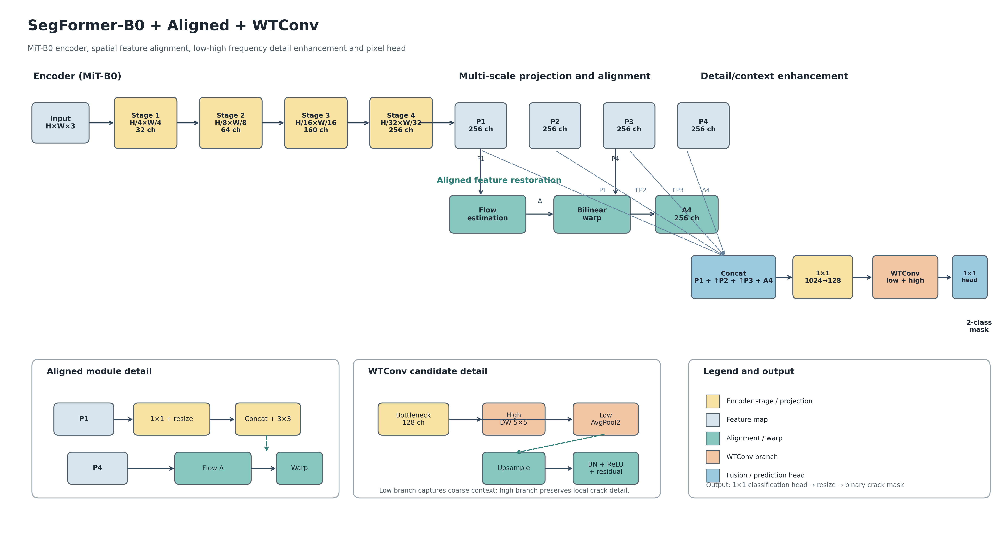

# 第4章 SegFormer-B0 + Aligned + WTConv 视觉分割方法与实验结果

## 4.1 面向裂缝循迹与精定位修复的视觉分割网络

道路裂缝具有宽度变化大、形态细长、方向不规则和局部对比度低等特点。对于四轮差速底盘的长裂缝循迹任务，模型需要保持裂缝区域的连续性和较强的长距离上下文建模能力；对于三轴机构的定点修复任务，模型还需要准确恢复裂缝边界和端点位置。原始 SegFormer-B0 采用 MiT-B0 编码器和轻量级解码器，具有较好的参数效率，但多尺度特征在融合过程中存在空间对应误差，且高层特征经过上采样后容易削弱细裂缝的局部结构。针对上述问题，本文在 SegFormer-B0 基础上引入 Aligned 特征恢复模块和 WTConv 细节增强模块，形成 SegFormer-B0 + Aligned + WTConv 网络。整体结构如图1所示。

图1. SegFormer-B0 + Aligned + WTConv 网络结构及模块展开示意图。

网络首先通过 MiT-B0 编码器提取四个尺度的特征。给定输入图像 $I\in\mathbb{R}^{H\times W\times3}$，编码器输出

\[
\{F_1,F_2,F_3,F_4\}=E_{\mathrm{MiT-B0}}(I),
\]

其中四个特征图的空间分辨率依次为 $H/4\times W/4$、$H/8\times W/8$、$H/16\times W/16$ 和 $H/32\times W/32$，通道数分别为 32、64、160 和 256。为了便于多尺度融合，本文使用四个 MLP 投影层将不同阶段的特征映射到统一的 256 维嵌入空间：

\[
P_i=\operatorname{MLP}_i(F_i),\quad i\in\{1,2,3,4\}.
\]

### 4.1.1 Aligned 跨尺度特征恢复

由于 $P_1$ 和 $P_4$ 在空间分辨率和语义层级上存在明显差异，直接上采样并进行拼接会产生边界错位。本文在高层特征分支中加入 Aligned 模块，以低层特征 $P_1$ 作为目标网格，并利用 $P_1$ 与 $P_4$ 的局部信息估计空间偏移场。具体地，首先对两路特征进行 $1\times1$ 投影和尺寸调整，然后通过卷积预测二维流场：

\[
\Delta=\phi\left(\operatorname{Concat}\left(\operatorname{Resize}(g_4(P_4)),g_1(P_1)\right)\right),
\]

其中 $g_1$ 和 $g_4$ 表示通道投影函数，$\phi(\cdot)$ 表示流场预测卷积。根据预测得到的 $\Delta$，通过双线性采样将高层特征重映射到低层目标网格：

\[
A_4=\operatorname{Warp}(P_4,\Delta;\operatorname{size}(P_1)).
\]

经过对齐后的 $A_4$ 与其他尺度特征共同参与解码。该设计保留高层语义信息，同时减小裂缝边缘、端点和细小分支在尺度变换过程中的位置偏差。Aligned 模块主要服务于裂缝边界定位和精细化修复坐标的稳定生成。

### 4.1.2 WTConv 低频上下文与高频细节增强

在完成尺度对齐后，本文将 $P_1$、上采样后的 $P_2$、$P_3$ 以及 $A_4$ 进行拼接：

\[
Z=\operatorname{Concat}\left(P_1,\operatorname{Resize}(P_2),\operatorname{Resize}(P_3),A_4\right).
\]

拼接后的 1024 维特征先通过 $1\times1$ 卷积压缩到 128 维，得到瓶颈特征 $Z_b$。随后采用当前工程中实现的 WTConv candidate 对 $Z_b$ 进行低频与高频分支处理。低频分支使用步长为 2 的平均池化提取较大范围的上下文信息，再通过 $1\times1$ 卷积和双线性插值恢复到原始尺寸：

\[
L=\operatorname{Resize}\left(\operatorname{Conv}_{1\times1}(\operatorname{AvgPool}_2(Z_b))\right).
\]

高频分支使用深度可分离的 $5\times5$ 卷积提取局部纹理和裂缝边缘响应：

\[
H=\operatorname{DWConv}_{5\times5}(Z_b).
\]

两路特征相加后经过逐点卷积、批归一化、ReLU 激活和残差连接，得到增强特征：

\[
Y=Z_b+\operatorname{ReLU}\left(\operatorname{BN}\left(\operatorname{Conv}_{1\times1}(H+L)\right)\right).
\]

低频分支用于增强长裂缝的连续性和区域上下文，高频分支用于保留细裂缝边界、端点和局部纹理。需要说明的是，本文将该实现记录为 WTConv candidate；它采用当前工程中的 AvgPool2D、depthwise $5\times5$ 和 pointwise/residual 结构，不能直接表述为未经核对的原始小波分解 WTConv 代码。

### 4.1.3 分割头与训练目标

增强后的特征经过 $1\times1$ 分类头输出裂缝和背景两个类别的预测图，并通过双线性插值恢复到输入图像尺寸：

\[
\hat{Y}=\operatorname{Resize}\left(\operatorname{Conv}_{1\times1}(Y)\right).
\]

训练阶段采用像素级交叉熵损失：

\[
\mathcal{L}_{\mathrm{CE}}=-\frac{1}{N}\sum_{p=1}^{N}\sum_{c=0}^{1} y_{p,c}\log \hat{y}_{p,c},
\]

其中 $N$ 为像素数量，$y_{p,c}$ 和 $\hat{y}_{p,c}$ 分别表示真实标签和预测概率。训练采用 AdamW 优化器、初始学习率 $6\times10^{-5}$、PolynomialDecay 学习率策略、FP32 精度、batch size 为 4，并训练 18,000 iter。模型选择仅依据验证集 mIoU，冻结 checkpoint 后再访问 test 集。

## 4.2 Crack500 消融实验

为了分析 Aligned 和 WTConv 的独立作用以及二者的组合效应，本文在相同数据划分、增强策略、初始化、训练预算和评价脚本下设置四组模型：C0 为原始 SegFormer-B0；C1 仅加入 Aligned；C2 仅加入 WTConv candidate 并关闭 Aligned；C3 同时加入 Aligned 和 WTConv。四组模型均完成 18,000 iter 训练，并在验证集上从普通 checkpoint 与 EMA checkpoint 中选择 mIoU 较高者。

| Variant | Precision (%) | Recall (%) | F1-score (%) | IoU (%) | mIoU (%) | Boundary F1@2px (%) | Params (M) |
|---|---:|---:|---:|---:|---:|---:|---:|
| C0 SegFormer-B0 | 72.8613 | 72.4660 | 72.6631 | 57.0637 | 76.9434 | 37.9749 | 3.715170 |
| C1 + Aligned | 70.9480 | 77.1986 | 73.9414 | 58.6564 | 77.7387 | 37.9813 | 3.785314 |
| C2 + WTConv-only | 72.6574 | 73.6516 | 73.1511 | 57.6679 | 77.2579 | 37.9876 | **3.653346** |
| C3 + Aligned + WTConv | 70.2578 | **78.4197** | **74.1147** | **58.8748** | **77.8361** | 36.8405 | 3.723490 |

与 C0 相比，C1 的 Recall、F1、裂缝 IoU 和 mIoU 分别提高 4.7326、1.2783、1.5927 和 0.7952 个百分点，表明 Aligned 对裂缝区域恢复和跨尺度空间对应具有积极作用，但 Precision 下降 1.9134 个百分点。C2 的参数量和 FLOPs 最低，并保持了小幅的区域指标增益，说明 WTConv candidate 在效率和精度之间具有较好的折中。C3 获得了四组模型中最高的 Recall、F1、裂缝 IoU 和 mIoU，但 Precision 下降 2.6036 个百分点，Boundary F1@2px 下降 1.1344 个百分点，说明联合模型更偏向扩大裂缝区域覆盖，同时增加了假阳性和边界退化风险。

## 4.3 Crack500 六模型对照实验

为了进一步考察本文模型在公开裂缝分割任务中的表现，将当前 C3 模型与 SegFormer-B0、OCRNet-HRNet-W18、PP-LiteSeg-STDC1、PSPNet-ResNet50、DeepLabV3P-ResNet50 和 Fast-SCNN 进行对照。公开模型行采用已有冻结记录，当前 C3 行来自 Wave17 新训练。由于公开模型记录来自不同阶段，初始化、损失、EMA、后端和运行批次未完全统一，表中结果用于当前复现范围内的参考比较，不能直接推导跨论文 SOTA 结论。

| Model | Precision (%) | Recall (%) | F1-score (%) | IoU (%) | mIoU (%) | Params (M) |
|---|---:|---:|---:|---:|---:|---:|
| **SegFormer-B0 + Aligned + WTConv (Ours)** | 70.2578 | **78.4197** | **74.1147** | **58.8748** | **77.8361** | 3.723490 |
| SegFormer-B0 | 72.8905 | 72.4478 | 72.6684 | 57.0702 | 76.9475 | 3.715170 |
| OCRNet-HRNet-W18 | 70.3819 | 75.9782 | 73.0731 | 57.5710 | 77.1509 | 12.109902 |
| PP-LiteSeg-STDC1 | **74.6053** | 69.7870 | 72.1157 | 56.3914 | 76.6260 | 8.039122 |
| PSPNet-ResNet50 | 72.1991 | 70.6710 | 71.4269 | 55.5535 | 76.1313 | 67.902052 |
| DeepLabV3P-ResNet50 | 72.2276 | 73.5601 | 72.8877 | 57.3412 | 77.0754 | 26.789874 |
| Fast-SCNN | 75.0411 | 61.4485 | 67.5680 | 51.0208 | 73.8029 | **1.441332** |

在当前比较范围内，C3 的 F1、裂缝 IoU 和 mIoU 均高于六个公开模型，同时 Recall 最高；PP-LiteSeg-STDC1 和 Fast-SCNN 的 Precision 高于 C3，Fast-SCNN 的参数量最低。因此，本文模型的主要优势表现为裂缝区域覆盖和细长结构召回，而不是所有指标同时达到最高。后续将结合四轮差速底盘循迹、三轴机构精定位和实际修复覆盖率进一步验证模型的工程价值。
