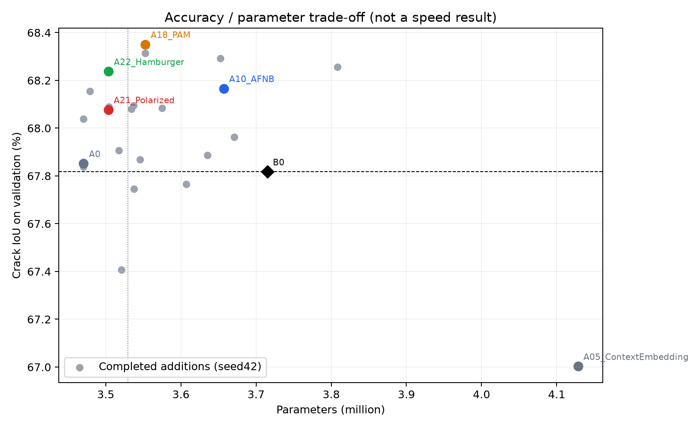
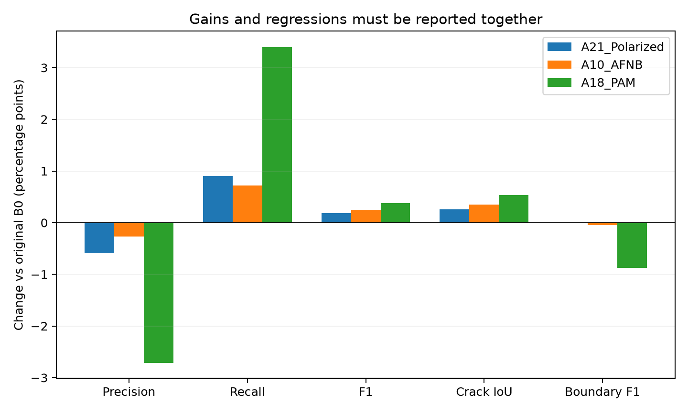

# SegFormer-B0＋Aligned 第二模块筛选阶段报告

> 后续更新：本文件保留 seed42 筛选阶段结果。2026-10-19 20:19 已完成九项归因/多 seed 新训练，最新三 seed 汇总见[复核完成说明](experiments/segformer_aligned_wave7_20261018/followup_20261019/README.md)。速度、公开模型与本轮统一 test 的待完成事项仍需继续核验。

更新时间：2026-10-19T09:10:12+08:00

本报告为阶段一完整筛选结果，三seed、稳定速度、六个公开模型与统一test仍未完成。

## 完成状态

登记24个机制：22项完整18k、真实exit0、冻结SHA和独立验证通过；DAPPM反向smoke真实失败；PSP兼容性暂缓。审计错误为0。所有新结果均是Crack500验证集348图、seed42，未读取test或自建数据。

## 完整结果

P/R/F1/IoU/mIoU/BF1均为百分数，Params为百万；待完成/兼容性失败不填性能。

| 模型 | 状态 | P | R | F1 | 裂缝IoU | mIoU | BF1 | Params M |
|---|---|---:|---:|---:|---:|---:|---:|---:|
| B0 | reused_frozen | 82.8269 | 78.9134 | 80.8228 | 67.8174 | 82.8021 | 45.1524 | 3.715170 |
| W128 | reused_frozen | 80.2747 | 81.1416 | 80.7058 | 67.6528 | 82.6784 | 44.0295 | 3.451746 |
| A0 | reused_frozen | 82.6766 | 79.0974 | 80.8474 | 67.8520 | 82.8184 | 44.9285 | 3.470434 |
| A01_GloRe | complete | 82.3299 | 79.4932 | 80.8867 | 67.9073 | 82.8431 | 44.9721 | 3.517666 |
| A02_ASPPsep | complete | 81.3419 | 80.6853 | 81.0123 | 68.0846 | 82.9235 | 44.7619 | 3.574882 |
| A03_Encoding | complete | 80.3396 | 81.2367 | 80.7857 | 67.7651 | 82.7390 | 43.8860 | 3.607218 |
| A04_ExternalAttention | complete | 81.4229 | 80.6120 | 81.0154 | 68.0890 | 82.9270 | 44.9818 | 3.504226 |
| A05_ContextEmbedding | complete | 82.2275 | 78.3493 | 80.2415 | 67.0028 | 82.3616 | 43.6995 | 4.128354 |
| A06_DNL | complete | 82.1970 | 79.3962 | 80.7724 | 67.7464 | 82.7559 | 45.1836 | 3.537443 |
| A07_PPContext | complete | 82.3667 | 78.7741 | 80.5303 | 67.4065 | 82.5778 | 44.5008 | 3.520706 |
| A08_DAPPM | smoke_failed | — | — | — | — | — | — | — |
| A09_APNB | complete | 81.8722 | 80.4574 | 81.1586 | 68.2915 | 83.0408 | 44.8512 | 3.652578 |
| A10_AFNB | complete | 82.5600 | 79.6327 | 81.0699 | 68.1660 | 82.9836 | 45.1057 | 3.656994 |
| A11_JPU | complete | 81.3370 | 80.3871 | 80.8593 | 67.8687 | 82.8087 | 44.4030 | 3.545570 |
| A12_DCM | complete | 82.0977 | 79.7882 | 80.9265 | 67.9635 | 82.8698 | 45.1252 | 3.670882 |
| A13_EMAU | complete | 82.9071 | 78.8686 | 80.8374 | 67.8379 | 82.8141 | 44.8531 | 3.470434 |
| A14_NonLocal | complete | 81.4188 | 80.6233 | 81.0191 | 68.0941 | 82.9296 | 44.7010 | 3.537186 |
| A15_AttentionRefinement | complete | 82.2794 | 79.5113 | 80.8717 | 67.8862 | 82.8312 | 44.9468 | 3.635298 |
| A16_CAM | complete | 81.1153 | 80.8441 | 80.9795 | 68.0382 | 82.8956 | 44.7038 | 3.470435 |
| A17_CCA | complete | 79.7584 | 82.6418 | 81.1745 | 68.3141 | 83.0218 | 44.3564 | 3.552675 |
| A18_PAM | complete | 80.1168 | 82.3137 | 81.2004 | 68.3507 | 83.0468 | 44.2719 | 3.552675 |
| A19_MSCA | complete | 81.8119 | 80.2226 | 81.0095 | 68.0806 | 82.9280 | 45.2581 | 3.534050 |
| A20_UAFMChannel | complete | 82.0532 | 80.2339 | 81.1333 | 68.2558 | 83.0244 | 44.8377 | 3.808098 |
| A21_Polarized | complete | 82.2351 | 79.8153 | 81.0071 | 68.0773 | 82.9321 | 45.1542 | 3.503330 |
| A22_Hamburger | complete | 81.9735 | 80.2845 | 81.1202 | 68.2372 | 83.0134 | 45.2614 | 3.503586 |
| A23_SE | complete | 81.6323 | 80.4983 | 81.0613 | 68.1539 | 82.9644 | 45.3831 | 3.478786 |
| A24_PSP | compatibility_deferred | — | — | — | — | — | — | — |

## 观察、解释和下一步

1. 区域IoU最高的是Aligned＋PAM（68.3507%），但Precision下降、边界F1也低，未通过预登记完整门槛。不能只按IoU最大值选最终模型。
2. 同时通过A0贡献门槛的两项为A21 Polarized和A10 AFNB；已在新seed与test之前冻结为复核候选，不能写成最终模型。
3. A21的IoU/F1/mIoU为68.0773/81.0071/82.9321%，较原B0分别增加0.2599/0.1843/0.1300个百分点，参数3.503330M，减少约5.70%。Precision比原B0下降约0.59个百分点、Recall提高约0.90个百分点；不能声称所有精度指标同时提升。
4. A10的IoU/F1/mIoU为68.1660/81.0699/82.9836%，参数3.656994M，减少约1.57%。它是平衡备选，不满足减参5%的严格参数线。
5. 更高IoU的APNB和Hamburger未通过A0的Precision下限；已保留其结果和预登记标志。不同数值门槛不能互相替代，不能事后调低Precision门槛。
6. Aligned＋GloRe只有小幅区域收益，未通过A0贡献门槛；ContextEmbedding、PPContext等均保留负结果。单模块表现不保证联合表现。
7. 以上是22路验证搜索后的单seed观察，含选择偏差。必须检验匹配seed43/44的平均变化和波动，速度稳定前不宣称加速；也不能据此声称SOTA。

解释假设：Polarized在融合特征上联合重标定空间/通道；AFNB在C3/C4之间补语义融合，与Aligned的C1/C4几何路径不同。当前数值支持进一步复核，并未证明具体阴影、落叶或长裂缝场景已解决。

## 下一阶段已登记

复核计划位于followup_20261019/refine-logs/PLAN.md。补W128＋AFNB seed42一项；B0、A0、A21、A10各seed43/44共8项。Polarized独立模块复用旧波M02_PSA。三seed齐备前不填写均值±标准差。

稳定配对速度先测四个冻结checkpoint；当P90/P10或配对比值IQR不稳定时保留测量并标为未确认。最终通过指标、参数、速度和多seed复核后，再补六个原始公开模型并冻结统一test。

## 证据与交付

以下路径均相对 [Wave7 实验目录](experiments/segformer_aligned_wave7_20261018/)。正在进行的多 seed 阶段见[复核结果](experiments/segformer_aligned_wave7_20261018/followup_20261019/refine-logs/RESULTS.md)及其状态/退出回执。

- 全部原始小数和门槛：results/comparison.json。
- 百分数完整CSV：results/ablation_percent_20261019.csv。
- 22组退出/最终18k/SHA/选模/验证审计：results/audit_complete_20261019.json。
- 数据前后4488文件哈希：provenance/data_before.json、data_after.json。
- 冻结候选与新seed预算：followup_20261019/provenance/frozen_candidates.json。
- 精确2px边界逐图CSV和全348空间归因：results、diagnostics。
- 约1.77GiB已完成smoke的重复产物已按逐文件SHA清单清理；正式18k/普通EMA最佳/冻结权重与失败证据保留。清单见provenance/smoke_cleanup_manifest_20261019.json及receipt。

最终交付清单依旧是refine-logs/FINAL_DELIVERY.md。本报告不替代最终统一test和多seed总结。

## 结果图

## 10月19日候选速度复核

独立速度子进程真实exit0，同进程、四冻结模型、平衡交错顺序、GPU同步。当前仍共享桌面资源，稳定性条件未通过，完整速度目标留空。下面是实际测量值，不能选择性省略变慢结果。

| 模型 | 400中位ms | 400配对B0比值 | 480中位ms | 480配对B0比值 | 稳定性 |
|---|---:|---:|---:|---:|---|
| B0 | 13.991 | 1.000 | 13.926 | 1.000 | 未通过 |
| A0 | 15.374 | 1.135 | 15.611 | 1.184 | 未通过 |
| A21 | 16.935 | 1.210 | 16.908 | 1.252 | 未通过 |
| A10 | 18.676 | 1.320 | 18.392 | 1.349 | 未通过 |

本次测量中两个候选的中位数均慢于B0；参数减少没有转化为速度优势。继续多seed只用于核实精度/参数收益及模块归因，不表示已通过完整效率门槛。任何最终“平衡方案”结论都必须连同这个延迟代价报告。

本轮未访问test。原Crack500 test在历史阶段已有结果，因此不能称它是整个项目从未观察的集合；当前模型筛选仍严格使用train/val，之后保留source-frame-disjoint泛化复核。
