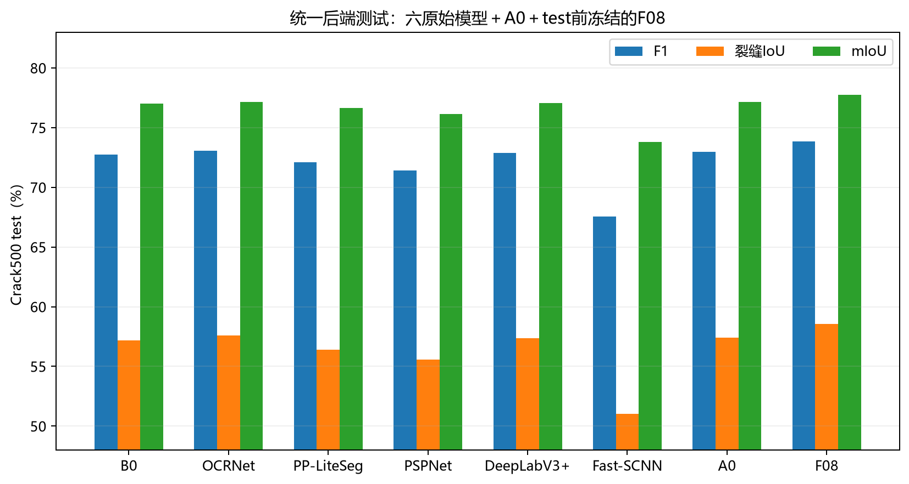

# 已有实验进度同步：2026-10-26

本次基于远端精简版本 `e314c2070` 发布小型证据，没有恢复本地旧目录、重写 Git 历史、启动/恢复训练、运行数据评估或改动模型与数据划分。这里只核对机器可检查的完成状态、文件和 SHA，不作新的独立科学审查。

## 统一冻结评价完成

完成标记为 2026-10-25T16:30:09+08:00，包装器 exit=0。8 组 test 各1124图、12组 val 各348图；本次核对30份退出回执（含包装器）均为0及逐图CSV行数。六个公开模型、A0与预先冻结的F08在同一WSL推理后端复评，训练配方中的初始化、loss、EMA仍有差异，不能描述为完全相同训练。

| 模型 | test 裂缝IoU（%） | test F1（%） | test mIoU（%） | 参数（M） |
|---|---:|---:|---:|---:|
| SegFormer-B0（共同初始化补控） | 57.1708 | 72.7499 | 76.9953 | 3.715170 |
| OCRNet-HRNet-W18 | 57.5710 | 73.0731 | 77.1509 | 12.109902 |
| PP-LiteSeg-STDC1 | 56.3898 | 72.1144 | 76.6251 | 8.150485 |
| PSPNet-ResNet50 | 55.5535 | 71.4269 | 76.1313 | 67.902052 |
| DeepLabV3P-ResNet50 | 57.3412 | 72.8877 | 77.0754 | 26.789874 |
| Fast-SCNN | 51.0208 | 67.5680 | 73.8029 | 1.441332 |
| A0 | 57.4185 | 72.9501 | 77.1665 | 3.470434 |
| F08_Branch32 | 58.5583 | 73.8634 | 77.7341 | 3.438178 |

精确P/R/BF1、配方和逐图证据见[统一结果](../results/unified_evaluation_20261025/comparison.json)与同目录CSV。F08参数比A0少0.9295%，未达到额外1%目标；480输入前向延迟中位数8.8342ms，B0为7.2403ms，不支持推理加速。旧test此前已被观察，不将本次称为从未观察过的盲测，也不声称领域SOTA。原来的历史表和Windows失败证据没有覆盖。

## Wave11 四格三seed＋匹配R0

训练队列于2026-10-26T02:03:10+08:00结束。15个运行均为18,000步，训练日志含最终步数；train、official_val、pixel_boundary共45份真实退出回执均为0；15份选模SHA与本地权重逐一匹配。所有运行仅使用train/val，队列与汇总记录`test_used:false`。旧的19时进度表已过时，不用于判断本次完成情况。

以下是已有JSON中的三seed均值，不是新测试；原始逐seed数值、样本SD、负差值、交互与门槛字段全部保留：

| 组别 | val 裂缝IoU（%） | val F1（%） | val mIoU（%） | val BF1（%） |
|---|---:|---:|---:|---:|
| E0 | 67.8980 | 80.8801 | 82.8328 | 44.8759 |
| E1：仅M1 | 67.7055 | 80.7427 | 82.7213 | 44.9307 |
| E2：仅M2 | 68.0471 | 80.9857 | 82.9118 | 45.1073 |
| E3：M1＋M2 | 67.6548 | 80.7068 | 82.6975 | 44.8984 |
| R0：新匹配控制 | 68.2149 | 81.1043 | 83.0001 | 45.3697 |

既有汇总记录`supports_two_modules_plus_combination:false`，交互IoU均值−0.1997个百分点、仅1/3 seed为正；E2虽改善多个均值，但未达到原登记完整效应门槛。以上是已有记录的如实展示，不由本次定时同步重新判定科学门槛、放宽阈值或触发test。原训练队列记录`profile_pending:true`，作为02:03的不可变快照保留。其后的量化科学子进程、10项显存测量、固定24图已全部完成并独立核验；最终数字、效率与负结果见[W11完整报告](wave11_final_20261026.md)。本次GitHub发布不重新计算或放宽门槛。

- [三seed完整汇总](../results/wave11_20261026/four_cell_three_seed_summary.json)、[逐运行CSV](../results/wave11_20261026/four_cell_runs.csv)、[交互CSV](../results/wave11_20261026/interactions.csv)。
- [机器检查与完成标记](../evidence/sync_20261026/machine_checks.json)、[选模SHA](../evidence/wave11_20261026/selection/)。
- [原登记计划](wave11_snapshot/EXPERIMENT_PLAN.md)、[匹配R0补充](wave11_snapshot/EXECUTION_ADDENDUM_20261025.md)、[代码快照使用边界](../scripts/wave11_snapshot/README.md)。

## 发布与溯源边界

沿用远端`.gitignore`白名单，不上传数据、权重、缓存、下载论文全文、任务注册、进程锁或大日志。原始完整日志仍在本地；发布的是有明确“节选”标识的末尾信息及原日志SHA和大小，不冒充完整原始日志。机器专用路径替换为占位符，不修改指标或SHA；原始和公开副本的不同哈希记在[来源清单](../evidence/sync_20261026/publication_sources.json)。

本次没有新增旧文件删除；此前精简提交、负结果、失败记录、预登记及必要依赖均延续保留。本地原始研究工作区与GitHub精简发布树不同，不能将旧工作区`git add --all`直接推回远端。

另发现原发布的10个配置模板校验值对应CRLF原始字节，而Git按`.gitattributes`保存为LF，导致既有静态校验失败。已逐项证明仅换行符差异：配置内容未改，只将发布元数据中的当前SHA对齐Git的LF字节，并另存原CRLF SHA及[机械核验记录](../evidence/sync_20261026/template_line_endings.json)。模型源码和实验配方均未修改。更新后静态源码/模板检查、相对链接、文件大小与隐私模式检查通过，未导入Paddle、读取数据或执行训练/推理。

## W11最终交付补充（同日）

15个完整训练与验证之后，已补齐同进程效率/显存测量和24固定图。M2幅度未过门槛、E3联合收益不成立；主科学子进程和可视化真实exit0，外层wrapper未知退出码单独保留，不改成0。详见[最终报告](wave11_final_20261026.md)、[结果表](../results/wave11_20261026/final/README.md)和[画廊](../figures/wave11_qualitative_20261026/README.md)。本次不上传原始全数据、独立原图导出、权重、完整归档或本机进程/任务清单。
