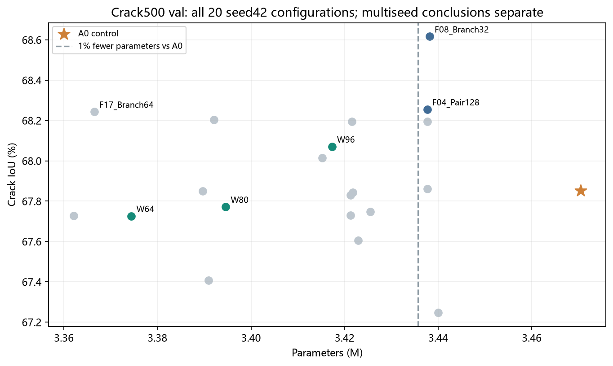
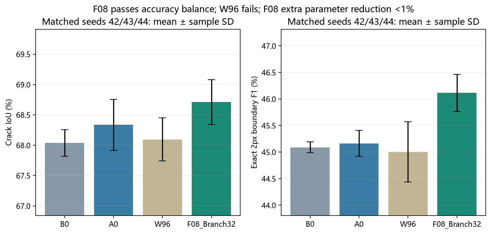
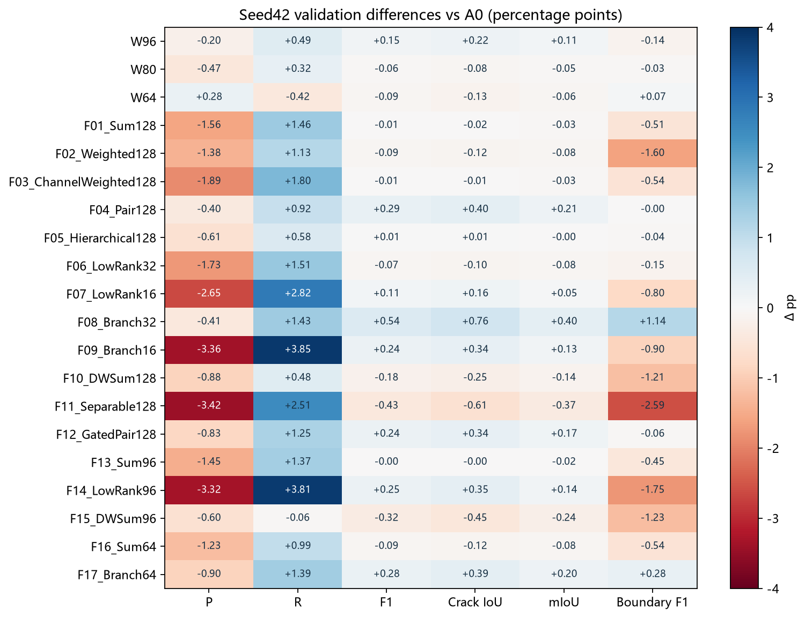
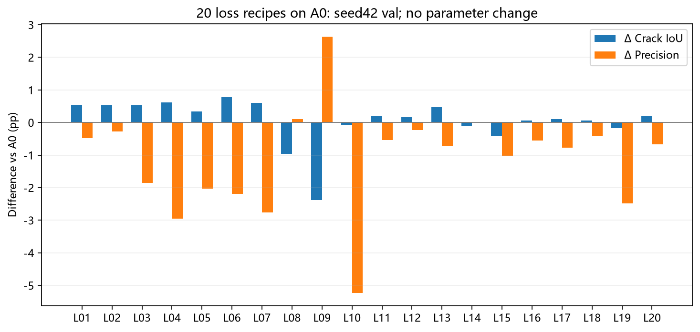
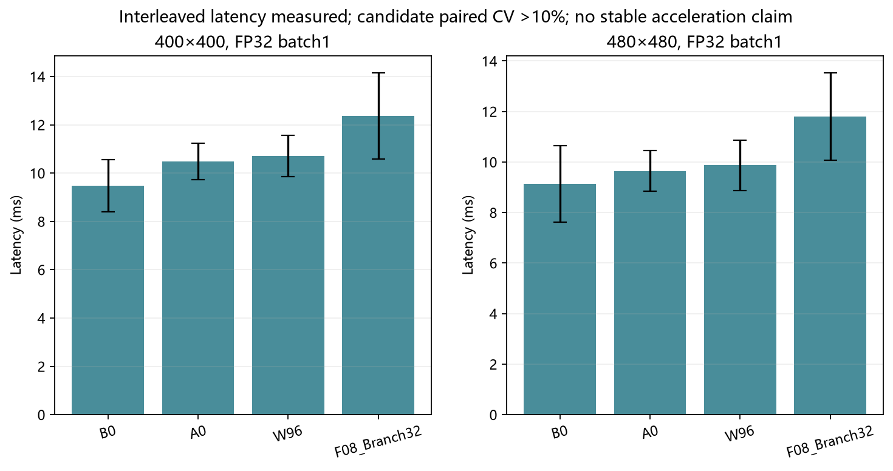
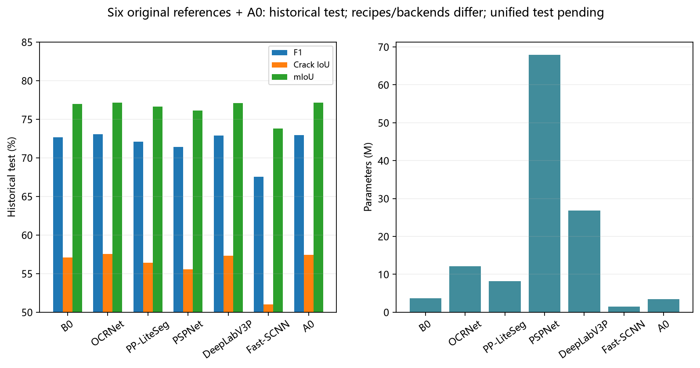

# SegFormer-B0 + Aligned 当前实验结果

筛选指标快照：2026-10-25T15:57:38+08:00。2026-10-26 已补充[统一 test 完成表及 Wave11 新结果](progress_20261026.md)；以下原筛选表仍为 Crack500 验证集348张结果，不与统一 test 或 Wave11 新匹配控制混用。

## 当前结论

- A0固定为SegFormer-B0 + width128 + Aligned。原始B0为3.715170M参数；A0为3.470434M。
- 轻量融合20个seed42配置及4个候选额外seed均已完成18000 iter、真实exit0、验证集选模冻结及独立验证。20个配置包含宽度控制和机制变体，不能写成20种独立算法。
- F08_Branch32三seed通过精度平衡门槛；相对A0减参0.9295%，未达到额外1%目标。相对原始B0减参7.4557%。
- W96相对A0减参1.5306%，但三seed平均Recall下降1.0647个百分点，未通过完整精度门槛，不作为最终候选。
- L01（CE+0.1Dice）是有效独立备选；损失变化不会减少参数，尚未与F08组合。L02（CE+0.25Dice）未通过完整门槛。
- 不能宣称领域SOTA、最低参数或已加速。

## 三seed验证结果

百分数；±为样本标准差（ddof=1），不是置信区间。

|模型|Precision|Recall|F1|裂缝IoU|mIoU|边界F1|Params(M)|
|---|---:|---:|---:|---:|---:|---:|---:|
|B0|81.9902 ± 0.7845|80.0075 ± 1.0456|80.9798 ± 0.1555|68.0389 ± 0.2195|82.9082 ± 0.1058|45.0887 ± 0.1030|3.715170|
|A0|81.8156 ± 0.9302|80.5944 ± 1.4337|81.1890 ± 0.2972|68.3353 ± 0.4205|83.0631 ± 0.2123|45.1644 ± 0.2469|3.470434|
|W96|82.5681 ± 0.0848|79.5297 ± 0.5008|81.0198 ± 0.2512|68.0957 ± 0.3549|82.9464 ± 0.1883|45.0022 ± 0.5677|3.417314|
|F08_Branch32|81.7910 ± 0.7133|81.1346 ± 1.2086|81.4540 ± 0.2602|68.7114 ± 0.3705|83.2626 ± 0.1876|46.1142 ± 0.3512|3.438178|

F08不是每个seed都优于A0：seed43 IoU变化为−0.2195个百分点，Recall变化为−1.6076个百分点；逐seed负结果完整保留。

## 损失优化复核

逐seed匹配A0，不使用候选自身seed42替代控制组。

|配置|平均裂缝IoU|平均F1|ΔIoU vs A0|ΔPrecision vs A0|完整门槛|
|---|---:|---:|---:|---:|---|
|CE+0.1Dice|68.8008|81.5168|0.4655|-0.3859|通过|
|CE+0.25Dice|68.7653|81.4919|0.4300|-0.5552|未通过|

20项损失配置含系数/组合，不能计作20种独立算法。L01–L04与L18原梯度预检失败，兼容副本仅对共享labels做clone以隔离原地副作用，公式、权重和模型不变；原失败保留。

## 延迟与内存

交错测速已真实exit0，但“测量完成”不等于“稳定加速”。W96/F08在400和480输入的配对延迟CV均超过10%；F08观测延迟更高。

|模型|输入|延迟中位数(ms)|配对B0倍率中位数|配对CV|稳定门槛|
|---|---:|---:|---:|---:|---|
|B0|400|9.4742|1.0000|0.00%|自比参照，不适用|
|A0|400|10.4872|1.1945|12.05%|未通过|
|W96|400|10.7090|1.1862|10.53%|未通过|
|F08_Branch32|400|12.3684|1.3401|15.31%|未通过|
|B0|480|9.1343|1.0000|0.00%|自比参照，不适用|
|A0|480|9.6430|1.0476|9.83%|通过|
|W96|480|9.8709|1.1189|17.99%|未通过|
|F08_Branch32|480|11.8050|1.2414|16.15%|未通过|

B0与自身比值恒为1，因此CV=0不能证明B0绝对延迟稳定。协议：同进程FP32、batch1、每模型每尺寸50预热、8轮随机交错、每轮100次同步前向、无I/O。

F08 peak allocated memory在400/480输入分别59,538,176/79,593,216 bytes；A0为69,588,224/123,821,312 bytes。测量包含模型与输入，排除allocator reserved和显示显存，不能等同部署端到端内存。完整FLOPs尚未完成。

## 完成范围与剩余工作

|阶段|完整训练数|失败/暂缓说明|
|---|---:|---|
|wave6结构及宽度|15|PSP smoke失败；16行全部保留|
|wave7第二结构模块|22|DAPPM失败、PSP暂缓|
|wave7归因及多seed|9|最终wrapper中断，不写exit0|
|wave8损失seed42|20|5项原失败和兼容恢复并列|
|wave8额外seed|4|L01通过、L02失败|
|wave10融合seed42|20|原中断保留，恢复完成|
|wave10额外seed|4|W96失败、F08精度平衡通过|

搜索及匹配种子合计94次完整训练，不含复用B0与六个公开模型；另已完成1次B0初始化补控，同范围含补控共95次，均不代表相同数量的独立算法。

B0初始化补控已于2026-10-25 16:15完成18k，五阶段及wrapper真实exit0，冻结SHA与独立验证均通过，val mIoU为82.7134%。新补控结果与修正后的B0三seed控制另见[记录](../results/b0_verified_initialization_control.json)，既有B0行保留为历史控制。统一评价已启动，完整终评尚未生成。

## 公开历史test与统一test必须分开

六个原始公开模型已有历史test：SegFormer-B0、OCRNet-HRNet-W18、PP-LiteSeg-STDC1、PSPNet-ResNet50、DeepLabV3+-ResNet50、FastSCNN；另有A0历史test。训练初始化、配方、后端以及历史边界实现不完全一致，不能当作严格同配方最终表。F08/W96当前没有完成新的统一test。

|原始模型|历史F1(%)|历史裂缝IoU(%)|历史mIoU(%)|
|---|---:|---:|---:|
|SegFormer-B0|72.6684|57.0702|76.9475|
|OCRNet-HRNet-W18|73.0731|57.5710|77.1509|
|PP-LiteSeg-STDC1|72.1157|56.3914|76.6260|
|PSPNet-ResNet50|71.4269|55.5535|76.1313|
|DeepLabV3P-ResNet50|72.8877|57.3412|77.0754|
|Fast-SCNN|67.5680|51.0208|73.8029|

B0补控已完成，继续依据已冻结验证结论执行统一评价；不能按test结果反向选模型。历史test已经观察，必须披露，后续保留source-frame-disjoint复核。当前未访问自建数据。

## 文件

- [20配置消融表](../results/fusion20_seed42.csv)
- [融合三seed表](../results/fusion_multiseed.csv)；[完整逐seed JSON](../results/fusion_multiseed.json)
- [20损失配置](../results/loss20.csv)；[损失多seed匹配A0](../results/loss_multiseed.csv)
- [wave6全部行](../results/structure_wave6.csv)；[wave7全部行](../results/structure_wave7.csv)
- [状态快照](../results/current_status.json)
- [训练核验](../evidence/training_audit.json)；[冻结SHA索引](../evidence/checkpoints.json)
- [协议](protocol.md)

空白表示没有合法结果，不填0。只分享结果与复现描述，不含原始数据和大权重。

## 结果图

