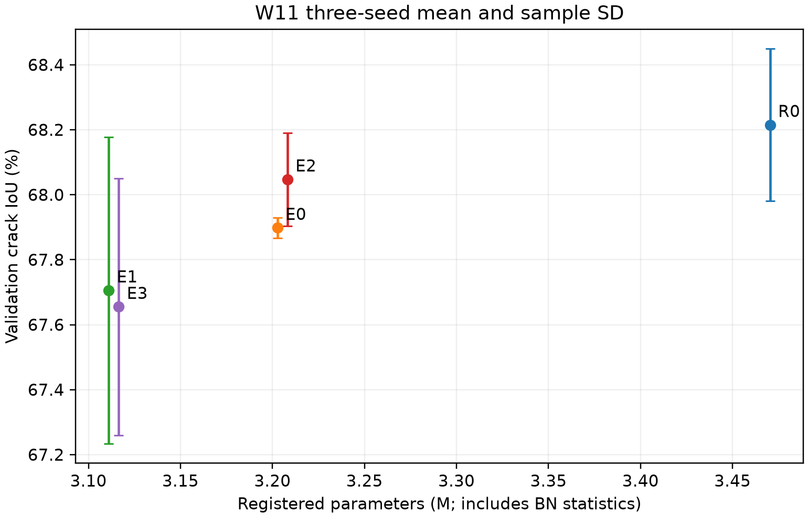
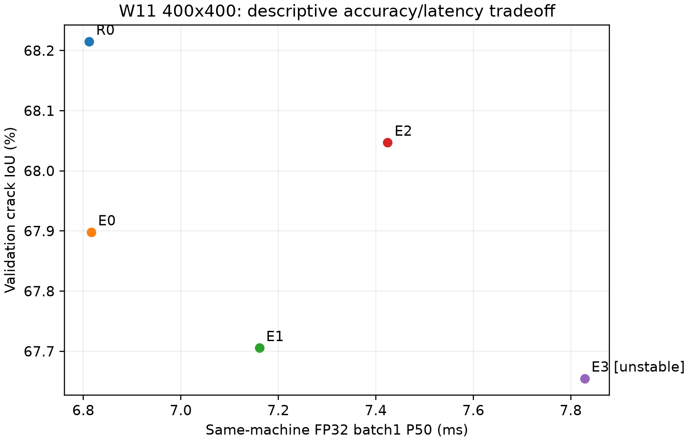
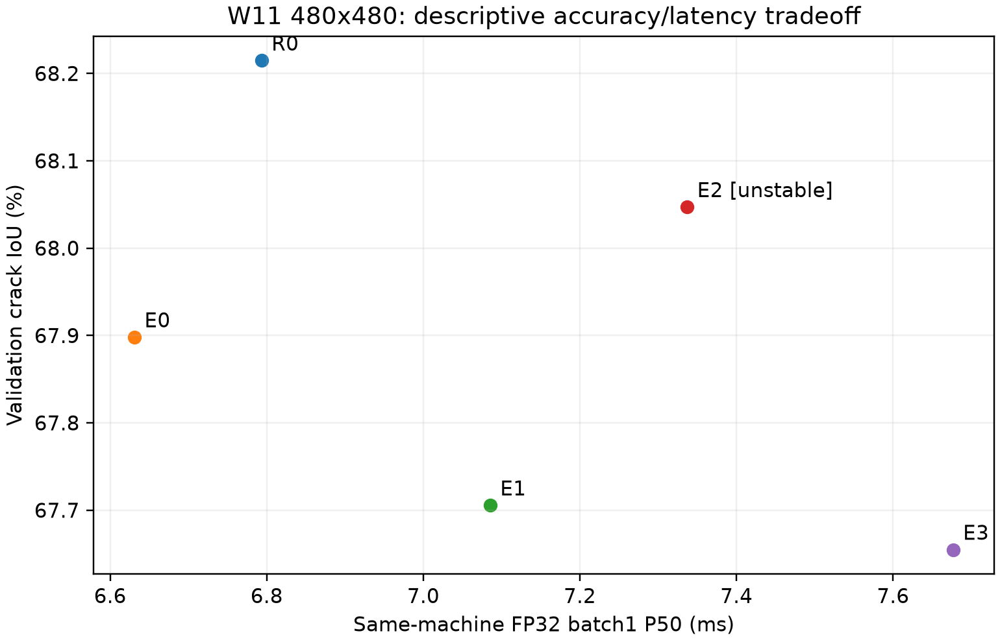
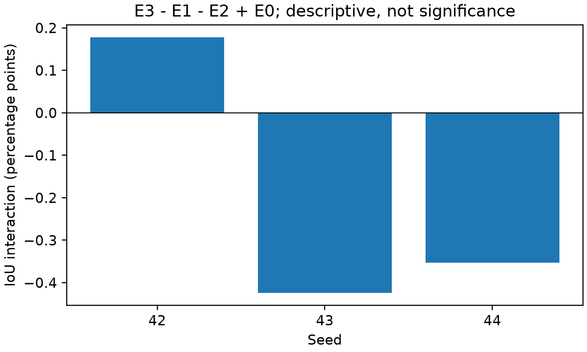

# SegFormer E0–E3 两模块互补实验报告

更新时间：2026-10-26T09:17:00+08:00。

当前真实完成 15/15 项（四格12项＋新匹配R0三项）。本表为完整三seed验证结果。

本轮只使用Crack500 train/val。历史test已被观察；本后处理不读取原图、标签、test或自建集，效率输入为随机张量。没有领域SOTA结论。

## 本次发布结论

15次完整18k、45份训练/验证exit0、同机效率测量和固定24图已全部核验。原始训练队列的`profile_pending:true`是02:03结束时的不可变快照；09:17量化测量及09:24可视化的独立完成记录补充其后状态，不改写旧标记。

- M1相对E0的IoU均值−0.1925个百分点，仅1/3种子改善。
- M2相对E0的IoU+0.1490、F1+0.1056、BF1+0.2314个百分点，三个种子方向均正，但不足原登记IoU+0.2和BF1+1个百分点门槛。
- E3相对E2的IoU−0.3922个百分点，三个种子均更低；平均交互−0.1997个百分点，不支持稳定两模块互补。
- E3比匹配R0减参10.1986%，但IoU−0.5601个百分点，完整轻量非劣未通过。480输入峰值allocated显存约减53%，前向配对延迟约增加11.63%；低参数/低显存没有产生加速。
- R0是本轮新匹配A0（原MiT-B0＋width128＋Aligned），不是未经改动的官方完整SegFormer-B0头。W11为val-only，不把历史F08统一test混入此表，也不宣称SOTA。

[数值与完整348逐图表](../results/wave11_20261026/final/README.md) · [固定24图画廊](../figures/wave11_qualitative_20261026/README.md) · [完成与审计摘要](../evidence/wave11_final_20261026/audit_summary.json)

## 结构与参数

R0是本轮匹配的原MiT-B0＋原A0头；E0–E3固定S4FFN768压缩骨干。E1=M1轻量多尺度解码器，E2=M2浅层门控恢复，E3=M1＋M2。旧历史A0三seed另作历史证据，不替代本轮R0。骨干压缩的减参不能全归为解码器贡献。

|模型|完成seed|注册总量|可训练量|
|---|---:|---:|---:|
|R0|3/3|3470434|3470178|
|E0|3/3|3202658|3202402|
|E1|3/3|3111010|3110178|
|E2|3/3|3208148|3207540|
|E3|3/3|3116500|3115316|

注册总量延续项目口径，包含Paddle注册但不训练的BN运行统计；可训练量另列。参数来自完整模型初始化核算，GPU阶段如已完成则另核冻结模型。

## 三seed验证结果

百分数均值 ± 样本SD（ddof=1）；三seed不足以声称统计显著性。

|模型|Precision|Recall|F1|裂缝IoU|mIoU|BF1@2px|BF1@1px|hard clDice|
|---|---:|---:|---:|---:|---:|---:|---:|---:|
|R0|81.8862 ± 0.9889|80.3478 ± 0.6324|81.1043 ± 0.1657|68.2149 ± 0.2344|83.0001 ± 0.1383|45.3697 ± 0.4041|31.9193 ± 0.4789|86.5541 ± 0.1955|
|E0|81.9467 ± 0.8001|79.8502 ± 0.7331|80.8801 ± 0.0221|67.8980 ± 0.0311|82.8328 ± 0.0258|44.8759 ± 0.2785|31.6012 ± 0.1325|86.5306 ± 0.1614|
|E1|81.2918 ± 0.8895|80.2204 ± 1.3444|80.7427 ± 0.3349|67.7055 ± 0.4713|82.7213 ± 0.2437|44.9307 ± 0.4997|31.5886 ± 0.3402|85.2333 ± 0.6574|
|E2|81.9343 ± 0.7090|80.0673 ± 0.7662|80.9857 ± 0.1020|68.0471 ± 0.1440|82.9118 ± 0.0739|45.1073 ± 0.1732|31.7227 ± 0.1288|86.5480 ± 0.1938|
|E3|81.5178 ± 1.1297|79.9399 ± 1.5162|80.7068 ± 0.2814|67.6548 ± 0.3955|82.6975 ± 0.1986|44.8984 ± 0.4456|31.5144 ± 0.3253|85.4465 ± 0.4516|

全348图先聚合像素/边界计数，再计算指标；hard clDice为固定骨架协议的全局诊断，不是额外训练loss，也不保证没有错误桥接。逐seed及全348图CSV在复现索引中保留。

## 单模块、联合和交互判断

|比较|均值效应门槛|方向门槛|IoU均值差（百分点）|
|---|---|---|---:|
|E1-E0|False|False|-0.1925|
|E2-E0|False|True|+0.1490|
|E3-E0|False|False|-0.2432|
|E3-E1|False|False|-0.0507|
|E3-E2|False|False|-0.3922|

完整‘两个单项有效且组合更好’门槛：False。
False表示该强主张未获支持，不删除负结果，也不事后放宽阈值。

IoU交互 I=E3−E1−E2＋E0，三seed均值 -0.1997 百分点，样本SD 0.3286，正向seed 1/3；一致正交互标志 False。
组合最好不等于正交互；以上是描述性检验，不写统计证明。

## 相对新匹配 R0 的轻量非劣门槛

|模型|注册参数比R0|可训练参数比R0|IoU容差内seed|完整门槛|
|---|---:|---:|---:|---|
|E0|0.922841|0.922835|1/3|False|
|E1|0.896433|0.896259|0/3|False|
|E2|0.924423|0.924316|1/3|False|
|E3|0.898014|0.897740|0/3|False|

## 同机效率与测量限制

FP32、batch1、400/480，所有五组同进程；每模型每尺寸100预热，5轮轮换顺序，每轮100次逐次CUDA同步。P50/P95统计单次延迟，配对比值由同轮P50相对R0得到；样本CV≤5%才标稳定。完整温度/时钟/功率与外部进程回执保留。WDDM返回的已核桌面C+G基线应用保持打开，XML类型及登记PID/名称/路径或特定可执行文件路径/名称/SHA256逐次核对；外部C/未知C+G阻止测量。测量前以5次采样确认低且稳定的桌面背景负载，不宣称绝对空闲GPU。

|输入|模型|P50 ms|P95 ms|配对P50/R0|比值CV|CV≤5%|
|---|---|---:|---:|---:|---:|---|
|400|R0|6.8121|11.0095|1.0000|0.0000|True|
|400|E0|6.8161|10.5154|1.0091|0.0337|True|
|400|E1|7.1609|10.6147|1.0434|0.0289|True|
|400|E2|7.4243|10.7846|1.0836|0.0474|True|
|400|E3|7.8282|10.9826|1.1317|0.0689|False|
|480|R0|6.7934|10.2417|1.0000|0.0000|True|
|480|E0|6.6311|9.4870|0.9767|0.0289|True|
|480|E1|7.0855|9.7556|1.0510|0.0273|True|
|480|E2|7.3371|11.4518|1.0855|0.0548|False|
|480|E3|7.6768|11.3570|1.1163|0.0378|True|

这些是本机冻结checkpoint的描述性测量；不把减参写成加速，也不隐去不稳定或变慢组。

|输入|模型|峰值allocated MiB|峰值reserved MiB|allocated增量 MiB|
|---|---|---:|---:|---:|
|400|R0|66.365|84.963|51.288|
|400|E0|65.343|83.079|51.288|
|400|E1|42.024|48.597|28.318|
|400|E2|65.284|78.196|51.206|
|400|E3|42.048|48.597|28.318|
|480|R0|118.085|149.659|102.203|
|480|E0|117.064|147.808|102.203|
|480|E1|55.271|69.834|40.759|
|480|E2|116.978|140.777|102.094|
|480|E3|55.295|69.834|40.759|

每行由独立新进程测量。实际内存API及峰值reset支持情况在对应JSON；无reset API时标明整进程峰值，不假称纯前向窗口。不是系统显示占用或其他应用显存。

FLOPs：NA。尚无覆盖grid_sample、插值、门控全部算子的可靠计数器，不把不完整卷积算量当完整GFLOPs。

## 图表、证据与后续

数值、三seed、门槛与交互：`results/wave11_20261026/final`。
checkpoint、初始化、源码、配置和真实exit SHA随交付manifest提供；压缩包不包含原始数据或大权重。

后续只在真实门槛支持时决定是否保留两模块。若组合未超过单项，优先简单方案；若只达到轻量非劣，按折中贡献表述。冻结最终候选后再登记统一test/额外泛化复核，不据test反选模型；自建集、source-frame-disjoint与机器人实验仍属后续阶段。

六个既有原始公开模型的历史统一对照保留原报告版本，本轮不重新训练或改写其数字。

## 固定24图及发布边界

正式训练前固定的24图、五组冻结seed42共有120项预测/GT SHA与全348逐图计数完全一致，无核验失败。24张完整对照图和4张概览见[画廊](../figures/wave11_qualitative_20261026/README.md)。FP/FN与骨架都保留，未删除失败图，不将定性案例当作场景统计或实物修复证明。

原自动后处理外层PowerShell回执未捕获退出码，原null仍保存；量化科学子进程、10项显存测量与可视化的真实退出码均为0。独立CPU交接核验绑定了完成记录和SHA，没有将旧未知退出码改成0。公开版只提取科学指标/测量协议与审计摘要，本机进程清单、任务注册及原完整归档留在本地。

本次发布未重新训练、评估或读取数据集，只整理已有核验结果。此前统一六公开模型与冻结F08的test见[前一阶段统一表](progress_20261026.md#统一冻结评价完成)。source-frame-disjoint、自建数据与机器人实物验证仍待开展。
