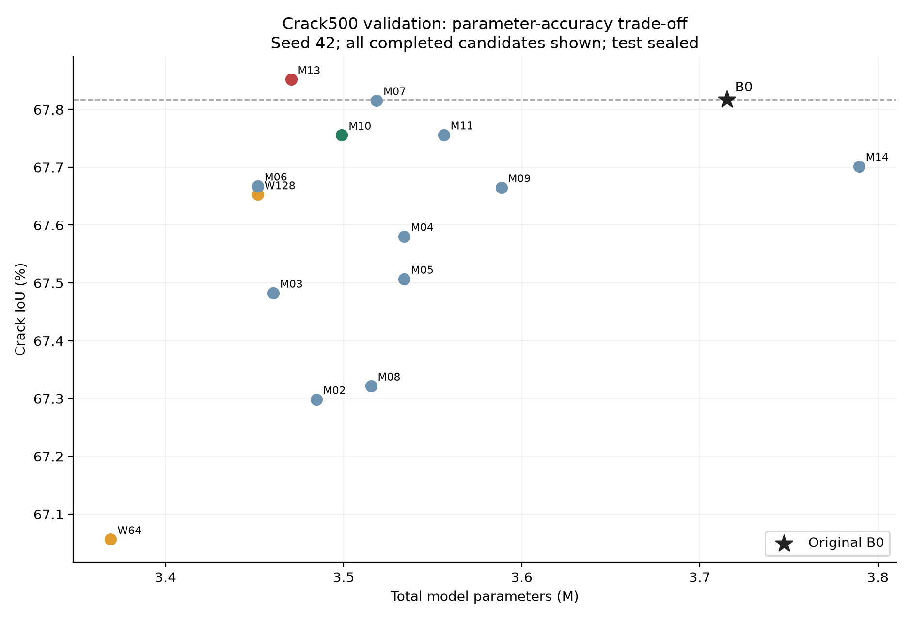
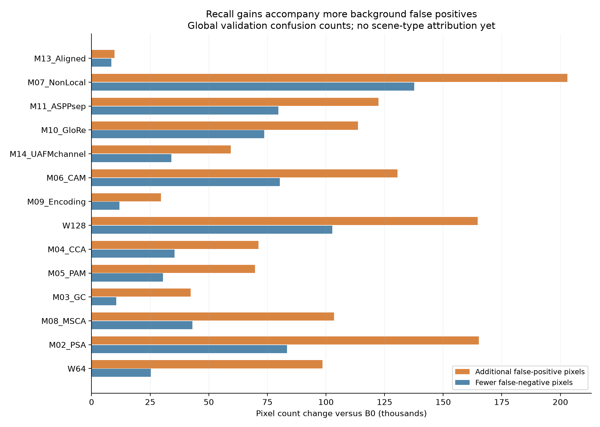

# SegFormer-B0 Crack500 模块消融结果与改进建议

更新时间：2026-10-17T15:45:58+08:00。这是本轮**验证集筛选报告**，不是最终test对照表。

> 2026-10-17 同步更新：已完成组的指标保持不变。SE 最新回执在 17:49:47 记录超时退出（exit_code=1，timed_out=true），状态为 needs_review，最后训练日志为 3200/18000；下文 13:34 的中断属于更早一次运行。SE 仍无完整性能结果，不能把旧 heartbeat 当作正在训练的证明。

## 已完成与未完成

已完成14个新训练组，其中12种不同模块、2个宽度控制；另复用原始B0冻结基线。14组均核对真实exit code 0、18,000/18,000日志、iter_18000、普通/EMA最高精确val mIoU、冻结SHA256、独立官方val、像素/边界评估和参数统计。原始B0 SHA仍一致，train/val全部4488个文件哈希复核无变化。SE未完成，PSP反向smoke失败，二者都不填写性能。

SE旧日志停在13:34，在2000iter后的验证过程中中断，没有训练exit JSON；实际原因未知。现场和已完成的14组保留，只对SE按相同seed/预训练重新训练。为处理反复丢失的工具会话，已获准使用有2小时时限、自动过期删除的一次性Windows任务运行同一队列；实际是否在运行仍须以新日志和回执核对，不能以注册成功代替完成。GloRe和UAFM通道组已经完整完成。

## 数据与口径

RTX5060，Paddle3.4，FP32，seed42，batch4，18k，AdamW lr6e-5、poly end_lr0、相同增强/400裁剪/CE/EMA；模块从相同ImageNet MiT-B0初始化。所有新模块接在width128母体，必须同时对照W128与原始width256基线，不能把减小通道宽度的收益算成模块收益。这里只使用Crack500 train1896/val348，没有读取test或自建数据。

Precision、Recall、F1、IoU均为裂缝前景的全验证集混淆矩阵指标；mIoU是背景/裂缝两类IoU均值。对于本报告的二值全局计数，F1=2×IoU/(1+IoU)，两者同升不是两个独立统计证据。Params采用同一模型参数统计，包含骨干与解码器，单位M。

边界为前景减3×3腐蚀、图外为零、精确欧氏距离≤2px，全局匹配计数后算调和平均。不能混入旧报告0.4177或曾错误计算的0.5894等不同口径B0边界数字。当前所有结果只有一个seed，不能称显著提升。

## 完整消融表

| 配置（模块组均为W128母体） | Precision % | Recall % | F1 % | IoU % | mIoU % | Params M | 边界F1 % |
|---|---:|---:|---:|---:|---:|---:|---:|
| SegFormer-B0，原始width256 | 82.827 | 78.913 | 80.823 | 67.817 | 82.802 | 3.715170 | 45.152 |
| W128 仅压缩解码器至128 | 80.275 | 81.142 | 80.706 | 67.653 | 82.678 | 3.451746 | 44.029 |
| W64 仅压缩解码器至64 | 81.115 | 79.462 | 80.280 | 67.056 | 82.374 | 3.369186 | 43.302 |
| M01_SE SE（未完成） | — | — | — | — | — | — | — |
| M02_PSA Polarized SA | 80.185 | 80.723 | 80.453 | 67.299 | 82.489 | 3.484642 | 43.277 |
| M03_GC Global Context | 82.080 | 79.143 | 80.585 | 67.483 | 82.614 | 3.460499 | 44.623 |
| M04_CCA Criss-Cross Attention | 81.651 | 79.682 | 80.654 | 67.581 | 82.660 | 3.533987 | 44.242 |
| M05_PAM PAM | 81.657 | 79.574 | 80.602 | 67.507 | 82.621 | 3.533987 | 44.108 |
| M06_CAM CAM | 80.776 | 80.657 | 80.716 | 67.668 | 82.694 | 3.451747 | 43.839 |
| M07_NonLocal NonLocal | 79.771 | 81.900 | 80.822 | 67.816 | 82.757 | 3.518498 | 43.445 |
| M08_MSCA MSCA | 81.101 | 79.848 | 80.470 | 67.322 | 82.515 | 3.515362 | 44.127 |
| M09_Encoding Encoding | 82.320 | 79.170 | 80.715 | 67.665 | 82.714 | 3.588530 | 44.786 |
| M10_GloRe GloRe | 81.047 | 80.513 | 80.779 | 67.756 | 82.745 | 3.498978 | 44.436 |
| M11_ASPPsep Separable ASPP | 80.916 | 80.643 | 80.780 | 67.756 | 82.743 | 3.556194 | 44.693 |
| M12_PSP PSP（兼容性失败） | — | — | — | — | — | — | — |
| M13_Aligned Aligned | 82.677 | 79.097 | 80.847 | 67.852 | 82.818 | 3.470434 | 44.928 |
| M14_UAFMchannel UAFM Channel | 81.860 | 79.651 | 80.741 | 67.702 | 82.727 | 3.789410 | 44.749 |

## 结果如何理解

1. **最好精度是Aligned，但提升很小。** 相对原始B0，F1增加0.0246个百分点，裂缝IoU增加0.0346个百分点，mIoU增加0.0164个百分点；参数减少6.59%。边界F1仍下降0.2239个百分点。相对W128母体，其IoU/F1/边界F1增加0.1992/0.1416/0.8990个百分点，表明能恢复部分压缩损失；是否能稳定超过原始B0尚未证实。它主要把W128的高Recall工作点拉回较高Precision，不足以认定所有细裂缝定位都改善。

2. **GloRe是效率方向的候选，不是精度胜出者。** 参数3.498978M，减少5.82%；F1/IoU分别低于B0约0.0437/ 0.0615个百分点。当前JSON的efficiency_pass=true，但使用了不同时间段测出的延迟，仅是临时规则判定。此前400/480尺寸出现倒挂、重复波动，**不能据10.67ms与基线15.58ms直接声称加速31.5%**。精度线和最终目标线仍未通过。

3. **背景误检没有解决。** 12个完成模块相对B0都提高Recall、降低Precision，且边界F1全部低于B0。B0总FP/FN为753850/971542；Aligned为763607/963066，即FP增加9,757、FN减少8,476；GloRe增加113,622个FP、减少73,690个FN；NonLocal增加203,059个FP、减少137,614个FN。说明多数候选以更激进的前景预测换取漏检减少，不能写成“阴影、落叶误检得到抑制”。具体场景归因仍需人工分组查看图像。

4. **继续减宽到64不合算。** 参数只比B0减少9.31%，IoU却下降0.7610个百分点；W128已减少7.09%，更适合作为效率母体。UAFM通道融合参数反而高于原B0约2%，同时F1下降，没有进入最终组合的充分理由。GC/PSA/CCA/PAM/MSCA等没有区域增益，不按模块名称继续堆叠。

5. **目前不是SOTA，也没有最终定型。** Aligned只是单seed验证集最好；GloRe仅临时满足效率容差。六个公开原始模型尚未完成本轮统一test表；不同数据划分、验证与test、服务器与本机数字不能横向拼成胜出证据。

## 建议的后续顺序

| 优先级 | 工作及模型位置 | 要解决的问题/预期收益 | 成本与风险 | 放行条件 |
|---|---|---|---|---|
| 1 | 完成SE；同一进程交错顺序复测B0、W128、Aligned、GloRe | 补齐单项，排除GPU热态/时钟造成的假加速 | 只补最后一个未完成模块；速度评估先避开并行训练 | 真exit0/18k/冻结独立val；同输入、FP32、batch1、预热和同步 |
| 2 | 从逐图CSV定位Aligned/GloRe的FP增加与边界损失，人工标注阴影/纹理/低对比度类别 | 判断瓶颈来自已有裂缝扩张、断裂还是背景激活 | 总指标不能自动推断场景；不得删失败图或按结果改标签 | 保留全348图，报告提升/下降分布及最差案例；只用val |
| 3 | **至多一组探索性Aligned+GloRe**：GloRe接原生C4；Aligned对齐C1与投影C4后再融合 | 一个补深层关系，一个补跨尺度恢复，观察互补性 | 参数静态估计3.517666M（约减5.32%），不是实测；可能累加FP或边界退化；grid_sample部署支持待测 | 先复测与诊断，运行前登记；与W128、两个单模块组成四行消融；不改输入/loss/预算 |
| 4 | 真正有效候选与B0匹配seed43/44 | 排除单seed和多模型反复筛选的偶然最大值 | 每组仍完整18k；当前不能计算均值±标准差 | 报告三seed均值/波动，完整精度与边界门槛不事后放宽 |
| 5 | 六个预选原始公开模型，统一冻结后test | 检验真实精度/参数折中 | 不因val弱删行；兼容性失败不伪造数字 | 阶段一稳定后再做；复用合法已有结果，补齐缺项 |

原计划优先的Aligned+GC、MSCA+CAM缺少两侧区域增益，不执行。Aligned+GloRe只是当前证据支持的下一组假设，**不是已经训练的组合**，不自动保证提升；本报告不把组合估算参数加入结果表。两者相对W128都减少FP、增加FN，误差方向相同；接入位置不同只提供结构互补的假设，不能写成已证明误差互补，联合时尤其要防止Recall继续下降。

如果组合仍无实质收益，停止重复叠加全局注意力：MiT本身已有长距离关系建模，冗余是一个待验证解释。优先补输入/裁剪细线保留、标签边界一致性及train内难负样本统计，再针对明确因素做一个单变量实验。若调整损失或采样，另起独立消融，不能与本轮结构改动同时变更，也不能看test调阈值。

最终论文可如实围绕“轻量解码器压缩与特征对齐带来的精度—成本折中”组织；现阶段不能写成“全部精度超过原模型、最低参数、阴影误检已解决、机器人实时性已证实”。自建数据、源帧互斥和机器人修复是后续外部验证。

## 图与证据

以下证据路径均相对 [Wave6 实验目录](../)。

参数—IoU图展示所有已完成项，而非只展示最好的候选。

误检与漏检变化图中的橙条是新增FP，蓝条是减少FN；两者同时增长正说明Precision/Recall取舍。

- 精确数据：`results/comparison.json`、各组`*_val.json`和`*_val_per_image.csv`。
- 百分数消融CSV：`results/ablation_table_percent_20261017.csv`。
- 核验清单：`results/result_audit_20261017.json`。
- 原始训练、验证、退出码：`logs/`和`results/*_exit.json`。
- 冻结权重及选模：`checkpoints/<ID>/selection.json`与同目录权重SHA256。
- 原始开源模块位置及训练契约：`refine-logs/EXPERIMENT_PLAN.md`、`provenance/RUNTIME.md`。

这是结果快照；SE后续完成时须按相同口径更新，不用中间迭代指标填表。
