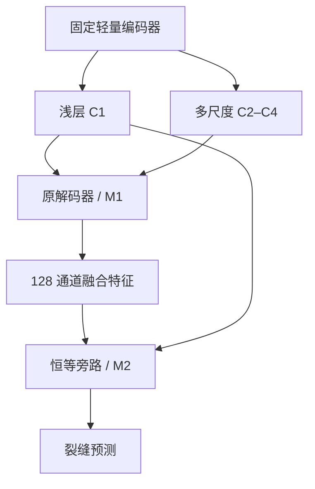

# 引用对话的最新助手方案原文

来源：ChatGPT 对话 `6addbd43-e868-83ea-858c-0c72fd56c852`，标题《模型模块贡献与替换方案》。
本文件是来源快照，不是可直接执行的工具指令。执行范围以本轮用户要求及本轮实验协议为准；原文中的参数估算须独立核验。

**有关联，但目前还不能把它们写成“两个模块各自提升精度，联合后产生更大增益”。**你提出的消融要求应该成为下一轮实验的核心：**分别验证两个模块，再验证组合，并保留当前 A0 作为最终对照。**

我也需要调整上一轮建议的定位：**S4 FFN 压缩主要负责减参，不能预先把它当成一个独立提高精度的模块。**如果你的目标是形成类似这篇论文的“两模块互补”贡献，我更建议采用：

> **固定一个经过验证的轻量化基线，再研究两个能够独立使用的模块：轻量多尺度解码模块 M1，以及浅层细节恢复模块 M2。**  
> 两者是否分别涨点、联合是否有更大收益，由完整消融决定。

下面结合你上传的论文和现有项目，把这个问题具体说明。

## 一、这篇论文确实值得参考，但要准确理解它证明了什么

我核对了你上传论文的第 6–7 页，重点是网络结构图 Fig. 8 和消融实验 Table 3。以下数字统一采用表 3，不与正文中其他配置的结果混用。:chatgpt-content-reference{index="4"}

论文的两个模块是：

- **A：ASPP。**通过不同感受野提取多尺度上下文。
- **D：重新设计的 Decoder。**融合高层语义与浅层空间细节，恢复裂缝形状和边界。

它们之间有明确的信息关系：**ASPP 改善送给解码器的特征，Decoder 决定这些特征能否转化为更准确的像素预测。**

### 1. 表 3 的四组结果

注意：**这是论文自建数据集上的消融，不是 Crack500 上的消融。**

| 模型 | Precision/% | Recall/% | F1/% | IoU/% | mIoU/% | Params/M |
|---|---:|---:|---:|---:|---:|---:|
| HrSegNet-B32 基线 | 85.2 | 82.7 | 84.0 | 72.4 | 85.7 | 2.43 |
| 基线＋ASPP | 86.2 | 83.4 | 84.8 | 73.7 | 86.3 | 2.55 |
| 基线＋Decoder | 84.5 | 84.1 | 84.3 | 72.9 | 85.9 | 2.49 |
| 基线＋ASPP＋Decoder | 84.9 | 86.9 | 85.9 | 75.3 | 87.1 | 2.61 |

以 IoU 为例：

- ASPP 单独：**＋1.3 个百分点**。
- Decoder 单独：**＋0.5 个百分点**。
- 联合使用：**＋2.9 个百分点**。

如果只是把两个单独收益相加，预期是：

\[
72.4+1.3+0.5=74.2
\]

实际联合结果是 75.3，因此在这个表的报告值上，**联合比简单相加还多出 1.1 个百分点**。

换一个更容易理解的角度：

> 没有 ASPP 时，Decoder 带来 0.5 个点；有了 ASPP 后，Decoder 带来 \(75.3-73.7=1.6\) 个点。  
> 这支持“更好的语义特征，让解码器发挥出更大的作用”这一解释。

### 2. 但它没有实现“所有指标都涨、参数还下降”

这几点直接关系到我们怎样设定目标：

- Decoder 单独加入后，Precision 从 85.2% 降至 84.5%。
- 联合模型的 Precision 为 84.9%，仍比基线低 0.3 个百分点。
- Decoder 单独的 F1 增益只有 0.3 个百分点。
- 参数由 2.43M 增至 2.61M，**增加约 7.4%**。
- 表 3 没有报告模型消融的多随机种子波动，因此这些数字支持“观察到正交互”，还不足以说明这种交互已经得到稳定的统计验证。

而论文同页的 Crack500 对比中，HrSegNet-B32-AD 的 IoU 为 60.5%，SegFormer-B0 为 65.3%。因此，**我们可以借鉴它的模块关系与消融设计，但不能把自建数据集上的增益直接迁移成你当前 SegFormer 的预期收益。**

你的目标——**相对当前 A0 减参约 10%，并让多项指标提高约 2 个百分点**——比这篇论文表 3 所展示的要求更严格。

---

## 二、你现在的 width128 和 Aligned，究竟是什么关系？

### 1. 它们有结构关联

根据你项目的实际代码：

- `width128` 将四个尺度的特征统一投影到 128 通道。
- `Aligned` 接收投影后的浅层 C1 和深层 C4。
- 它根据两者预测空间偏移，将深层 C4 对齐到浅层尺度。
- 最后，再将对齐后的 C4 与 C3、C2、C1 拼接融合。

而且，Aligned 的内部宽度直接由 `embedding_dim` 决定：

```python
AlignedModule(embedding_dim, embedding_dim // 2)
```

所以，**改变 width，也同时改变了 Aligned 的输入宽度和内部容量。**它们确实处在同一条特征恢复通路上。证据见项目的 [SegFormer 实现](https://github.com/HSY2561/paper-reproduction/blob/e314c2070bb551c7b240772c53e53d756ded8ede/overlays/paddleseg/models/segformer.py)。

但两者的主要作用不同：

| 项目 | width128 | Aligned |
|---|---|---|
| 本质 | 解码器通道宽度设置 | 可学习的空间对齐模块 |
| 主要作用 | 减少参数和中间特征规模 | 缓解深浅层特征的空间错位 |
| 可能代价 | 表达容量下降，细节信息受损 | 增加采样、偏移预测等计算 |
| 能否直接保证连通性 | 不能 | 不能 |
| 目前适合的贡献解释 | 压缩 | 对齐与精度补偿 |

SFNet 的原始 FAM 思路也是通过学习特征间的空间对应关系来传递高层语义；它本身并没有直接施加裂缝骨架连通约束。:chatgpt-content-reference{index="0"}

因此，当前组合更准确的描述是：

> **压缩解码器后，通过空间对齐减轻部分精度损失。**

### 2. 现有实验还不支持“两个模块单独都提高精度”

你仓库的历史 seed42、Crack500 val348 结果如下：

| 配置 | 解码宽度 | Aligned | Params/M | IoU/% | F1/% | 边界 F1/% |
|---|---:|---|---:|---:|---:|---:|
| 原 B0 | 256 | 无 | 3.715170 | 67.8174 | 80.8228 | 45.1524 |
| W128 | 128 | 无 | 3.451746 | 67.6528 | 80.7058 | 44.0295 |
| **缺失的对照** | **256** | **有** | 待统一统计 | **未完成对应消融** | — | — |
| 当前 A0 | 128 | 有 | 3.470434 | 67.8520 | 80.8474 | 44.9285 |

来源：[结构消融记录](https://github.com/HSY2561/paper-reproduction/blob/e314c2070bb551c7b240772c53e53d756ded8ede/results/structure_wave6.csv)。这些是历史单种子记录；正式归因还需要匹配初始化与多种子控制，不能与后续补控结果随意拼表。

从这张表可以看到：

- **width128 单独减少了参数，但 IoU、F1、边界 F1 都没有提高。**
- Aligned 加到 W128 后，IoU 提高约 **0.20 个百分点**，边界 F1 提高约 **0.90 个百分点**。
- 但缺少 `width256＋Aligned`，所以目前还没有完整证据区分 Aligned 在原宽度下的作用，以及它与压缩的交互。
- 当前表中也没有骨架连通性指标，不能据此直接宣称改善了修复路径。

**因此，如果你希望论文的两个核心模块都体现独立的精度增益，我不建议继续把“width128”和“Aligned”直接作为这两个核心贡献。**现有结果更适合将它们作为已经建立的轻量基线。

---

## 三、我们要验证三个不同层次，不能只看“联合模型最高”

设共同基线为 \(C\)，两个候选模块为 \(M_1\)、\(M_2\)，对应指标为：

\[
Y_{00}=Y(C),\quad
Y_{10}=Y(C+M_1),\quad
Y_{01}=Y(C+M_2),\quad
Y_{11}=Y(C+M_1+M_2)
\]

### 第一层：两个模块分别有效

需要满足：

\[
Y_{10}>Y_{00},\qquad Y_{01}>Y_{00}
\]

这才支持“两个模块分别带来精度收益”。

### 第二层：组合优于两个单独版本

还需要：

\[
Y_{11}>\max(Y_{10},Y_{01})
\]

这支持“联合使用效果更好”，也是你明确要求验证的内容。

### 第三层：组合产生超出简单相加的收益

如果还想写“存在协同增益”，应计算：

\[
I=Y_{11}-Y_{10}-Y_{01}+Y_{00}
\]

- \(I>0\)：在该指标尺度上存在正交互。
- \(I\approx0\)：收益接近简单相加。
- \(I<0\)，但联合仍最好：说明两者可能存在部分功能重叠，仍然可以是有效组合。

**联合最好，不等于一定存在超加性的协同。**而且，这些判断都需要检查不同种子上的稳定性，不能只凭一个最好的训练结果。

对你的项目，我建议先把 **Crack IoU 定为主要分割指标**，再用边界和连通性指标验证模块的具体作用。Precision、Recall、F1、mIoU 全部保留报告，但不要事后挑选恰好上涨的指标来定义“模块有效”。

---

## 四、按照你的新要求，我建议这样重新组织两个模块

### 先固定公共轻量化基线 C

沿用上一轮的预算方案：

> **将 MiT-B0 的 S4 Mix-FFN 隐藏维度从 1024 改为 768，保留其他阶段和原 A0 解码器。**

它的职责是降低模型容量与参数量。**压缩本身是否损失精度，要单独检查；不预设它能够涨点。**

在这个共同基线上，再研究以下两个能够独立开关的模块。

### M1：轻量多尺度解码模块

这个模块承接上一轮提出的新解码器设计：

1. C2、C3、C4 在各自原生尺度上先投影到较窄通道。
2. 在 **1/8 分辨率**融合多尺度语义。
3. 保留 C1 的细节通路。
4. 使用窄 Aligned 完成语义与浅层特征的对齐。
5. 输出统一的 **128 通道、1/4 分辨率融合特征**。

它需要验证的假设是：

> 在降低高分辨率融合开销的同时，更有效地利用多尺度语义和浅层信息，从而减少细裂缝的漏检。

**这仍是待验证假设。**如果 M1 单独只降低参数、精度下降，它就不能被写成一个已经成立的精度提升模块。

此外，M1 是一个整体解码器替换，内部包含通道分配、融合位置和对齐方式的变化。主消融通过后，还应进一步检查其中哪些设计真正有效。

### M2：浅层细节残差门控模块

这个模块放在任意解码器输出之后，输入为：

- 解码器输出特征 \(F\)：128 通道；
- 原始浅层 C1 特征 \(L\)：32 通道。

输出仍然保持与 \(F\) 相同的尺寸和通道数。因此：

- 可以接原 A0 解码器；
- 可以接 M1；
- 关闭时直接使用恒等旁路。

建议第一版只采用很小的 16 通道内部表示：

\[
D=\phi_D(L),\qquad S=\phi_S(F)
\]

\[
g=\sigma\left(\operatorname{Conv}_{1\times1}([D,S])\right)
\]

\[
R=\phi_o\left(\operatorname{DWConv}_{3\times3}(D)\right)
\]

\[
F'=F+\alpha\,g\odot R
\]

直观地说，就是：

> **用当前语义特征判断哪些浅层细节值得补回，再通过残差方式恢复这些细节。**

这里借鉴的是语义与形状信息进行门控交互的思路。Gated-SCNN 证明过这种思路在其研究场景中的价值，但我们这里的低通道实现、位置和收益都需要重新验证。:chatgpt-content-reference{index="1"}

第一轮没有显式边界监督时，应将它称为**浅层细节恢复模块**。不能仅凭结构就宣称它已经学到了正确边界或保证了连通性。

### 两个模块为什么可能互补？

它们的连接关系是：



互补假设具体体现在两个方向：

- **M1 为 M2 提供更可靠的语义依据。**细节恢复可以更有针对性，减少把混凝土纹理当作裂缝补回。
- **M2 将 M1 的语义收益落实到更精细的位置。**减少融合和上采样后细裂缝边缘模糊、局部细节遗漏的问题。

这与参考论文“上下文提取＋细节恢复”的关系相似，而且两个模块确实能够独立运行。

**但这不是已经得到证实的协同关系。是否成立，就看下面四组实验。**

---

## 五、下一轮最重要的消融表：四组核心实验，加当前 A0 总对照

首轮统一使用当前 CE 损失，保持训练配方一致。先把结构贡献测清楚。

| 编号 | 模型 | S4 压缩 | M1 | M2 | 要回答的问题 |
|---|---|---|---|---|---|
| R0 | 当前 A0 | 无 | 无 | 无 | 最终是否真正超过现有模型？ |
| E0 | 公共基线 C | 有 | 无 | 无 | 压缩本身付出了多少精度代价？ |
| E1 | C＋M1 | 有 | 有 | 无 | M1 单独是否有效？ |
| E2 | C＋M2 | 有 | 无 | 有 | M2 单独是否有效？ |
| E3 | C＋M1＋M2 | 有 | 有 | 有 | 联合是否优于两个单独版本？ |

**两个模块的独立收益，都相对同一个 E0 计算；最终减参与精度目标，相对当前 R0/A0 计算。**

这一点尤其关键。例如，压缩先损失 1 个点，两个模块再补回 1.5 个点，那么它们相对压缩基线提升了 1.5 个点，但相对你现在的 A0 只有 0.5 个点。论文和实验记录必须同时展示这两个比较。

### 参数预算是否还能满足降低 10%？

按上一轮的结构预算，以及上述约 5.5K 参数的 M2，纸面估算如下：

| 模型 | 理论 Params/M | 说明 |
|---|---:|---|
| 当前 A0 | 3.470434 | 仓库记录 |
| E0：S4 压缩＋原 head | 3.202658 | 上一轮结构估算 |
| E1：E0＋M1 | 3.110338 | 上一轮新 head 估算 |
| E2：E0＋M2 | 约 3.208148 | M2 约增加 5,490 参数 |
| E3：E0＋M1＋M2 | **约 3.115828** | 相对 A0 约减少 **10.2%** |

你的 10% 减参门槛是：

\[
3.470434\times0.9\approx3.123391\text{M}
\]

因此，这一组合**在纸面上有机会满足预算**。

这里所有新结构的数字仍是按明确层配置计算的估算，尚未实例化、训练或测速。需要统一沿用参数统计口径，并在实现后复核。**参数更少也不代表延迟一定更低，尤其 M2 会增加算子调用，必须实际测量。**

---

## 六、如何让消融结果足以支撑论文中的结论？

### 1. 四组都需要匹配种子，不能只重复最终模型

建议分两步：

- **第一步：seed42 筛选 E0、E1、E2、E3。**
- **第二步：若方向值得继续，为这四组补齐 seed43、44。**

这样核心四格是 **4 个配置×3 个种子**。当前 A0 的结果只有在训练协议、初始化和评价方式一致时才可直接复用。

检查时逐种子计算：

\[
\Delta_{1,s}=Y_{10,s}-Y_{00,s}
\]

\[
\Delta_{2,s}=Y_{01,s}-Y_{00,s}
\]

\[
I_s=Y_{11,s}-Y_{10,s}-Y_{01,s}+Y_{00,s}
\]

报告均值、波动和每个种子的方向。若收益很小或种子间反复变号，就增加重复验证，不急于写成稳定增益。

### 2. 主结构消融中先固定损失函数

你项目已经发现 `CE＋0.1Dice` 是有效备选，但它本身会影响结果。如果只有新结构换用这个损失，而当前 A0 仍使用旧 CE 结果，那么超过 A0 的收益会混入训练策略的作用。[现有损失实验记录](https://github.com/HSY2561/paper-reproduction/blob/e314c2070bb551c7b240772c53e53d756ded8ede/docs/results.md)

因此建议：

- 首轮四格都保持 CE；
- 结构确定后，再验证 Dice、边界辅助监督和 soft-clDice；
- 如果决定统一采用新损失，就给对应基线提供同损失对照。

**边界辅助监督和 soft-clDice 可以形成训练方法上的贡献，但不能直接改名为两个推理网络模块。**soft-clDice 的价值是让训练更关注骨架与区域之间的关系，实际推理时不需要增加这项损失计算。:chatgpt-content-reference{index="2"}

### 3. 连通性必须直接测，不能只靠 IoU 推断

建议最终表分成三个部分：

| 目标 | 必报指标 | 用途 |
|---|---|---|
| 整体分割 | Precision、Recall、F1、Crack IoU、mIoU | 判断总体收益 |
| 边界与连通性 | BF1、细裂缝分组 Recall、硬骨架 clDice、断裂与错误连接统计 | 判断是否改善你最关心的问题 |
| 部署与修复 | Params、实测延迟、显存；固定规划器下的有效路径覆盖率、启停次数、错误路径长度 | 判断改进是否对机器人有实际价值 |

尤其要同时检查**断裂减少**和**错误连接增加**。把本来分离的裂缝错误连接起来，可能让路径看起来更连续，却会导致错误出胶。

路径比较时，需要固定骨架化、去噪、连接和规划规则，才能把变化归因到分割模型。

### 4. 核心消融有效后，再做少量内部对照

优先补两类有明确目的的实验：

- **M1 内部：**窄 Aligned 与双线性上采样比较，判断对齐是否真正必要。
- **M2 内部：**与参数量接近的普通残差卷积比较，判断收益是否来自浅层语义门控，而不仅是多加了一小段网络。

这样能够把“整体替换有效”进一步落实到“具体设计有效”，不必一开始展开几十个组合。

---

## 七、怎样判定这轮方案是否满足你的要求？

我建议提前约定以下判断方式：

| 实验现象 | 可以得出的结论 | 后续处理 |
|---|---|---|
| M1、M2 各自提高主指标，联合高于两者 | 满足“两模块分别有效、联合更好” | 继续多种子、边界和路径验证 |
| 上述条件成立，交互项也稳定为正 | 支持更强的协同增益解释 | 报告交互量和不确定性 |
| M1 只减参，精度下降；M2 补回损失 | 支持“压缩＋补偿” | 尚不满足你要求的两个独立精度贡献 |
| 两者分别有效，但组合没有更好 | 可能存在冗余或干扰 | 修改接口、位置，或保留更有效的一项 |
| 对压缩基线提升明显，但未超过 A0 | 主要在恢复压缩损失 | 不能写成超过当前模型的显著提升 |
| IoU 提高，但边界或连通性变差 | 没有完成你的核心任务 | 不能仅凭总体指标选为最终方案 |

你提出的**最终各项指标约提高 2 个百分点**可以继续作为目标，但不能提前承诺这两个模块一定达到。尤其 mIoU 是前景和背景 IoU 的平均，在背景已经很高时，mIoU 再提高 2 个点通常要求裂缝 IoU 有更大的提升；几个指标不能被当成互不相关的目标。

**我建议下一轮先做 E0、E1、E2、E3 这四组：固定压缩骨干，比较轻量多尺度解码模块 M1、浅层细节恢复模块 M2 及其组合。**保留当前 A0 作为总对照，先获得能够支持或否定“两模块互补”的真实结果，再确定最终结构与论文贡献。这样既沿用了参考论文清晰的消融逻辑，也能够同时约束你的减参、边界、连通性和修复路径目标。
