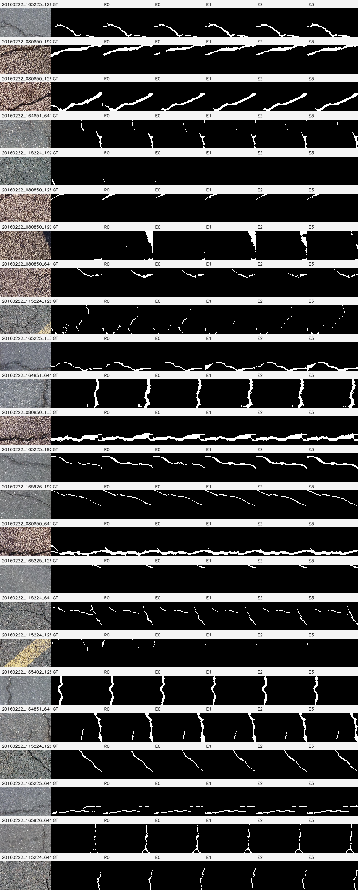

# W11 固定24图：五组模型预测与误差

24张图在正式训练前依输入/GT确定，五组使用冻结seed42。全部120项预测/GT逐像素SHA和混淆矩阵匹配各自完整348图CSV；全部案例保留。示例不能替代三seed全验证集统计。

这些科学对照面板包含公开Crack500代表性输入裁图、GT和派生预测/误差；不发布完整数据集、独立原图文件或权重。红为FP，青为FN，绿为TP；GT骨架青、预测骨架粉、重叠白。

[完整逐图核验CSV](../../results/wave11_20261026/final/fixed24_verification.csv) · [最终报告](../../docs/wave11_final_20261026.md)

|固定案例|完整对照面板|
|---|---|
|01_20160222_165225_1281_361|[预测/误差/骨架](01_20160222_165225_1281_361.png)|
|02_20160222_080850_1921_361|[预测/误差/骨架](02_20160222_080850_1921_361.png)|
|03_20160222_080850_1281_361|[预测/误差/骨架](03_20160222_080850_1281_361.png)|
|04_20160222_164851_641_1081|[预测/误差/骨架](04_20160222_164851_641_1081.png)|
|05_20160222_115224_1921_1081|[预测/误差/骨架](05_20160222_115224_1921_1081.png)|
|06_20160222_080850_1281_721|[预测/误差/骨架](06_20160222_080850_1281_721.png)|
|07_20160222_080850_1921_1|[预测/误差/骨架](07_20160222_080850_1921_1.png)|
|08_20160222_080850_641_721|[预测/误差/骨架](08_20160222_080850_641_721.png)|
|09_20160222_115224_1281_1|[预测/误差/骨架](09_20160222_115224_1281_1.png)|
|10_20160222_165225_1_361|[预测/误差/骨架](10_20160222_165225_1_361.png)|
|11_20160222_164851_641_1|[预测/误差/骨架](11_20160222_164851_641_1.png)|
|12_20160222_080850_1_361|[预测/误差/骨架](12_20160222_080850_1_361.png)|
|13_20160222_165225_1921_721|[预测/误差/骨架](13_20160222_165225_1921_721.png)|
|14_20160222_165926_1921_721|[预测/误差/骨架](14_20160222_165926_1921_721.png)|
|15_20160222_080850_641_361|[预测/误差/骨架](15_20160222_080850_641_361.png)|
|16_20160222_165225_1281_721|[预测/误差/骨架](16_20160222_165225_1281_721.png)|
|17_20160222_115224_641_1|[预测/误差/骨架](17_20160222_115224_641_1.png)|
|18_20160222_115224_1281_361|[预测/误差/骨架](18_20160222_115224_1281_361.png)|
|19_20160222_165402_1281_1|[预测/误差/骨架](19_20160222_165402_1281_1.png)|
|20_20160222_164851_641_721|[预测/误差/骨架](20_20160222_164851_641_721.png)|
|21_20160222_115224_1281_1081|[预测/误差/骨架](21_20160222_115224_1281_1081.png)|
|22_20160222_165225_641_361|[预测/误差/骨架](22_20160222_165225_641_361.png)|
|23_20160222_165926_641_361|[预测/误差/骨架](23_20160222_165926_641_361.png)|
|24_20160222_115224_641_361|[预测/误差/骨架](24_20160222_115224_641_361.png)|
