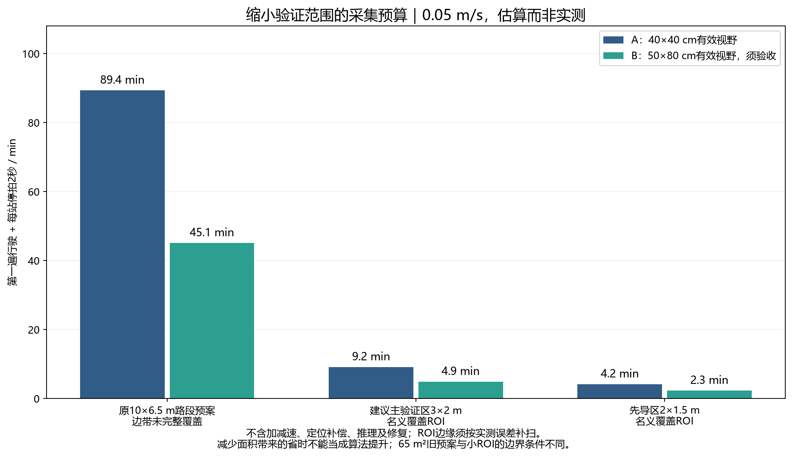

# 实验范围缩小与效率改进：文献依据及执行建议

日期：2026-10-17（北京时间）。对象：152 mm轮、369∶1减速电机、编码器+IMU、麦克纳姆底盘、40×40 cm XYZ修复窗口与中心下视相机。

## 1. 建议先改变验证规模

**建议把当前主实验缩小为场地内部约3×2 m的检测区域，先用2×1.5 m跑通；10×6.5 m整场保留为后续扩展。**这是结合本机硬件和当前成熟度提出的工程建议，不是文献规定的尺寸，也不是已经选定了实地边界。

缩小的是需要完整检查的地面区域，不是把相机视场裁得更小，也不是把原始图片缩小。相机继续保持最终安装位置与可验证的清晰范围，局部修复仍保持40×40 cm。

现在的核心问题是：图像能否形成可信的米制地图、第二次能否找回、局部喷嘴能否连续接力修复。反复扫描65 m²会放大定位漂移、记录和调试成本，但面积大本身不会更充分证明毫米级局部精修能力。

小实验也不能退化成一张照片、一次喷嘴动作。主验证区应包含跨多个视野的真实裂缝，至少实际完成3个连续修复站位及2处交接；有分叉则另验分支。长裂缝长度相对40 cm行程足够大，才能体现移动底盘的作用。

## 2. 上一方案慢在哪里

上一轮约45–89分钟是低速、逐站停拍、整片区域的第一遍采集预算，不是实测用时，也不包含全部推理和修复。

粗略地，覆盖路径长度随 `区域面积/扫描带间距` 增大，任务时间可分解为：

`T = 扫描行走 + 停车拍摄 + 定位校正 + 不可并行的计算 + 修复转场 + 精修 + 人工介入`。

本阶段最值得减少的是：没有裂缝的大面积搜索、每帧都停车、用小修复窗口约束所有检测带距、重复访问已处理窗口。最终还要分别测量每一项，不能仅优化模型FPS就假定全任务显著加速。

第二遍应沿目标工位行驶，本来就不需要再把整块区域均匀扫一次。若已知裂缝图，只需访问能覆盖目标的XYZ站位。

## 3. 文献支持什么、不支持什么

| 文献与核验来源 | 对本项目有用的结论 | 使用边界 |
|---|---|---|
| Veeraraghavan等，*Complete and Near-Optimal Robotic Crack Coverage and Filling in Civil Infrastructure*，IEEE T-RO，2024，[作者全文](https://arxiv.org/html/2403.00613v2)，[官方代码](https://github.com/Binghamton-ACSR-Lab/Crack-Filling-Robot) | 区分传感器对区域的检查覆盖与执行机构对裂缝的作业覆盖，并研究在线图更新及路径协调。启发我们按有效相机范围搜索、按40 cm窗口修复。 | VI-A使用5.79×6.10 m室内场地、蓝/红漆模拟裂缝与填充、Vicon定位，并以已知位置提供局部地图模拟检测。不是廉价相机在真实路面上完成自主定位建图的直接证据。 |
| Zhang等，*Segment-to-track for pavement crack with light-weight neural network on unmanned wheeled robot*，Automation in Construction 161，2024，105346，[期刊页面](https://www.sciencedirect.com/science/article/abs/pii/S0926580524000827) | 研究分割到轮式机器人裂缝跟踪的链路，支持先验证连续视觉引导、再扩展任务复杂度。 | 沿一条裂缝走，不等于无遗漏找到整场其他不相连裂缝；不能替代未知区域覆盖证明。 |
| Zhang等，*Vision-guided robot for automated pixel-level pavement crack sealing*，Automation in Construction 168，2024，105783，[期刊页面](https://www.sciencedirect.com/science/article/abs/pii/S0926580524005193) | 结合分割轨迹、相机/机器人几何和LQR封缝控制，适合参考感知—轨迹—执行的任务验证。 | 其粗细细化首先是Mask处理，不能据此直接声称采用了我们这套两遍扫描方案；pixel-level不等于实际喷嘴毫米误差已满足本机要求。 |
| Mier等，*Fields2Cover: An Open-Source Coverage Path Planning Library for Unmanned Agricultural Vehicles*，IEEE RA-L 8(4)，2023，2166–2172，[作者单位论文页](https://research.wur.nl/en/publications/fields2cover-an-open-source-coverage-path-planning-library-for-un/)，[官方库](https://github.com/Fields2Cover/Fields2Cover) | 将边界、扫描带、访问次序和可行路径分开处理；适合后期比较带方向和空驶距离。 | 来源是农业覆盖规划，不是裂缝精修系统。当前矩形小区用简单弓字已足够，不必马上增加库和复杂转弯模型。 |

前两篇Zhang论文的完整本地PDF在本轮环境中未找到，依据期刊可访问摘要/引言核对，未臆造其场地尺寸或页码。T-RO全文及本地既有源码记录均可核查。特别是T-RO场地并不小，所以“小范围足以做当前验证”的建议来自我们的研究范围选择，而不是声称参考论文都用了小场地。

## 4. 首选的实验区域与工作量

### 4.1 区域怎么选

- 先导区：2×1.5 m，验证图像、位姿、拼接与一次重访。
- 主验证区：约3×2 m，优先包含约1–2 m或更长的真实弯曲裂缝段，以及实际存在的分叉/宽度变化。
- 两条裂缝相距较远时，分别划两个主验证区，不为了把中间空白全部纳入而扩大为65 m²。
- 补充一个真实阴影或高纹理负样本小区（条件存在时），检查错误定位/错误修复风险；不只挑最清楚的裂缝。
- 在推理和任务运行前登记区域边界及选择理由。可以人工选择“有裂缝的验证区”，但不能把裂缝中心线坐标预先给规划器后再声称盲搜完成。
- 切断长裂缝的ROI边界应标记为“人工截断”，不能当自然端点；结论是处理选定裂缝段，不是整条裂缝都已修复。

这些小区是大场地内部的**虚拟检测边界**，不是围墙。底盘允许占用周边真实道路缓冲区，缓冲宽度由实测外廓和平台偏置决定；仍不得触碰实际路缘或越出可行驶范围。

### 4.2 同样停拍条件下的预算

以下0.05 m/s、每站停2秒；不含进出区域、加减速、额外定位、推理及修复，均为计算值。

| 检测区域 | 有效视野（前向×横向） | 扫描带×每带帧 | 路程 | 采集预算 |
|---|---|---:|---:|---:|
| 原10×6.5 m路段预案 | 0.4×0.4 m | 21×34=714 | 196.7 m | 89.4 min |
| 原10×6.5 m路段预案 | 0.5×0.8 m，待验证 | 11×27=297 | 105.7 m | 45.1 min |
| **主验证区3×2 m** | **0.4×0.4 m** | **7×11=77** | **19.8 m** | **9.2 min** |
| 主验证区3×2 m | 0.5×0.8 m，待验证 | 4×9=36 | 11.2 m | 4.9 min |
| 先导区2×1.5 m | 0.4×0.4 m | 5×7=35 | 9.1 m | 4.2 min |
| 先导区2×1.5 m | 0.5×0.8 m，待验证 | 3×6=18 | 5.2 m | 2.3 min |

原大场地预案有物理边缘盲带，分别只得到57/61.44 m²理想观测面积；新ROI是道路内部，允许车体使用ROI外的缓冲区。两种边界条件不同，表格仅用于安排资源，不能据此计算“新算法效率提升百分比”。

小ROI名义首末足迹恰好压在边界上，尚未留误差余量。若每轴综合误差上界e确经验证，应向外补扫并限制相邻间距。以**未实测的示例e=4 cm**计算，3×2 m、0.4²视野仍为77帧，路程20.44 m、约9.38 min；可见必要边缘余量不会把小验证区变回几十分钟，但4 cm不能用作细裂缝配准允许误差。

## 5. 改进方向：按收益与实现代价排序

| 优先级/方向 | 解决的问题与修改位置 | 预期收益 | 成本、风险和验收 |
|---|---|---|---|
| 1 缩小首次验证区 | 改实验任务边界，保留多视野和多站交接 | 缩短单次试验，便于重复和定位失败原因 | 只能支撑局部验证；必须保留实际跨站与分支问题 |
| 2 检测覆盖与作业覆盖分开 | 扫描带距由有效检测视野决定，修复站位由40 cm窗口决定 | 少扫无裂缝区域、少走重复扫描带 | 大视野若漏细裂缝就无效；按目标最小宽度与最低对比度实测，不能直接使用100°标称视场 |
| 3 连续采集、按位移选关键帧 | 改采集调度：相机连续记录，按约20–28 cm位移选帧，定位采样保持高频 | 减少每帧停车/稳定时间，不必每个视频帧都推理 | 时间同步、曝光、模糊、掉帧、打滑；先用相同小区对比停拍与连续采集，指标不下降才采用 |
| 4 有限窗口内处理更多裂缝 | 改修复站位选择：一次停靠覆盖多条相邻支路、保存已处理区间 | 降低站位数、重停靠和重复出胶 | 核心区和余量不能取消；同一复杂窗口可能喷嘴耗时更大，须看总时间 |
| 5 按裂缝图排序修复站位 | 改第二遍任务顺序，比较原顺序/最近邻与现有图规划思路 | 减少空驶和关胶转移 | 起终点、分支、可达性和局部曲线需保留；既有图模块直线边不能直接当喷嘴轨迹 |
| 6 沿裂缝进行定向巡检 | 改任务为已知候选裂缝附近的跟踪/补扫 | 稀疏裂缝场景可少走大量空白区 | 会漏掉远处独立裂缝；如果用航拍/人工给候选区，必须声明使用先验，不能与全区域盲扫直接比 |
| 7 在线发现—停车修复—继续搜索 | 借鉴在线覆盖思想，减少两遍间的回访 | 有机会减少转场与返场 | 地图会随修复改变、分支和已修区管理复杂；在线SCC本机此前未完成完整运行，不能宣称已经具备；后期再试 |
| 8 底盘运动中同步出胶 | 同时控制底盘与XYZ | 进一步减少停靠 | 坐标补偿、时延、材料流量及耦合控制风险显著增加；目前暂不作为必做项 |

这里“较粗的检测”是允许地图定位精度低于局部喷嘴精度，不是允许丢掉要修复的细裂缝。较宽视野依然必须可靠发现目标。不要靠抬高相机或降低分辨率换取表面上的覆盖速度。

连续采集是第二优先的工程提效，不能替代定位验收。例：3×2 m、A条件的停拍预算9.17 min中，2.57 min来自77次×2秒停留；在同速且其他开销相同的理想情况下取消这些停留，扫描运动部分为6.60 min。这只是可节省项的计算，尚非实车结果。加减速减少可能继续省时，但需要测量。

第一遍可以采完离线建图，也可在算力允许时采集/推理并行；无论哪种方式，第二遍开始前必须使用冻结地图，总任务时间必须包含未被并行隐藏的处理时间。60fps相机不要求每秒60次分割，也不证明推理与曝光都足够快。

## 6. 小场地仍可形成有效论文证据

把当前目标写为：**真实路面局部区域内，视觉建图引导移动底盘重定位与笛卡尔机构跨站修复的验证。**这与“65 m²全场无遗漏自主维修”是不同强度的结论。

最少保留三类证据：

1. **建图正确性**：同一裂缝跨帧能对应到同一坐标；独立检验点误差、遗漏/重复、地图不确定区；区域内无裂缝部分也检查。
2. **重访与精定位价值**：对同一批参考目标，比较按旧地图直接执行与停车后局部复拍；编码器+IMU和增加固定标记的比较可放后续。不能把未经标定的错误坐标当作刻意弱对照。
3. **跨站执行效果**：至少3站实际接续，统计交接处漏修/重复出胶、中心线偏差、成功找回率和时间。先笔迹/无胶后实胶。

定位和无胶试验每种条件建议至少3次，改变起始摆放并重新定位，保存全部失败。真实修复不能在同一已填过裂缝上反复填来构造独立重复；需使用未修复段或可替换试件。来自同一裂缝的多个ROI不当作互相独立的裂缝样本。

效率对照只选两个起点一致、终点规则一致、相同ROI/裂缝/模型/合格阈值的策略即可：

- R0：停拍扫描 + 固定顺序访问已知修复站位 + 局部复拍。
- R1：保留其余条件，仅把停拍改成连续采集；若通过，再单独比较第二遍站位排序。

有效视野扩大另做单变量对照，不能和速度、站位排序、输入缩放一起变。报告总时间、扫描/修复转场距离、停车数、漏检长度、喷嘴误差和人工介入；提速同时漏检增加，不能判为成功。

若需要比较“全作业窗口均匀覆盖”和“宽视野扫描后按目标访问”，使用同一小区、相同覆盖/精度要求；不要用65 m²的旧方案对比6 m²的新方案来宣称算法优势。

## 7. 接下来具体做什么

1. 在大路段内部先选一个2×1.5 m先导区，含真实裂缝且周边有整车通行缓冲。记录四角物理坐标，不从航拍缩放直接给毫米坐标。
2. 保持相机现有安装，采集原生照片、毫米尺和标定板。昨天的航拍SegFormer输出未可靠识别路面裂缝，因此车载近景是否可用仍是首个验收点。
3. 完成编码器整圈计数、IMU轴/零偏、相机与XYZ标定；先停拍约35帧的名义小网格，实际按误差补边。
4. 形成地图、重新启动并定位，做3–4个工位的无胶接续。标定或重访失败时就地排查，暂不扩大面积。
5. 通过后在3×2 m主区开展重复试验；另一条裂缝再选一个独立区域。只有这些环节稳定后，比较连续采集与宽视野扫描。
6. 10×6.5 m保留为可选扩展：用于验证累计漂移、长时间运行、边缘覆盖与整场效率。若论文暂不主张大场地自主维护，可先不做全场实胶修复。

本文件是效率和实验规模调整建议；未改变模型、未启动训练、未生成或下发新的实车运动命令。2026-10-16全场方案保留作扩展预案。本轮计算依据保存在 `experiments/field_efficiency_20261017/roi_calculations.json`。
