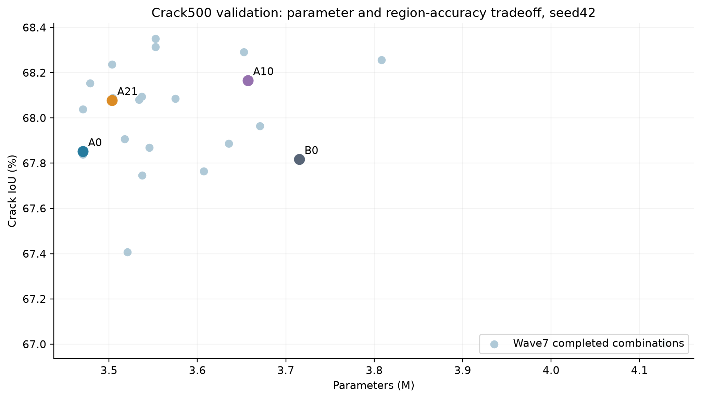
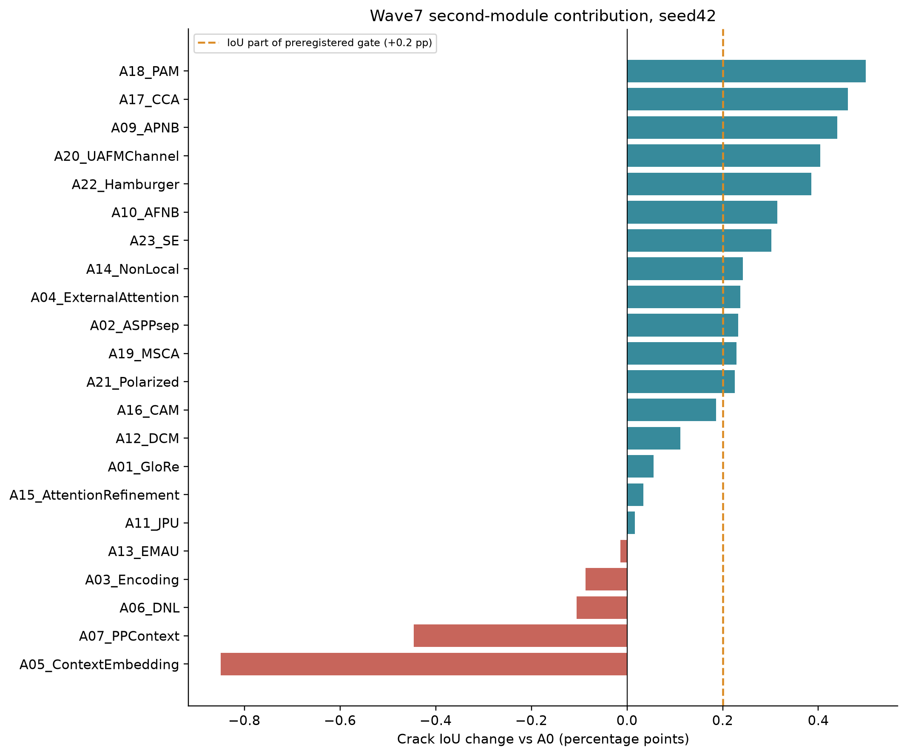
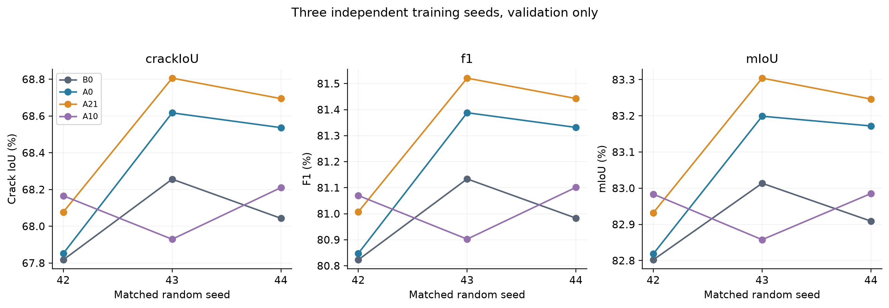
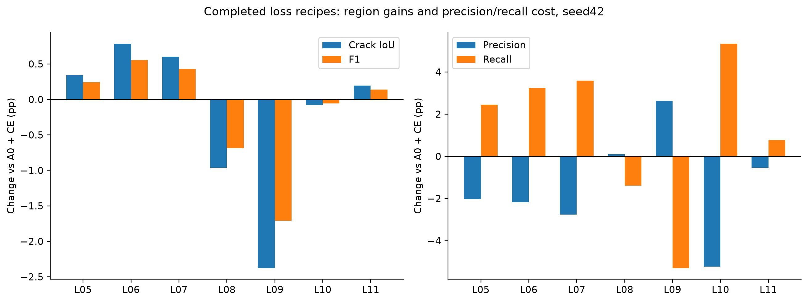
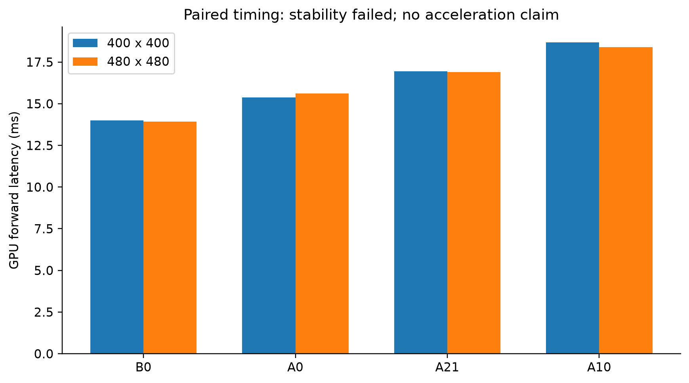
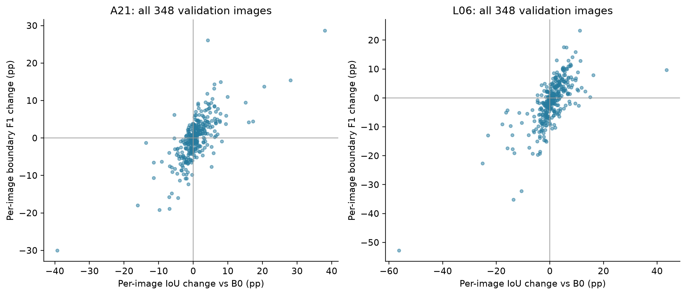

# SegFormer裂缝分割全部实验结果与涨点总结报告

结果快照时间：2026年10月20日 11:25:23（北京时间）。本报告供实验审核、同门协作和后续论文写作使用。所有数字由既有JSON/CSV重新读取、按对应母体重新计算，不启动训练或推理，不更改原始图像、标签、运行中队列或筛选门槛。报告是这一时刻的结果快照，运行中的损失实验后续会继续产生新结果。

## 一 目前能确认的结论

已经完成Wave6的13种官方单模块及2个宽度控制、Wave7的22种第二模块组合，以及后续9项归因和匹配随机种子训练。本次快照中Wave8的20种损失配置已完成7项，其余项目按真实状态列出。以上属于不同配置与训练运行，存在模块复用及多种子复跑，不能合计成几十种独立新算法。

当前最清楚的正结果是：A0（SegFormer-B0，解码器宽度128＋Aligned）和A21（在A0上加入Polarized）在三种子平均区域指标上优于原始B0。A21对B0的平均裂缝IoU提高0.4871个百分点、F1提高0.3437个百分点、mIoU提高0.2527个百分点，参数减少5.7020%；Precision略降而Recall提高，不能描述为所有指标同时上涨。A21第二模块相对A0的平均IoU提升仅0.1907895个百分点，低于预登记0.2个百分点，不能四舍五入放行。A10（AFNB组合）未显示稳定的第二模块增益。

当前不能宣称最终模型、完整精度效率目标通过或领域SOTA。候选的稳定速度条件未通过，且实际配对中位延迟慢于B0；新的结构/损失候选尚未做最终test。已有原始test结果主要是SegFormer-B0和OCRNet，六个原始公开模型尚未齐全。论文应保留负结果、协议差异、验证搜索偏差以及数据来源互斥复核尚待完成这些限制。

## 二 数据和训练评价协议

| 部分 | 清单样本数 | 实际作用 | 本轮访问情况 |
| --- | --- | --- | --- |
| Crack500 train | 1896 | 更新网络权重 | 所有新候选使用 |
| Crack500 val | 348 | 普通/EMA选择、结构/损失筛选 | 所有完成候选独立验证 |
| Crack500 test | 1124 | 冻结模型后统一最终评估 | 历史B0/OCRNet已测；新候选未测 |
| 自建数据集 | 历史train1400、val177 | 早期独立实验 | 当前Wave6–8不使用 |

当前Crack500清单合计3368个图像—标签样本，其中训练/验证2244个。样本包含裁剪，不能当作3368张相互独立的原始道路照片。只读入口为C:/Users/user/algolab_data；历史数据清单有4488个train/val源文件哈希（图像和标签各计一文件）。本报告只读取已有结果，不重新读取测试图像或标签。自建集历史有精确图像/D4去重处理，原始源帧身份尚未完整建立；其分数不能与Crack500横向排名。

统一主要协议：本机RTX5060 8GB，Paddle3.4/PaddleSeg-2.10.0，FP32，batch4，AdamW，初始学习率6e-5，PolynomialDecay end_lr=0，18000 iter，EMA，每1000 iter验证。训练增强沿用0.75–1.25缩放、400×400裁剪、水平翻转、颜色扰动和Normalize；验证不做这些随机增强。新结构/损失训练从共同ImageNet MiT-B0预训练初始化，并非从训练好的对照模型接着微调。多种子为42/43/44，预算保持一致。

评价：先聚合348张图的混淆矩阵，再计算Precision、Recall、F1和前景IoU；mIoU是背景IoU与裂缝IoU的均值。F1=2×IoU/(1+IoU)，因此F1和裂缝IoU不是两份独立证据。BF1为前景减3×3腐蚀所得内边界，图像外为零，精确欧氏距离≤2px双向匹配，全数据集计数后计算调和平均。逐图宏平均和全局指标单独报告。

选模规则：普通best与EMA best比较精确验证mIoU，选择最高者，复制冻结checkpoint并计算SHA256，随后官方val.py和独立像素/边界评估复核。不同模型不能依据test成绩反向选权重。本报告中Δ均表示绝对百分点（pp），不是相对百分比；例如IoU从67.8%到68.3%为+0.5pp。参数变化百分比则另按相对B0计算。

## 三 阶段完成清单与结果可信度

| 阶段 | 快照状态 | 包含内容 | 解释 |
| --- | --- | --- | --- |
| 早期SegFormer UAFM/PPContext/EMAU/DualAttention/LightHam | 5项历史候选 | 不同早期记录完整性；LightHam已纠正EMA选模 | 见历史章节，边界不混比 |
| Wave6 宽度与单模块 | 15/16完成 | 13单模块＋2宽度；PSP smoke失败 | 真实18k、退出、冻结和独立验证 |
| Wave7 Aligned＋第二模块 | 22/24完成 | 22完成；DAPPM失败，PSP暂缓 | 不把同一模块换接入点计为全新机制 |
| 归因补充与匹配seed | 9/9完成 | AFNB独立seed42；四模型seed43/44 | 形成四模型各3seed |
| Wave8 固定A0损失 | 7/20完成 | 7项正式结果；兼容恢复另列 | 超参数配置不计独立模型机制 |
| 最终六个原始公开对照 | 尚未齐全 | B0/OCRNet test已有；PP-LiteSeg val已有 | PSPNet/DeepLab/FastSCNN未有完整统一test |

本次确定性核验共检查53个完成运行：训练/官方验证/独立像素边界/profile真实exit0、最终18000日志与checkpoint、冻结SHA、普通/EMA最高选择、精确验证复现和指标一致性；发现错误0。该计数是“运行数”，含控制组和多种子，不代表独立模型数量。核验详情见provenance/结果确定性核验.json。另已尝试独立审阅，但指定审阅代理因使用配额限制未执行完成，因此独立语义审计状态是BLOCKED，不是PASS；详见EXPERIMENT_AUDIT.md。历史缺少真实训练exit的条目不伪造exit0。

## 四 对照与宽度压缩

| 配置 | 状态 | P% | R% | F1% | 裂缝IoU% | mIoU% | BF1% | Params M | ΔIoU pp | ΔF1 pp | ΔmIoU pp |
| --- | --- | --- | --- | --- | --- | --- | --- | --- | --- | --- | --- |
| B0 原始width256 | 冻结复用 | 82.8269 | 78.9134 | 80.8228 | 67.8174 | 82.8021 | 45.1524 | 3.715170 | +0.0000 | +0.0000 | +0.0000 |
| W128 | 完成 | 80.2747 | 81.1416 | 80.7058 | 67.6528 | 82.6784 | 44.0295 | 3.451746 | -0.1646 | -0.1170 | -0.1236 |
| W64 | 完成 | 81.1151 | 79.4618 | 80.2799 | 67.0564 | 82.3742 | 43.3016 | 3.369186 | -0.7610 | -0.5429 | -0.4278 |
| A0 W128 + Aligned | 冻结复用 | 82.6766 | 79.0974 | 80.8474 | 67.8520 | 82.8184 | 44.9285 | 3.470434 | +0.0346 | +0.0246 | +0.0164 |

W128相对原B0减少约7.09%参数，但seed42的区域与边界略降；W64减少约9.31%，区域损失更大，且已有计时不能证明更快。Aligned接在W128后，恢复了部分区域精度，但参数节约主要来自解码宽度压缩，不能全部归因于Aligned。后续组合的直接母体为A0，不是原始width256模型。

## 五 早期SegFormer模块历史结果及选模修正

| 配置 | 状态 | P% | R% | F1% | 裂缝IoU% | mIoU% | Params M | ΔIoU pp | ΔF1 pp | ΔmIoU pp |
| --- | --- | --- | --- | --- | --- | --- | --- | --- | --- | --- |
| UAFM_SpAtten | 历史已验证 | 82.0200 | 79.2400 | 80.5900 | 67.5200 | 82.6300 | 4.896968 | -0.2974 | -0.2328 | -0.1721 |
| PPContext兼容版 | 历史已验证 | 81.0944 | 79.7896 | 80.4367 | 67.2754 | 82.4902 | 3.914018 | -0.5419 | -0.3861 | -0.3118 |
| EMAU | 历史已验证 | 80.0025 | 81.4678 | 80.7285 | 67.6847 | 82.6912 | 3.847266 | -0.1327 | -0.0943 | -0.1109 |
| DualAttention | 历史已验证 | 80.9990 | 80.7437 | 80.8712 | 67.8855 | 82.8128 | 3.976883 | +0.0681 | +0.0484 | +0.0107 |
| LightHam | 历史已验证 | 81.1394 | 79.5698 | 80.3469 | 67.1499 | 82.4242 | 3.431138 | -0.6674 | -0.4759 | -0.3778 |

UAFM旧汇总含错误的缓存delta，本表从绝对指标重新相减：裂缝IoU相对B0实际下降约0.2974pp，不能沿用旧文档中的“增加0.0030”。该行原始汇总仅保留四位小数，精度低于后续逐像素结果。PPContext兼容版完整迭代/独立验证有证据，但原启动器没有真实训练退出JSON，退出码保留未知；兼容性修复不等于性能通过。

LightHam旧汇总错误选了普通权重（mIoU82.3293%）；正确按最高验证mIoU应选EMA iter10000（mIoU82.4242%、裂缝IoU67.1499%、F1 80.3469%）。修正后仍低于原B0，不改变负结果性质。旧波BF1使用默认外延/近似距离，部分更早记录还存在非调和平均公式错误；本表不混入其BF1，不能把重评口径变化解释为模型提升。

## 六 Wave6 全部单模块与宽度实验

本节除B0外均为width128上的单模块，W64是单独压缩控制。每行P/R/F1/IoU/mIoU/BF1均为seed42验证百分数；涨点以原B0为参照。

| 配置 | 状态 | P% | R% | F1% | 裂缝IoU% | mIoU% | BF1% | Params M | ΔIoU pp | ΔF1 pp | ΔmIoU pp |
| --- | --- | --- | --- | --- | --- | --- | --- | --- | --- | --- | --- |
| W128 | 完成 | 80.2747 | 81.1416 | 80.7058 | 67.6528 | 82.6784 | 44.0295 | 3.451746 | -0.1646 | -0.1170 | -0.1236 |
| W64 | 完成 | 81.1151 | 79.4618 | 80.2799 | 67.0564 | 82.3742 | 43.3016 | 3.369186 | -0.7610 | -0.5429 | -0.4278 |
| M08_MSCA | 完成 | 81.1014 | 79.8482 | 80.4699 | 67.3219 | 82.5150 | 44.1265 | 3.515362 | -0.4954 | -0.3529 | -0.2871 |
| M13_Aligned | 完成 | 82.6766 | 79.0974 | 80.8474 | 67.8520 | 82.8184 | 44.9285 | 3.470434 | +0.0346 | +0.0246 | +0.0164 |
| M03_GC | 完成 | 82.0801 | 79.1426 | 80.5846 | 67.4826 | 82.6142 | 44.6230 | 3.460499 | -0.3348 | -0.2382 | -0.1879 |
| M06_CAM | 完成 | 80.7763 | 80.6565 | 80.7164 | 67.6676 | 82.6938 | 43.8392 | 3.451747 | -0.1498 | -0.1065 | -0.1083 |
| M11_ASPPsep | 完成 | 80.9164 | 80.6430 | 80.7795 | 67.7564 | 82.7430 | 44.6930 | 3.556194 | -0.0610 | -0.0433 | -0.0591 |
| M02_PSA | 完成 | 80.1853 | 80.7231 | 80.4533 | 67.2986 | 82.4889 | 43.2772 | 3.484642 | -0.5188 | -0.3696 | -0.3131 |
| M04_CCA | 完成 | 81.6508 | 79.6821 | 80.6544 | 67.5806 | 82.6602 | 44.2421 | 3.533987 | -0.2368 | -0.1684 | -0.1418 |
| M05_PAM | 完成 | 81.6568 | 79.5738 | 80.6019 | 67.5068 | 82.6211 | 44.1078 | 3.533987 | -0.3105 | -0.2209 | -0.1809 |
| M07_NonLocal | 完成 | 79.7710 | 81.9002 | 80.8216 | 67.8156 | 82.7572 | 43.4454 | 3.518498 | -0.0017 | -0.0012 | -0.0449 |
| M09_Encoding | 完成 | 82.3205 | 79.1703 | 80.7147 | 67.6652 | 82.7145 | 44.7865 | 3.588530 | -0.1521 | -0.1081 | -0.0876 |
| M10_GloRe | 完成 | 81.0472 | 80.5128 | 80.7791 | 67.7559 | 82.7446 | 44.4361 | 3.498978 | -0.0615 | -0.0437 | -0.0574 |
| M14_UAFMchannel | 完成 | 81.8604 | 79.6510 | 80.7406 | 67.7017 | 82.7275 | 44.7492 | 3.789410 | -0.1157 | -0.0822 | -0.0746 |
| M01_SE | 完成 | 80.9929 | 80.2795 | 80.6346 | 67.5527 | 82.6360 | 43.7970 | 3.460098 | -0.2646 | -0.1882 | -0.1661 |
| M12_PSP | 反向smoke失败 | — | — | — | — | — | — | — | — | — | — |

### 6.1 相对W128的模块净贡献

| 模块 | ΔP pp | ΔR pp | ΔF1 pp | ΔIoU pp | ΔmIoU pp | ΔBF1 pp |
| --- | --- | --- | --- | --- | --- | --- |
| M08_MSCA | +0.8267 | -1.2934 | -0.2359 | -0.3309 | -0.1634 | +0.0971 |
| M13_Aligned | +2.4018 | -2.0442 | +0.1416 | +0.1992 | +0.1400 | +0.8990 |
| M03_GC | +1.8054 | -1.9990 | -0.1212 | -0.1702 | -0.0642 | +0.5936 |
| M06_CAM | +0.5015 | -0.4850 | +0.0105 | +0.0148 | +0.0154 | -0.1902 |
| M11_ASPPsep | +0.6417 | -0.4985 | +0.0737 | +0.1036 | +0.0646 | +0.6635 |
| M02_PSA | -0.0895 | -0.4185 | -0.2526 | -0.3542 | -0.1895 | -0.7523 |
| M04_CCA | +1.3761 | -1.4595 | -0.0514 | -0.0722 | -0.0182 | +0.2127 |
| M05_PAM | +1.3821 | -1.5678 | -0.1040 | -0.1460 | -0.0573 | +0.0783 |
| M07_NonLocal | -0.5037 | +0.7587 | +0.1158 | +0.1629 | +0.0788 | -0.5841 |
| M09_Encoding | +2.0457 | -1.9712 | +0.0089 | +0.0124 | +0.0360 | +0.7570 |
| M10_GloRe | +0.7725 | -0.6287 | +0.0733 | +0.1031 | +0.0662 | +0.4066 |
| M14_UAFMchannel | +1.5857 | -1.4905 | +0.0348 | +0.0489 | +0.0490 | +0.7197 |
| M01_SE | +0.7181 | -0.8621 | -0.0712 | -0.1000 | -0.0424 | -0.2325 |
| M12_PSP | — | — | — | — | — | — |

观察：Aligned单独在W128上带来约+0.1992pp IoU和+0.1416pp F1；其余单模块多数表现为Precision/Recall工作点变化或很小的区域收益。NonLocal的Recall提高，但Precision损失明显；独立Polarized在该母体上并未提高IoU。单模块无效并不保证其在Aligned母体上也无效，反之也不能自动假定联合互补，需要下一节完整训练验证。PSP只有兼容失败，不存在合法性能分数。

### 6.2 每项模块的作用与真实观察

- M08_MSCA（MSCAN SpatialAttention）：对W128，IoU -0.3309pp、F1 -0.2359pp、P +0.8267pp、R -1.2934pp、BF1 +0.0971pp；对原B0，IoU -0.4954pp。参数3.515362M。

- M13_Aligned（SFNet AlignedModule）：对W128，IoU +0.1992pp、F1 +0.1416pp、P +2.4018pp、R -2.0442pp、BF1 +0.8990pp；对原B0，IoU +0.0346pp。参数3.470434M。

- M03_GC（Global Context Block）：对W128，IoU -0.1702pp、F1 -0.1212pp、P +1.8054pp、R -1.9990pp、BF1 +0.5936pp；对原B0，IoU -0.3348pp。参数3.460499M。

- M06_CAM（Channel Attention Module）：对W128，IoU +0.0148pp、F1 +0.0105pp、P +0.5015pp、R -0.4850pp、BF1 -0.1902pp；对原B0，IoU -0.1498pp。参数3.451747M。

- M11_ASPPsep（Separable ASPP）：对W128，IoU +0.1036pp、F1 +0.0737pp、P +0.6417pp、R -0.4985pp、BF1 +0.6635pp；对原B0，IoU -0.0610pp。参数3.556194M。

- M02_PSA（Polarized Self Attention）：对W128，IoU -0.3542pp、F1 -0.2526pp、P -0.0895pp、R -0.4185pp、BF1 -0.7523pp；对原B0，IoU -0.5188pp。参数3.484642M。

- M04_CCA（Criss Cross Attention）：对W128，IoU -0.0722pp、F1 -0.0514pp、P +1.3761pp、R -1.4595pp、BF1 +0.2127pp；对原B0，IoU -0.2368pp。参数3.533987M。

- M05_PAM（Position Attention Module）：对W128，IoU -0.1460pp、F1 -0.1040pp、P +1.3821pp、R -1.5678pp、BF1 +0.0783pp；对原B0，IoU -0.3105pp。参数3.533987M。

- M07_NonLocal（NonLocal2D）：对W128，IoU +0.1629pp、F1 +0.1158pp、P -0.5037pp、R +0.7587pp、BF1 -0.5841pp；对原B0，IoU -0.0017pp。参数3.518498M。

- M09_Encoding（EncModule）：对W128，IoU +0.0124pp、F1 +0.0089pp、P +2.0457pp、R -1.9712pp、BF1 +0.7570pp；对原B0，IoU -0.1521pp。参数3.588530M。

- M10_GloRe（GloRe GruModule）：对W128，IoU +0.1031pp、F1 +0.0733pp、P +0.7725pp、R -0.6287pp、BF1 +0.4066pp；对原B0，IoU -0.0615pp。参数3.498978M。

- M14_UAFMchannel（UAFM Channel Attention）：对W128，IoU +0.0489pp、F1 +0.0348pp、P +1.5857pp、R -1.4905pp、BF1 +0.7197pp；对原B0，IoU -0.1157pp。参数3.789410M。

- M01_SE（MobileNetV3 SE）：对W128，IoU -0.1000pp、F1 -0.0712pp、P +0.7181pp、R -0.8621pp、BF1 -0.2325pp；对原B0，IoU -0.2646pp。参数3.460098M。

- M12_PSP：反向smoke失败，保留失败证据；不填写涨点。

## 七 Wave7 Aligned与第二模块的全部组合

全部组合结构为MiT-B0＋width128解码器＋Aligned＋表中第二模块，数据、损失CE、初始化和训练预算保持一致。预登记24种组合，22项完成，2项技术失败/暂缓。

| 配置 | 状态 | P% | R% | F1% | 裂缝IoU% | mIoU% | BF1% | Params M |
| --- | --- | --- | --- | --- | --- | --- | --- | --- |
| A01_GloRe | 完成 | 82.3299 | 79.4932 | 80.8867 | 67.9073 | 82.8431 | 44.9721 | 3.517666 |
| A02_ASPPsep | 完成 | 81.3419 | 80.6853 | 81.0123 | 68.0846 | 82.9235 | 44.7619 | 3.574882 |
| A03_Encoding | 完成 | 80.3396 | 81.2367 | 80.7857 | 67.7651 | 82.7390 | 43.8860 | 3.607218 |
| A04_ExternalAttention | 完成 | 81.4229 | 80.6120 | 81.0154 | 68.0890 | 82.9270 | 44.9818 | 3.504226 |
| A05_ContextEmbedding | 完成 | 82.2275 | 78.3493 | 80.2415 | 67.0028 | 82.3616 | 43.6995 | 4.128354 |
| A06_DNL | 完成 | 82.1970 | 79.3962 | 80.7724 | 67.7464 | 82.7559 | 45.1836 | 3.537443 |
| A07_PPContext | 完成 | 82.3667 | 78.7741 | 80.5303 | 67.4065 | 82.5778 | 44.5008 | 3.520706 |
| A08_DAPPM | 反向smoke失败 | — | — | — | — | — | — | — |
| A09_APNB | 完成 | 81.8722 | 80.4574 | 81.1586 | 68.2915 | 83.0408 | 44.8512 | 3.652578 |
| A10_AFNB | 完成 | 82.5600 | 79.6327 | 81.0699 | 68.1660 | 82.9836 | 45.1057 | 3.656994 |
| A11_JPU | 完成 | 81.3370 | 80.3871 | 80.8593 | 67.8687 | 82.8087 | 44.4030 | 3.545570 |
| A12_DCM | 完成 | 82.0977 | 79.7882 | 80.9265 | 67.9635 | 82.8698 | 45.1252 | 3.670882 |
| A13_EMAU | 完成 | 82.9071 | 78.8686 | 80.8374 | 67.8379 | 82.8141 | 44.8531 | 3.470434 |
| A14_NonLocal | 完成 | 81.4188 | 80.6233 | 81.0191 | 68.0941 | 82.9296 | 44.7010 | 3.537186 |
| A15_AttentionRefinement | 完成 | 82.2794 | 79.5113 | 80.8717 | 67.8862 | 82.8312 | 44.9468 | 3.635298 |
| A16_CAM | 完成 | 81.1153 | 80.8441 | 80.9795 | 68.0382 | 82.8956 | 44.7038 | 3.470435 |
| A17_CCA | 完成 | 79.7584 | 82.6418 | 81.1745 | 68.3141 | 83.0218 | 44.3564 | 3.552675 |
| A18_PAM | 完成 | 80.1168 | 82.3137 | 81.2004 | 68.3507 | 83.0468 | 44.2719 | 3.552675 |
| A19_MSCA | 完成 | 81.8119 | 80.2226 | 81.0095 | 68.0806 | 82.9280 | 45.2581 | 3.534050 |
| A20_UAFMChannel | 完成 | 82.0532 | 80.2339 | 81.1333 | 68.2558 | 83.0244 | 44.8377 | 3.808098 |
| A21_Polarized | 完成 | 82.2351 | 79.8153 | 81.0071 | 68.0773 | 82.9321 | 45.1542 | 3.503330 |
| A22_Hamburger | 完成 | 81.9735 | 80.2845 | 81.1202 | 68.2372 | 83.0134 | 45.2614 | 3.503586 |
| A23_SE | 完成 | 81.6323 | 80.4983 | 81.0613 | 68.1539 | 82.9644 | 45.3831 | 3.478786 |
| A24_PSP | 兼容暂缓 | — | — | — | — | — | — | — |

### 7.1 对直接母体A0的涨点

| 组合 | ΔP pp | ΔR pp | ΔF1 pp | ΔIoU pp | ΔmIoU pp | ΔBF1 pp | 原单seed母体门槛 |
| --- | --- | --- | --- | --- | --- | --- | --- |
| A01_GloRe | -0.3467 | +0.3958 | +0.0393 | +0.0554 | +0.0247 | +0.0436 | False |
| A02_ASPPsep | -1.3346 | +1.5879 | +0.1649 | +0.2327 | +0.1051 | -0.1666 | False |
| A03_Encoding | -2.3370 | +2.1393 | -0.0617 | -0.0869 | -0.0794 | -1.0425 | False |
| A04_ExternalAttention | -1.2537 | +1.5146 | +0.1680 | +0.2370 | +0.1085 | +0.0533 | False |
| A05_ContextEmbedding | -0.4491 | -0.7481 | -0.6058 | -0.8491 | -0.4568 | -1.2290 | False |
| A06_DNL | -0.4795 | +0.2988 | -0.0750 | -0.1056 | -0.0626 | +0.2551 | False |
| A07_PPContext | -0.3099 | -0.3233 | -0.3170 | -0.4454 | -0.2407 | -0.4277 | False |
| A08_DAPPM | — | — | — | — | — | — | — |
| A09_APNB | -0.8044 | +1.3600 | +0.3112 | +0.4396 | +0.2224 | -0.0773 | False |
| A10_AFNB | -0.1166 | +0.5353 | +0.2225 | +0.3141 | +0.1652 | +0.1772 | True |
| A11_JPU | -1.3395 | +1.2897 | +0.0119 | +0.0167 | -0.0097 | -0.5255 | False |
| A12_DCM | -0.5789 | +0.6908 | +0.0791 | +0.1115 | +0.0513 | +0.1967 | False |
| A13_EMAU | +0.2306 | -0.2288 | -0.0100 | -0.0140 | -0.0044 | -0.0754 | False |
| A14_NonLocal | -1.2578 | +1.5259 | +0.1717 | +0.2422 | +0.1112 | -0.2275 | False |
| A15_AttentionRefinement | -0.3971 | +0.4139 | +0.0243 | +0.0343 | +0.0128 | +0.0183 | False |
| A16_CAM | -1.5613 | +1.7467 | +0.1321 | +0.1863 | +0.0772 | -0.2247 | False |
| A17_CCA | -2.9181 | +3.5444 | +0.3271 | +0.4621 | +0.2034 | -0.5721 | False |
| A18_PAM | -2.5597 | +3.2163 | +0.3530 | +0.4988 | +0.2284 | -0.6566 | False |
| A19_MSCA | -0.8647 | +1.1252 | +0.1621 | +0.2286 | +0.1095 | +0.3296 | False |
| A20_UAFMChannel | -0.6234 | +1.1365 | +0.2860 | +0.4038 | +0.2059 | -0.0908 | False |
| A21_Polarized | -0.4414 | +0.7179 | +0.1597 | +0.2253 | +0.1136 | +0.2257 | True |
| A22_Hamburger | -0.7030 | +1.1871 | +0.2729 | +0.3853 | +0.1950 | +0.3329 | False |
| A23_SE | -1.0443 | +1.4009 | +0.2139 | +0.3019 | +0.1460 | +0.4546 | False |
| A24_PSP | — | — | — | — | — | — | — |

### 7.2 对原始SegFormer-B0的涨点

| 组合 | ΔP pp | ΔR pp | ΔF1 pp | ΔIoU pp | ΔmIoU pp | ΔBF1 pp | 减参% |
| --- | --- | --- | --- | --- | --- | --- | --- |
| A01_GloRe | -0.4970 | +0.5798 | +0.0639 | +0.0900 | +0.0411 | -0.1803 | 5.316 |
| A02_ASPPsep | -1.4849 | +1.7719 | +0.1895 | +0.2673 | +0.1214 | -0.3905 | 3.776 |
| A03_Encoding | -2.4873 | +2.3233 | -0.0372 | -0.0523 | -0.0630 | -1.2663 | 2.906 |
| A04_ExternalAttention | -1.4040 | +1.6986 | +0.1926 | +0.2716 | +0.1249 | -0.1705 | 5.678 |
| A05_ContextEmbedding | -0.5994 | -0.5642 | -0.5813 | -0.8145 | -0.4405 | -1.4529 | -11.122 |
| A06_DNL | -0.6298 | +0.4828 | -0.0504 | -0.0710 | -0.0462 | +0.0312 | 4.784 |
| A07_PPContext | -0.4602 | -0.1393 | -0.2925 | -0.4108 | -0.2243 | -0.6516 | 5.234 |
| A08_DAPPM | — | — | — | — | — | — | — |
| A09_APNB | -0.9547 | +1.5439 | +0.3358 | +0.4742 | +0.2388 | -0.3012 | 1.685 |
| A10_AFNB | -0.2669 | +0.7193 | +0.2471 | +0.3487 | +0.1815 | -0.0467 | 1.566 |
| A11_JPU | -1.4899 | +1.4737 | +0.0365 | +0.0514 | +0.0067 | -0.7494 | 4.565 |
| A12_DCM | -0.7292 | +0.8748 | +0.1037 | +0.1461 | +0.0677 | -0.0272 | 1.192 |
| A13_EMAU | +0.0802 | -0.0449 | +0.0146 | +0.0206 | +0.0120 | -0.2992 | 6.587 |
| A14_NonLocal | -1.4081 | +1.7098 | +0.1962 | +0.2768 | +0.1276 | -0.4514 | 4.791 |
| A15_AttentionRefinement | -0.5475 | +0.5979 | +0.0489 | +0.0689 | +0.0292 | -0.2056 | 2.150 |
| A16_CAM | -1.7116 | +1.9307 | +0.1566 | +0.2209 | +0.0935 | -0.4486 | 6.587 |
| A17_CCA | -3.0684 | +3.7284 | +0.3517 | +0.4967 | +0.2198 | -0.7960 | 4.374 |
| A18_PAM | -2.7100 | +3.4002 | +0.3776 | +0.5334 | +0.2447 | -0.8805 | 4.374 |
| A19_MSCA | -1.0150 | +1.3092 | +0.1866 | +0.2632 | +0.1259 | +0.1057 | 4.875 |
| A20_UAFMChannel | -0.7737 | +1.3205 | +0.3105 | +0.4384 | +0.2223 | -0.3146 | -2.501 |
| A21_Polarized | -0.5918 | +0.9018 | +0.1843 | +0.2599 | +0.1300 | +0.0018 | 5.702 |
| A22_Hamburger | -0.8533 | +1.3711 | +0.2974 | +0.4199 | +0.2113 | +0.1090 | 5.695 |
| A23_SE | -1.1946 | +1.5849 | +0.2385 | +0.3365 | +0.1623 | +0.2307 | 6.363 |
| A24_PSP | — | — | — | — | — | — | — |

### 7.3 每个组合的结果解读

- A01_GloRe（GloRe Graph Reasoning Unit）：相对A0的IoU +0.0554pp、F1 +0.0393pp，P -0.3467pp、R +0.3958pp、BF1 +0.0436pp。原单seed完整母体门槛未通过；相对B0的IoU +0.0900pp、参数3.517666M。

- A02_ASPPsep（Separable Atrous Spatial Pyramid Pooling）：相对A0的IoU +0.2327pp、F1 +0.1649pp，P -1.3346pp、R +1.5879pp、BF1 -0.1666pp。原单seed完整母体门槛未通过；相对B0的IoU +0.2673pp、参数3.574882M。

- A03_Encoding（Context Encoding Module）：相对A0的IoU -0.0869pp、F1 -0.0617pp，P -2.3370pp、R +2.1393pp、BF1 -1.0425pp。原单seed完整母体门槛未通过；相对B0的IoU -0.0523pp、参数3.607218M。

- A04_ExternalAttention（RTFormer External Attention）：相对A0的IoU +0.2370pp、F1 +0.1680pp，P -1.2537pp、R +1.5146pp、BF1 +0.0533pp。原单seed完整母体门槛未通过；相对B0的IoU +0.2716pp、参数3.504226M。

- A05_ContextEmbedding（BiSeNetV2 Context Embedding Block）：相对A0的IoU -0.8491pp、F1 -0.6058pp，P -0.4491pp、R -0.7481pp、BF1 -1.2290pp。原单seed完整母体门槛未通过；相对B0的IoU -0.8145pp、参数4.128354M。

- A06_DNL（Disentangled Non-Local Block）：相对A0的IoU -0.1056pp、F1 -0.0750pp，P -0.4795pp、R +0.2988pp、BF1 +0.2551pp。原单seed完整母体门槛未通过；相对B0的IoU -0.0710pp、参数3.537443M。

- A07_PPContext（PP-LiteSeg Simple Pyramid Context Module）：相对A0的IoU -0.4454pp、F1 -0.3170pp，P -0.3099pp、R -0.3233pp、BF1 -0.4277pp。原单seed完整母体门槛未通过；相对B0的IoU -0.4108pp、参数3.520706M。

- A08_DAPPM：反向smoke失败，未形成正式性能结论。

- A09_APNB（Asymmetric Pyramid Non-local Block）：相对A0的IoU +0.4396pp、F1 +0.3112pp，P -0.8044pp、R +1.3600pp、BF1 -0.0773pp。原单seed完整母体门槛未通过；相对B0的IoU +0.4742pp、参数3.652578M。

- A10_AFNB（Asymmetric Fusion Non-local Block）：相对A0的IoU +0.3141pp、F1 +0.2225pp，P -0.1166pp、R +0.5353pp、BF1 +0.1772pp。原单seed完整母体门槛通过；相对B0的IoU +0.3487pp、参数3.656994M。

- A11_JPU（FastFCN Joint Pyramid Upsampling）：相对A0的IoU +0.0167pp、F1 +0.0119pp，P -1.3395pp、R +1.2897pp、BF1 -0.5255pp。原单seed完整母体门槛未通过；相对B0的IoU +0.0514pp、参数3.545570M。

- A12_DCM（DMNet Dynamic Convolutional Module）：相对A0的IoU +0.1115pp、F1 +0.0791pp，P -0.5789pp、R +0.6908pp、BF1 +0.1967pp。原单seed完整母体门槛未通过；相对B0的IoU +0.1461pp、参数3.670882M。

- A13_EMAU（Expectation-Maximization Attention Unit）：相对A0的IoU -0.0140pp、F1 -0.0100pp，P +0.2306pp、R -0.2288pp、BF1 -0.0754pp。原单seed完整母体门槛未通过；相对B0的IoU +0.0206pp、参数3.470434M。

- A14_NonLocal（Embedded-Gaussian Non-Local Block）：相对A0的IoU +0.2422pp、F1 +0.1717pp，P -1.2578pp、R +1.5259pp、BF1 -0.2275pp。原单seed完整母体门槛未通过；相对B0的IoU +0.2768pp、参数3.537186M。

- A15_AttentionRefinement（BiSeNetV1 Attention Refinement Module）：相对A0的IoU +0.0343pp、F1 +0.0243pp，P -0.3971pp、R +0.4139pp、BF1 +0.0183pp。原单seed完整母体门槛未通过；相对B0的IoU +0.0689pp、参数3.635298M。

- A16_CAM（DANet Channel Attention Module）：相对A0的IoU +0.1863pp、F1 +0.1321pp，P -1.5613pp、R +1.7467pp、BF1 -0.2247pp。原单seed完整母体门槛未通过；相对B0的IoU +0.2209pp、参数3.470435M。

- A17_CCA（Criss-Cross Attention）：相对A0的IoU +0.4621pp、F1 +0.3271pp，P -2.9181pp、R +3.5444pp、BF1 -0.5721pp。原单seed完整母体门槛未通过；相对B0的IoU +0.4967pp、参数3.552675M。

- A18_PAM（DANet Position Attention Module）：相对A0的IoU +0.4988pp、F1 +0.3530pp，P -2.5597pp、R +3.2163pp、BF1 -0.6566pp。原单seed完整母体门槛未通过；相对B0的IoU +0.5334pp、参数3.552675M。

- A19_MSCA（MSCAN Multi-Scale Convolutional Attention）：相对A0的IoU +0.2286pp、F1 +0.1621pp，P -0.8647pp、R +1.1252pp、BF1 +0.3296pp。原单seed完整母体门槛未通过；相对B0的IoU +0.2632pp、参数3.534050M。

- A20_UAFMChannel（PP-LiteSeg Channel-Attention UAFM）：相对A0的IoU +0.4038pp、F1 +0.2860pp，P -0.6234pp、R +1.1365pp、BF1 -0.0908pp。原单seed完整母体门槛未通过；相对B0的IoU +0.4384pp、参数3.808098M。

- A21_Polarized（Polarized Self-Attention）：相对A0的IoU +0.2253pp、F1 +0.1597pp，P -0.4414pp、R +0.7179pp、BF1 +0.2257pp。原单seed完整母体门槛通过；相对B0的IoU +0.2599pp、参数3.503330M。

- A22_Hamburger（SegNeXt Hamburger NMF Context）：相对A0的IoU +0.3853pp、F1 +0.2729pp，P -0.7030pp、R +1.1871pp、BF1 +0.3329pp。原单seed完整母体门槛未通过；相对B0的IoU +0.4199pp、参数3.503586M。

- A23_SE（MobileNetV3 Squeeze-and-Excitation）：相对A0的IoU +0.3019pp、F1 +0.2139pp，P -1.0443pp、R +1.4009pp、BF1 +0.4546pp。原单seed完整母体门槛未通过；相对B0的IoU +0.3365pp、参数3.478786M。

- A24_PSP：兼容暂缓，未形成正式性能结论。

最高seed42区域IoU来自Aligned＋PAM（68.3507%），但Precision和BF1明显下降，不得仅按最高IoU选择最终模型。APNB、Hamburger等也存在母体Precision限制。原先仅A21 Polarized与A10 AFNB进入冻结复核，不等于两者最终通过。GloRe/PPContext/ContextEmbedding等负结果保留；组合名称代表官方模块的适配组合，不是宣称完整复现该模块原论文的整网。

图1 单seed参数与裂缝IoU的取舍。高IoU不自动等于满足全部门槛。

图2 第二模块相对A0的IoU变化。虚线只表示IoU分项门槛，不能替代Precision/Recall/BF1等完整条件。

## 八 两模块四行消融与交互归因

| 配置 | 状态 | P% | R% | F1% | 裂缝IoU% | mIoU% | BF1% | Params M |
| --- | --- | --- | --- | --- | --- | --- | --- | --- |
| W128 | 完成／复用 | 80.2747 | 81.1416 | 80.7058 | 67.6528 | 82.6784 | 44.0295 | 3.451746 |
| W128 + Aligned | 完成／复用 | 82.6766 | 79.0974 | 80.8474 | 67.8520 | 82.8184 | 44.9285 | 3.470434 |
| W128 + Polarized | 完成／复用 | 80.1853 | 80.7231 | 80.4533 | 67.2986 | 82.4889 | 43.2772 | 3.484642 |
| W128 + Aligned + Polarized | 完成／复用 | 82.2351 | 79.8153 | 81.0071 | 68.0773 | 82.9321 | 45.1542 | 3.503330 |
| W128 | 完成／复用 | 80.2747 | 81.1416 | 80.7058 | 67.6528 | 82.6784 | 44.0295 | 3.451746 |
| W128 + Aligned | 完成／复用 | 82.6766 | 79.0974 | 80.8474 | 67.8520 | 82.8184 | 44.9285 | 3.470434 |
| W128 + AFNB | 完成／复用 | 83.5434 | 78.4309 | 80.9064 | 67.9352 | 82.8740 | 45.5842 | 3.638306 |
| W128 + Aligned + AFNB | 完成／复用 | 82.5600 | 79.6327 | 81.0699 | 68.1660 | 82.9836 | 45.1057 | 3.656994 |

| 第二模块 | IoU交互差 pp | F1交互差 pp | mIoU交互差 pp |
| --- | --- | --- | --- |
| Polarized | +0.5795 | +0.4123 | +0.3031 |
| AFNB | +0.0316 | +0.0219 | -0.0304 |

交互差=(联合−Aligned母体)−(第二模块单独−W128)。它只是seed42的描述性差分，不是统计显著性检验，不能证明作用机制。Polarized单独较弱、与Aligned组合较好说明效果依赖接入母体；AFNB有单独对照后才能讨论其联合贡献。组合减参仍主要来自width256→128，损失优化没有参与这些结构行。

## 九 三随机种子完整复核

四个模型均具备seed42/43/44结果。以下标准差为样本标准差（ddof=1），不能将三seed宣称为充分的统计显著性证明，也不能消除反复使用同一验证集的搜索偏差。

| 配置 | 状态 | P% | R% | F1% | 裂缝IoU% | mIoU% | BF1% | Params M |
| --- | --- | --- | --- | --- | --- | --- | --- | --- |
| B0 seed42 | 完成／冻结复用 | 82.8269 | 78.9134 | 80.8228 | 67.8174 | 82.8021 | 45.1524 | 3.715170 |
| B0 seed43 | 完成／冻结复用 | 81.2712 | 80.9966 | 81.1337 | 68.2562 | 83.0136 | 44.9699 | 3.715170 |
| B0 seed44 | 完成／冻结复用 | 81.8726 | 80.1126 | 80.9830 | 68.0432 | 82.9090 | 45.1438 | 3.715170 |
| A0 seed42 | 完成／冻结复用 | 82.6766 | 79.0974 | 80.8474 | 67.8520 | 82.8184 | 44.9285 | 3.470434 |
| A0 seed43 | 完成／冻结复用 | 80.8290 | 81.9550 | 81.3881 | 68.6171 | 83.1989 | 45.4210 | 3.470434 |
| A0 seed44 | 完成／冻结复用 | 81.9412 | 80.7310 | 81.3316 | 68.5368 | 83.1720 | 45.1437 | 3.470434 |
| A21 seed42 | 完成／冻结复用 | 82.2351 | 79.8153 | 81.0071 | 68.0773 | 82.9321 | 45.1542 | 3.503330 |
| A21 seed43 | 完成／冻结复用 | 81.1620 | 81.8831 | 81.5210 | 68.8062 | 83.3042 | 45.4277 | 3.503330 |
| A21 seed44 | 完成／冻结复用 | 81.2620 | 81.6240 | 81.4426 | 68.6947 | 83.2464 | 45.5574 | 3.503330 |
| A10 seed42 | 完成／冻结复用 | 82.5600 | 79.6327 | 81.0699 | 68.1660 | 82.9836 | 45.1057 | 3.656994 |
| A10 seed43 | 完成／冻结复用 | 82.5433 | 79.3254 | 80.9024 | 67.9294 | 82.8578 | 45.4652 | 3.656994 |
| A10 seed44 | 完成／冻结复用 | 80.9896 | 81.2134 | 81.1014 | 68.2105 | 82.9853 | 44.0877 | 3.656994 |

### 9.1 均值与样本标准差

| 模型 | P% 均值±SD | R% 均值±SD | F1% 均值±SD | IoU% 均值±SD | mIoU% 均值±SD | BF1% 均值±SD | Params M |
| --- | --- | --- | --- | --- | --- | --- | --- |
| B0 | 81.9902 ± 0.7845 | 80.0075 ± 1.0456 | 80.9798 ± 0.1555 | 68.0389 ± 0.2195 | 82.9082 ± 0.1058 | 45.0887 ± 0.1030 | 3.715170 |
| A0 | 81.8156 ± 0.9302 | 80.5944 ± 1.4337 | 81.1890 ± 0.2972 | 68.3353 ± 0.4205 | 83.0631 ± 0.2123 | 45.1644 ± 0.2469 | 3.470434 |
| A21 | 81.5531 ± 0.5928 | 81.1075 ± 1.1265 | 81.3236 ± 0.2768 | 68.5261 ± 0.3926 | 83.1609 ± 0.2003 | 45.3797 ± 0.2058 | 3.503330 |
| A10 | 82.0310 ± 0.9019 | 80.0572 ± 1.0131 | 81.0246 ± 0.1070 | 68.1020 ± 0.1511 | 82.9422 ± 0.0731 | 44.8862 ± 0.7145 | 3.656994 |

### 9.2 匹配种子的涨点

| 候选 | 参照 | seed | ΔP pp | ΔR pp | ΔF1 pp | ΔIoU pp | ΔmIoU pp | ΔBF1 pp |
| --- | --- | --- | --- | --- | --- | --- | --- | --- |
| A0 | B0 | 42 | -0.1503 | +0.1840 | +0.0246 | +0.0346 | +0.0164 | -0.2239 |
| A0 | B0 | 43 | -0.4422 | +0.9583 | +0.2544 | +0.3609 | +0.1853 | +0.4510 |
| A0 | B0 | 44 | +0.0686 | +0.6184 | +0.3485 | +0.4936 | +0.2631 | -0.0002 |
| A21 | B0 | 42 | -0.5918 | +0.9018 | +0.1843 | +0.2599 | +0.1300 | +0.0018 |
| A21 | B0 | 43 | -0.1092 | +0.8865 | +0.3873 | +0.5500 | +0.2906 | +0.4578 |
| A21 | B0 | 44 | -0.6106 | +1.5115 | +0.4596 | +0.6515 | +0.3374 | +0.4135 |
| A21 | A0 | 42 | -0.4414 | +0.7179 | +0.1597 | +0.2253 | +0.1136 | +0.2257 |
| A21 | A0 | 43 | +0.3330 | -0.0718 | +0.1329 | +0.1891 | +0.1053 | +0.0067 |
| A21 | A0 | 44 | -0.6791 | +0.8931 | +0.1111 | +0.1579 | +0.0743 | +0.4137 |
| A10 | B0 | 42 | -0.2669 | +0.7193 | +0.2471 | +0.3487 | +0.1815 | -0.0467 |
| A10 | B0 | 43 | +1.2721 | -1.6712 | -0.2313 | -0.3268 | -0.1558 | +0.4953 |
| A10 | B0 | 44 | -0.8830 | +1.1009 | +0.1184 | +0.1673 | +0.0763 | -1.0562 |
| A10 | A0 | 42 | -0.1166 | +0.5353 | +0.2225 | +0.3141 | +0.1652 | +0.1772 |
| A10 | A0 | 43 | +1.7143 | -2.6296 | -0.4857 | -0.6877 | -0.3411 | +0.0442 |
| A10 | A0 | 44 | -0.9516 | +0.4825 | -0.2302 | -0.3263 | -0.1868 | -1.0560 |

### 9.3 原门槛的最终审核

| 候选 | 参照 | 平均ΔP pp | 平均ΔR pp | 平均ΔF1 pp | 平均ΔIoU pp | 平均ΔmIoU pp | 平均ΔBF1 pp | IoU正增益seed |
| --- | --- | --- | --- | --- | --- | --- | --- | --- |
| A0 | B0 | -0.1747 | +0.5869 | +0.2092 | +0.2963 | +0.1549 | +0.0757 | 3/3 |
| A21 | B0 | -0.4372 | +1.0999 | +0.3437 | +0.4871 | +0.2527 | +0.2910 | 3/3 |
| A21 | A0 | -0.2625 | +0.5130 | +0.1346 | +0.1908 | +0.0978 | +0.2154 | 3/3 |
| A10 | B0 | +0.0407 | +0.0496 | +0.0447 | +0.0631 | +0.0340 | -0.2025 | 2/3 |
| A10 | A0 | +0.2154 | -0.5373 | -0.1645 | -0.2333 | -0.1209 | -0.2782 | 1/3 |

A21相对B0的平均IoU增益0.4871338pp、F1增益0.3437393pp，3/3 seed为正。相对A0，平均IoU增益精确为0.1907895284pp，要求至少0.2pp，因此第二模块稳定贡献门槛未通过；差距很小也不能通过四舍五入放行。A10相对A0平均IoU下降0.2332866pp，仅1/3 seed为正，第二模块不稳定。A0相对B0平均IoU增加0.2963443pp；但没有匹配的W128 seed43/44，三seed只能支持“A0整套压缩与Aligned方案”的比较，不能把全部均值增益归因于Aligned单模块。

因此此前阶段报告中的“进入候选/单seed通过”已被三seed结果进一步限定：A21可记录为有重复区域收益的参数折中研究结果，但不能写为完整通过的最终模型；A10不宜继续作为稳定第二模块。当前最新路线是固定A0，检验损失配方，见下一节。

图3 同seed对比可区分训练波动与模型差值；不能挑选某一seed代替三seed均值。

## 十 Wave8 固定A0的20个损失配置

本节快照中当前任务为L12_TopKCE_train，最后心跳2026-10-20T11:25:05+08:00，最近训练迭代11800。共7项完整结果；运行中行以真实状态文件覆盖可能过时的汇总pending状态。C0就是A0＋CE的同seed42冻结控制；参数恒3.470434M，模型结构、推理阈值、输入与训练预算未变。损失函数不会单独降低推理参数量或自然带来加速。

| 配置 | 状态 | P% | R% | F1% | 裂缝IoU% | mIoU% | BF1% | Params M | ΔIoU pp | ΔF1 pp | ΔmIoU pp |
| --- | --- | --- | --- | --- | --- | --- | --- | --- | --- | --- | --- |
| C0 A0 + CE | 冻结复用 | 82.6766 | 79.0974 | 80.8474 | 67.8520 | 82.8184 | 44.9285 | 3.470434 | +0.0000 | +0.0000 | +0.0000 |
| L01_CE_Dice | 梯度预检失败 | — | — | — | — | — | — | — | — | — | — |
| L02_CE_Dice | 梯度预检失败 | — | — | — | — | — | — | — | — | — | — |
| L03_CE_Dice | 梯度预检失败 | — | — | — | — | — | — | — | — | — | — |
| L04_CE_Dice | 梯度预检失败 | — | — | — | — | — | — | — | — | — | — |
| L05_CE_Lovasz | 完成 | 80.6454 | 81.5407 | 81.0906 | 68.1953 | 82.9721 | 44.1729 | 3.470434 | +0.3433 | +0.2432 | +0.1537 |
| L06_CE_Lovasz | 完成 | 80.4899 | 82.3360 | 81.4025 | 68.6376 | 83.2048 | 44.7172 | 3.470434 | +0.7856 | +0.5551 | +0.3864 |
| L07_CE_Lovasz | 完成 | 79.9114 | 82.6848 | 81.2744 | 68.4557 | 83.0994 | 45.4401 | 3.470434 | +0.6038 | +0.4271 | +0.2810 |
| L08_WeightedCE | 完成 | 82.7779 | 77.7043 | 80.1609 | 66.8904 | 82.3095 | 44.1797 | 3.470434 | -0.9615 | -0.6865 | -0.5090 |
| L09_WeightedCE | 完成 | 85.3079 | 73.7972 | 79.1362 | 65.4755 | 81.5913 | 43.5890 | 3.470434 | -2.3765 | -1.7112 | -1.2271 |
| L10_WeightedCE | 完成 | 77.4460 | 84.4415 | 80.7926 | 67.7748 | 82.6971 | 41.7729 | 3.470434 | -0.0771 | -0.0548 | -0.1213 |
| L11_TopKCE | 完成 | 82.1388 | 79.8635 | 80.9851 | 68.0463 | 82.9143 | 45.1958 | 3.470434 | +0.1943 | +0.1378 | +0.0958 |
| L12_TopKCE | 正式训练中 | — | — | — | — | — | — | — | — | — | — |
| L13_OHEM | 待运行 | — | — | — | — | — | — | — | — | — | — |
| L14_SoftmaxFocal | 待运行 | — | — | — | — | — | — | — | — | — | — |
| L15_SoftmaxFocal | 待运行 | — | — | — | — | — | — | — | — | — | — |
| L16_CE_Focal | 待运行 | — | — | — | — | — | — | — | — | — | — |
| L17_OHEM_Dice | 待运行 | — | — | — | — | — | — | — | — | — | — |
| L18_WeightedCE_Dice | 待运行 | — | — | — | — | — | — | — | — | — | — |
| L19_CE_DualTask | 待运行 | — | — | — | — | — | — | — | — | — | — |
| L20_CE_RMI | 待运行 | — | — | — | — | — | — | — | — | — | — |

### 10.1 全部损失配方及状态

| 编号 | 配方 | 真实状态 | 完整门槛 | 未满足项 |
| --- | --- | --- | --- | --- |
| L01_CE_Dice | CE + 0.1 Dice | 梯度预检失败 | 尚无性能结论 | — |
| L02_CE_Dice | CE + 0.25 Dice | 梯度预检失败 | 尚无性能结论 | — |
| L03_CE_Dice | CE + 0.5 Dice | 梯度预检失败 | 尚无性能结论 | — |
| L04_CE_Dice | CE + 1.0 Dice | 梯度预检失败 | 尚无性能结论 | — |
| L05_CE_Lovasz | CE + 0.1 Lovasz | 完成 | 未通过 | Precision -2.0311pp；边界F1 -0.7555pp |
| L06_CE_Lovasz | CE + 0.25 Lovasz | 完成 | 未通过 | Precision -2.1867pp |
| L07_CE_Lovasz | CE + 0.5 Lovasz | 完成 | 未通过 | Precision -2.7651pp |
| L08_WeightedCE | CE weights [1.5, 1.0] | 完成 | 未通过 | 裂缝IoU -0.9615pp；F1 -0.6865pp；mIoU -0.5090pp；Recall -1.3931pp；边界F1 -0.7488pp |
| L09_WeightedCE | CE weights [2.0, 1.0] | 完成 | 未通过 | 裂缝IoU -2.3765pp；F1 -1.7112pp；mIoU -1.2271pp；Recall -5.3002pp；边界F1 -1.3395pp |
| L10_WeightedCE | CE weights [1.0, 2.0] | 完成 | 未通过 | 裂缝IoU -0.0771pp；F1 -0.0548pp；mIoU -0.1213pp；Precision -5.2306pp；边界F1 -3.1556pp |
| L11_TopKCE | CE top 0.5 | 完成 | 未通过 | 裂缝IoU +0.1943pp；Precision -0.5378pp |
| L12_TopKCE | CE top 0.25 | 正式训练中 | 尚无性能结论 | — |
| L13_OHEM | OHEM CE | 待运行 | 尚无性能结论 | — |
| L14_SoftmaxFocal | Softmax Focal gamma 1.0 | 待运行 | 尚无性能结论 | — |
| L15_SoftmaxFocal | Softmax Focal gamma 2.0 | 待运行 | 尚无性能结论 | — |
| L16_CE_Focal | CE + 0.5 Softmax Focal | 待运行 | 尚无性能结论 | — |
| L17_OHEM_Dice | OHEM + 0.25 Dice | 待运行 | 尚无性能结论 | — |
| L18_WeightedCE_Dice | Weighted CE [1.5,1] + 0.25 Dice | 待运行 | 尚无性能结论 | — |
| L19_CE_DualTask | CE + 0.01 DualTask | 待运行 | 尚无性能结论 | — |
| L20_CE_RMI | CE + 0.01 RMI | 待运行 | 尚无性能结论 | — |

CE＋Lovasz的权重分别是[1,0.1]、[1,0.25]、[1,0.5]，并非归一化到权重和为1；因此也改变总梯度幅值。L06的裂缝IoU由A0的67.8520%到68.6376%，增加0.7856pp，F1增加0.5551pp；但Precision由82.6766%降到80.4899%，损失2.1867pp，超过预登记允许下降0.5pp，仍未通过。L07也提高Recall，但Precision损失更大。不能把这些行称为最终有效配方。

加权CE类别顺序为[背景,裂缝]。L08/L09增加背景权重，提高Precision却牺牲Recall/IoU；L09的Precision85.3079%不是整体最好模型。L10增加裂缝权重，Recall达到84.4415%，但Precision降至77.4460%，BF1也下降；“Recall最高”不能替代区域与边界的综合质量。TopK等方案应按上表的完成状态解释：只有complete行才有性能结论，运行中或pending的配置不预判涨点；当前新增完成的L11也没有通过完整门槛。

L01–L04在原MixedLoss组合中发生标签原地修改相关梯度版本冲突，未进入合法性能比较；计划中的L18也涉及同类组合路径。独立兼容副本仅在各损失调用处传labels.clone()隔离标签突变，不改变损失数学定义或权重。已通过的CPU预检不等于GPU或正式训练通过。恢复队列当前waiting_for_parent，gpu_started=False；它等待父队列结束，不应与当前训练重复占GPU。原失败与修复来源必须分别披露，恢复原配置不计新算法。

图4 已完成损失配方的区域收益与Precision/Recall代价，参考为同seed42的A0＋CE。

## 十一 参数和同机推理效率

| 模型 | 输入 | 中位延迟ms | P10 ms | P90 ms | 配对B0比值 | 稳定条件 |
| --- | --- | --- | --- | --- | --- | --- |
| B0 | 400×400 | 13.991 | 12.337 | 16.274 | 1.000 | 未通过 |
| A0 | 400×400 | 15.374 | 14.766 | 19.313 | 1.135 | 未通过 |
| A21 | 400×400 | 16.935 | 15.805 | 18.534 | 1.210 | 未通过 |
| A10 | 400×400 | 18.676 | 17.837 | 19.996 | 1.320 | 未通过 |
| B0 | 480×480 | 13.926 | 12.216 | 14.808 | 1.000 | 未通过 |
| A0 | 480×480 | 15.611 | 14.169 | 17.896 | 1.184 | 未通过 |
| A21 | 480×480 | 16.908 | 15.269 | 18.399 | 1.252 | 未通过 |
| A10 | 480×480 | 18.392 | 17.080 | 21.113 | 1.349 | 未通过 |

配对协议：同一RTX5060、FP32、batch1，四个冻结模型、400/480输入，预热40次、15轮平衡顺序，每轮30次同步前向，转场预热5次；不含读图、模型加载或机器人控制开销。事先要求每模型P90/P10≤1.15且配对比值IQR/median≤0.10。当前条件不满足，桌面其他应用共享资源，不能声明稳定独占性能。

实测480输入B0/A0/A21/A10中位约13.93/15.61/16.91/18.39ms，对应配对比值约1.00/1.18/1.25/1.35。此处比值为逐轮配对比值中位数，不一定等于两总体中位数直接相除。可以如实写“参数更少”，但不能写“更快”“实时效率全面提升”或“最低参数”。旧单项profile因测量热态/时钟差异出现大输入反而更快等现象，只保留原始记录，不用最短一轮替代本表。FLOPs中部分EMAU/NMF算子计数不完整，未作为完整算力结论。

图5 已有速度测量的真实成本。稳定性未通过，图中变慢结果仍完整保留。

## 十二 真正的Crack500 test结果与公开模型状态

本节才是1124张原始test的结果。它与前面348张验证集的分数不能混排；例如A21 val 68%以上IoU不能拿来直接宣称超过OCRNet test 57%左右IoU。历史test在项目中已经被观察过，后续应如实披露，不能声称是全项目从未见过的最终集合。

| 配置 | 状态 | P% | R% | F1% | 裂缝IoU% | mIoU% | Params M |
| --- | --- | --- | --- | --- | --- | --- | --- |
| SegFormer-B0 | 历史冻结test完成 | 72.8905 | 72.4478 | 72.6684 | 57.0702 | 76.9475 | 3.715170 |
| OCRNet-HRNet-W18 | 历史冻结test完成 | 70.3819 | 75.9782 | 73.0731 | 57.5710 | 77.1509 | 12.109902 |

| 六个原始公开模型 | 现有证据 | 本轮统一test状态 |
| --- | --- | --- |
| SegFormer-B0 | 18k、冻结、历史test已完成 | 可核SHA复用，待统一汇总 |
| OCRNet-HRNet-W18 | 18k、冻结、历史test已完成 | 可核SHA复用，待统一汇总 |
| PP-LiteSeg-STDC1 | 18k与独立val已完成，原训练exit未知 | 尚未完成；作为对照不因val弱删行 |
| PSPNet-ResNet50 | 未取得当前协议完整训练和最终test | 待兼容与完整实验 |
| DeepLabV3+-ResNet50 | 历史GPU反向smoke失败 | 待兼容与完整实验 |
| FastSCNN | 未取得当前协议完整训练和最终test | 待完整实验 |

PP-LiteSeg现有val：P82.5001%、R77.2995%、F1 79.8152%、裂缝IoU66.4104%、mIoU82.0509%，参数8.039122M；该行不是test。原PIDNet-S也曾GPU smoke失败，留作历史工程记录，不临时冒充本轮预选六模型之一。所有原始对照保持官方结构；没有原始训练/test回执的模型不能填引用论文数字，也不能用师兄论文表格补齐。

## 十三 逐图误差和空间归因

| 模型 | 验证图 | 逐图宏IoU% | 空预测图 | 零重叠图 | TP像素 | FP像素 | FN像素 |
| --- | --- | --- | --- | --- | --- | --- | --- |
| B0 | 348 | 61.8652 | 6 | 10 | 3635857 | 753850 | 971542 |
| W128 | 348 | 62.0996 | 8 | 9 | 3738516 | 918636 | 868883 |
| A0 | 348 | 61.3720 | 12 | 12 | 3644333 | 763607 | 963066 |
| A21 | 348 | 62.4968 | 1 | 4 | 3677408 | 794414 | 929991 |
| A10 | 348 | 61.3218 | 15 | 16 | 3668997 | 775042 | 938402 |
| L06 | 348 | 62.4846 | 10 | 11 | 3793550 | 919528 | 813849 |

全局IoU是像素量加权意义的混淆矩阵结果；逐图宏IoU让每张图同权，两者可朝不同方向变化。Aligned相对B0全局IoU略高，但空预测增加，小前景/边缘段仍可能完全漏检。不能只报告整体涨点而隐去完全变差的样本。逐图CSV完整保留，未删除失败图片。

| 模型 | ≤2px附近FP | 2–5px FP | >5px远处FP | GT内部距离≤2px FN | GT内部距离>2px FN | 空预测 |
| --- | --- | --- | --- | --- | --- | --- |
| B0 | 272718 | 239663 | 241469 | 342034 | 629508 | 6 |
| M13_Aligned | 288501 | 249121 | 225985 | 327063 | 636003 | 12 |
| M10_GloRe | 299790 | 271781 | 295901 | 316032 | 581820 | 7 |

该空间统计源自既有官方inference与恢复流程的独立诊断，能描述误检距GT的位置，却不能自动把远处FP命名为“落叶/阴影”。FN按GT内部距离分带不等于物理裂缝宽度分组。已有代表图只人工查看12张，尚不足以估计全数据集的阴影/落叶场景占比或证明特定模块解决了这些场景。误差原因解释在当前阶段仍是待验证假设。

图6 全348图的区域与边界变化。左上象限表示边界改善但区域退化，右上象限表示两者改善，左下象限表示同时变差。

### A21 的代表性定量案例

| 类型 | 图像ID | ΔIoU pp | ΔBF1 pp | ΔFP | ΔFN |
| --- | --- | --- | --- | --- | --- |
| 边界改善但IoU下降 | 20160407_165001_1_1081.jpg | -5.502 | +6.158 | -932 | 744 |
| 边界改善但IoU下降 | 20160321_185557_641_721.jpg | -0.054 | +3.810 | -612 | 533 |
| 边界改善但IoU下降 | 20160318_181632_1_1.jpg | -0.229 | +3.745 | -644 | 622 |
| IoU与边界同时改善 | 20160402_151054_1_721.jpg | +38.030 | +28.694 | 36 | -1112 |
| IoU与边界同时改善 | 20160318_181632_641_721.jpg | +28.060 | +15.409 | -646 | -376 |
| IoU与边界同时改善 | 20160326_141808_641_361.jpg | +20.472 | +13.728 | 1264 | -2600 |
| IoU下降最多 | 20160316_143547_1281_361.jpg | -39.323 | -30.020 | 1144 | 11 |
| IoU下降最多 | 20160310_114505_641_361.jpg | -16.098 | -18.008 | 3946 | -111 |
| IoU下降最多 | 20160329_103807_721_1281.jpg | -13.705 | -1.304 | -239 | 350 |

### L06 的代表性定量案例

| 类型 | 图像ID | ΔIoU pp | ΔBF1 pp | ΔFP | ΔFN |
| --- | --- | --- | --- | --- | --- |
| 边界改善但IoU下降 | 20160316_143527_641_361.jpg | -1.962 | +4.883 | -843 | 821 |
| 边界改善但IoU下降 | 20160330_170359_1_721.jpg | -3.073 | +4.386 | -57 | 1262 |
| 边界改善但IoU下降 | 20160328_152022_1921_1.jpg | -1.235 | +3.875 | 828 | -438 |
| IoU与边界同时改善 | 20160326_142745_1281_361.jpg | +43.525 | +9.701 | 1056 | -5649 |
| IoU与边界同时改善 | IMG_2942_1_485.jpg | +16.159 | +7.862 | 2922 | -2360 |
| IoU与边界同时改善 | 20160328_152511_1921_361.jpg | +15.065 | +0.283 | -559 | -1905 |
| IoU下降最多 | 20160405_171348_1281_361.jpg | -56.324 | -52.781 | -31 | 757 |
| IoU下降最多 | 20160222_115224_1921_1081.jpg | -25.123 | -22.667 | -102 | 362 |
| IoU下降最多 | 20160329_103807_721_1281.jpg | -23.045 | -12.940 | -303 | 551 |

这些案例按已经存在的验证指标选取，只是诊断列表；不是随机场景样本，也没有在本报告中重新推理或将GT叠加误标为预测。完整逐图变化见tables/12_逐图涨点与误检漏检变化.csv。

## 十四 历史BiSeNet与自建集结果保留

下列属于已经退出当前主线的历史协议，仅供审计和回溯；C4不是当前SegFormer基线或最终对照，不与Wave6–8混合排序。部分旧指标/边界实现、增强与预算不同，不能从本表推导本轮新模型的净收益。

| 配置 | 状态 | P% | R% | F1% | 裂缝IoU% | mIoU% | Params M |
| --- | --- | --- | --- | --- | --- | --- | --- |
| BiSeNetV2 C0 | 历史排除主线 | 80.2614 | 76.8588 | 78.5233 | 64.6406 | 81.0794 | — |
| BiSeNetV2 + OCR C1 | 历史排除主线 | 80.9275 | 76.3233 | 78.5580 | 64.6877 | 81.1145 | — |
| BiSeNetV2 + Shape C2 | 历史排除主线 | 79.8333 | 77.4008 | 78.5982 | 64.7423 | 81.1266 | — |
| BiSeNetV2 + OCR融合 C1b | 历史排除主线 | 80.2352 | 77.4330 | 78.8092 | 65.0291 | 81.2851 | — |
| BiSeNetV2 + PointRend C2b | 历史排除主线 | 79.9127 | 77.0510 | 78.4558 | 64.5492 | 81.0255 | — |
| BiSeNetV2 C4 输入方案（历史） | 历史排除主线 | 81.7792 | 76.6734 | 79.1440 | 65.4863 | 81.5506 | — |
| BiSeNetV2 C4 seed43（历史） | 历史排除主线 | 81.5087 | 77.0534 | 79.2185 | 65.5882 | 81.6008 | — |
| BiSeNetV2 C4 seed44（历史） | 历史排除主线 | 82.2578 | 75.5687 | 78.7715 | 64.9777 | 81.2876 | — |

历史BiSeNet-C4原始test：Precision=73.7494%, Recall=69.4136%, F1=71.5158%, 裂缝IoU=55.6612%, mIoU=76.2226%；仅在历史附录保留，不进入六个原始公开模型表。

### 历史自建集验证

| 配置 | 状态 | P% | R% | F1% | 裂缝IoU% | mIoU% | Params M |
| --- | --- | --- | --- | --- | --- | --- | --- |
| 自建 SegFormer-B0 S0 | 历史自建val | 82.9301 | 89.6792 | 86.1727 | 75.7047 | 87.3787 | — |
| 自建 SegFormer + UAFM | 历史自建val | 84.5317 | 88.7602 | 86.5944 | 76.3581 | 87.7269 | — |

自建集val为177张，历史训练清单1400对，与Crack500不是同一划分。自建UAFM的高分不能证明其Crack500有效；相反，跨数据差异是继续做域泛化和来源互斥复核的理由。本次没有访问自建test。服务器RTX4090结果、SCSegamba已作废或被用户移除的对照、师兄论文表格不用于当前本机主结果；未经本次独立原始回执核验的历史数字不编入本表，见原历史复盘文档。

## 十五 失败与尚未完成项

1. 结构兼容：Wave6 PSP反向smoke失败；Wave7 DAPPM失败、PSP暂缓。失败不等于模型精度差，不能填写性能为0。
2. 旧记录问题：UAFM缓存delta、LightHam ordinary/EMA选择、历史BF1公式/边界口径，以及部分训练缺真实exit；本报告逐项说明并采用更精确证据。
3. 队列包装器与单组训练分开：旧系统任务曾异常结束或缺末端wrapper回执，不能把wrapper写为exit0；单组已有真实exit0/最终权重/独立验证的运行仍可据其证据核验。
4. 损失兼容恢复尚未完成；CPU预检与等待心跳不计GPU训练成功。
5. 所有新模型尚无最终统一test；六模型尚未齐全；速度稳定条件尚未通过。
6. source-frame-disjoint、自建集最终测试、相机—底盘—三轴标定及机器人循迹/宽度/修复覆盖率实验尚不能由分割分数替代，本文不填机器人结果。

## 十六 论文可采用的结论和后续任务

可以写：在相同本机Crack500 train/val协议下，已系统比较宽度控制、官方结构模块组合和匹配种子；参数压缩与特征对齐方案具有小幅且可重复的区域指标收益，但部分组合在Precision、边界或延迟上存在代价。该说法同时保留正结果与局限。

不能写：已实现所有指标最优、领域SOTA、参数最小、已显著加速、已解决阴影落叶或已提高机器人修复精度。当前证据不支持这些表述。更多配置数量不自动增加方法新颖性；最终方法需要清楚的任务动机、因果消融、稳定取舍及真实应用验证。

接下来按现有授权计划：完成正在进行的20损失配置及原配置兼容恢复；只对完整门槛通过的配方冻结最多top2，再做匹配seed43/44；若没有通过者如实报告，不根据观察成绩降低Precision/BF1门槛。之后补齐六个原始公开对照，按val冻结并统一原始test，保留弱对照；再做源帧互斥复核及用户安排的自建集和机器人阶段。因新一轮20损失训练还在进行，以前“结构复核结束后再需8–16小时”的估计不再覆盖当前新增范围，不能沿用为全部任务截止时间。

建议最终论文正文采用三类表：①结构与压缩消融（B0/W128/A0/有效第二模块及联合，保留各自母体）；②固定结构的损失消融（CE及真实有效配方、匹配种子）；③统一test公开模型表（六个官方原始模型与冻结最终模型）。全量负结果可放补充材料，正文选择不能隐瞒未达到预登记门槛的事实。

## 十七 报告附件和复现入口

tables/目录提供所有新实验的原始小数、百分数、对B0和直接母体的逐指标涨点、参数变化，以及逐seed/均值/配对差值、2×2归因、原始test、逐图误检漏检、历史BiSeNet与自建集独立表。figures/提供6组PNG和SVG图，SVG可继续编辑。provenance/snapshots/保留读取时的原始JSON快照及SHA索引，避免运行中汇总变化造成报告不可追溯。

本报告生成器build_results_report.py仅聚合既有产物，CPU绘图，不运行模型。源代码、完整训练/验证日志和原始checkpoint仍在对应实验目录；交付压缩包不包含数据集、环境、预训练或训练大权重。复现索引见同目录复现索引.md。

## 附录A 每个模块的优点 代价和提升方向

本附录把设计作用与实际观察分开。机制说明依据冻结的PaddleSeg官方类及其原始论文；参数/涨点取自本机实验。优势是设计特征或本次观察，风险与原因是待验证解释，不当作已证明因果。未来方向均为建议，本报告不新增训练或改变当前固定A0损失计划。

### SFNet AlignedModule

接入位置：C1与C4投影特征之间，替换C4普通上采样。设计作用：用学习到的采样偏移对齐深浅层特征，针对跨尺度位置错位。

实测观察：单独接W128 M13_Aligned：ΔIoU=+0.1992pp，ΔP=+2.4018pp，ΔR=-2.0442pp，ΔBF1=+0.8990pp，参数3.470434M。

优点：新增参数少；在压缩解码器上恢复部分区域质量，适合作为已有研究母体。

代价和风险：grid_sample与偏移预测有真实算子成本；极小裂缝在深层已丢失时，单靠对齐无法恢复。

提升方向：优先检查已有逐图漏检及恢复对齐，再比较更简洁的融合替代；若未来实验改变采样，必须单独登记并验证奇数尺寸，不把当前小涨点解释为所有边界已改善。

### MobileNetV3 SE

接入位置：融合后128通道。设计作用：全局池化后产生通道权重，抑制无用通道。

实测观察：单独接W128 M01_SE：ΔIoU=-0.1000pp，ΔP=+0.7181pp，ΔR=-0.8621pp，ΔBF1=-0.2325pp，参数3.460098M；在A0上联合 A23_SE：ΔIoU=+0.3019pp，ΔP=-1.0443pp，ΔR=+1.4009pp，ΔBF1=+0.4546pp，参数3.478786M。

优点：参数成本很低；可以利用全局通道统计，联合Aligned时存在一定单seed边界收益。

代价和风险：全局统计可能把极少像素的细裂缝抑制掉；单模块未产生区域增益，池化也有后端兼容风险。

提升方向：当前保留低成本负结果；若有新诊断再考虑残差式使用或接入位置控制，不以改reduction系数凑独立模块。

### Polarized Self Attention

接入位置：多尺度融合后。设计作用：分别保留空间或通道维信息进行重标定，服务于像素定位与通道判别。

实测观察：单独接W128 M02_PSA：ΔIoU=-0.3542pp，ΔP=-0.0895pp，ΔR=-0.4185pp，ΔBF1=-0.7523pp，参数3.484642M；在A0上联合 A21_Polarized：ΔIoU=+0.2253pp，ΔP=-0.4414pp，ΔR=+0.7179pp，ΔBF1=+0.2257pp，参数3.503330M。

优点：与Aligned联合后比独立加入更有价值，参数可维持原B0的95%以下；三个种子对原B0区域指标均有改善。

代价和风险：第二模块对A0平均贡献不足原门槛；实际候选延迟更高，Precision均值有损失，不能当作最终通过模型。

提升方向：作为条件有效但门槛未过的消融保留；当前优先完成固定A0损失路线。以后如评估更轻的替换，应登记新假设，不能通过挑seed或降低0.2pp门槛放行。

### Global Context Block

接入位置：原生C4，MLP投影前。设计作用：用紧凑全局上下文向量调节深层语义。

实测观察：单独接W128 M03_GC：ΔIoU=-0.1702pp，ΔP=+1.8054pp，ΔR=-1.9990pp，ΔBF1=+0.5936pp，参数3.460499M。

优点：相对轻量；在W128上Precision与BF1有收益，说明可改变前景/背景取舍。

代价和风险：区域IoU和F1下降；同一全局向量对不同位置作用有限，可能抑制小前景。

提升方向：不继续重复叠全局注意力；只有错误分组明确需要全局语义时再考虑，需保留Recall和小前景分组。

### Criss Cross Attention

接入位置：原生C4。设计作用：沿行列建立长距离位置关系，降低完整空间两两关系的开销。

实测观察：单独接W128 M04_CCA：ΔIoU=-0.0722pp，ΔP=+1.3761pp，ΔR=-1.4595pp，ΔBF1=+0.2127pp，参数3.533987M；在A0上联合 A17_CCA：ΔIoU=+0.4621pp，ΔP=-2.9181pp，ΔR=+3.5444pp，ΔBF1=-0.5721pp，参数3.552675M。

优点：Aligned组合的Recall和区域指标明显上涨，可作为连通性方向的探索证据。

代价和风险：Precision和BF1退化，可能把纹理也连成前景；当前没有骨架连续性实测证明长裂缝问题已解决。

提升方向：低优先级保留；未来如研究连通性，先用预测掩码测断点/骨架覆盖，而不是继续用IoU推断连通性。

### Position Attention Module

接入位置：原生C4。设计作用：计算位置相似度并聚合远处信息。

实测观察：单独接W128 M05_PAM：ΔIoU=-0.1460pp，ΔP=+1.3821pp，ΔR=-1.5678pp，ΔBF1=+0.0783pp，参数3.533987M；在A0上联合 A18_PAM：ΔIoU=+0.4988pp，ΔP=-2.5597pp，ΔR=+3.2163pp，ΔBF1=-0.6566pp，参数3.552675M。

优点：当前Aligned组合seed42的裂缝IoU最高，是区域召回方向的强信号。

代价和风险：明显Precision与BF1代价，未过完整门槛；位置相似并不保证是同一真实裂缝。

提升方向：不能按最高IoU替代A21；先诊断误检集中位置。只有新证据支持时才登记受约束的融合替代，不同时改loss和结构掩盖原因。

### Channel Attention Module

接入位置：原生C4。设计作用：聚合通道之间的关系，使用很少可学习参数。

实测观察：单独接W128 M06_CAM：ΔIoU=+0.0148pp，ΔP=+0.5015pp，ΔR=-0.4850pp，ΔBF1=-0.1902pp，参数3.451747M；在A0上联合 A16_CAM：ΔIoU=+0.1863pp，ΔP=-1.5613pp，ΔR=+1.7467pp，ΔBF1=-0.2247pp，参数3.470435M。

优点：参数增量几乎可忽略；相对其他上下文模块有较好的参数成本。

代价和风险：独立结果几乎无变化，Aligned组合边界与Precision也可能下降；少参数不代表矩阵乘无成本。

提升方向：保留为低参数控制，不以微小单seed上涨作为模块贡献；未来优先简化融合计算而非再叠同类通道块。

### NonLocal2D

接入位置：原生C4。设计作用：利用全局成对相似度建模长距离上下文。

实测观察：单独接W128 M07_NonLocal：ΔIoU=+0.1629pp，ΔP=-0.5037pp，ΔR=+0.7587pp，ΔBF1=-0.5841pp，参数3.518498M；在A0上联合 A14_NonLocal：ΔIoU=+0.2422pp，ΔP=-1.2578pp，ΔR=+1.5259pp，ΔBF1=-0.2275pp，参数3.537186M。

优点：独立时Recall提高，联合时区域也有部分收益。

代价和风险：Precision/BF1取舍明显，位置关系与主干已有注意力可能重复；导出和内存访问也有开销。

提升方向：当前不作为优先方向；将其作为“强全局上下文不自动改善细裂缝”的负对照。

### MSCAN SpatialAttention

接入位置：融合后高分辨率128通道。设计作用：多尺度深度条带卷积提供不同方向与范围的局部上下文。

实测观察：单独接W128 M08_MSCA：ΔIoU=-0.3309pp，ΔP=+0.8267pp，ΔR=-1.2934pp，ΔBF1=+0.0971pp，参数3.515362M；在A0上联合 A19_MSCA：ΔIoU=+0.2286pp，ΔP=-0.8647pp，ΔR=+1.1252pp，ΔBF1=+0.3296pp，参数3.534050M。

优点：与裂缝细长形状匹配；联合Aligned的BF1有正向变化。

代价和风险：独立结果区域指标下降；融合后分辨率高，实际访存和延迟可能大于参数暗示。

提升方向：若后续修改，先定位细端点与宽度分组是否获益；可考虑低分辨率替换式接入，但那是新的单变量实验，不把未运行配置写成已有效。

### EncModule

接入位置：原生C4，只取特征输出。设计作用：以可学习码本编码深层残差统计。

实测观察：单独接W128 M09_Encoding：ΔIoU=+0.0124pp，ΔP=+2.0457pp，ΔR=-1.9712pp，ΔBF1=+0.7570pp，参数3.588530M；在A0上联合 A03_Encoding：ΔIoU=-0.0869pp，ΔP=-2.3370pp，ΔR=+2.1393pp，ΔBF1=-1.0425pp，参数3.607218M。

优点：可表达全局材质/纹理统计，给复杂背景提供另一种表示。

代价和风险：参数和码本激活有成本；与Aligned联合时区域与边界收益不足，存在材质过拟合风险。

提升方向：当前保留负结果；如要证明背景抑制，应先建立盲法纹理场景标注并做域外验证。

### GloRe GruModule

接入位置：原生C4。设计作用：将特征映射到关系节点空间推理，再投回原空间。

实测观察：单独接W128 M10_GloRe：ΔIoU=+0.1031pp，ΔP=+0.7725pp，ΔR=-0.6287pp，ΔBF1=+0.4066pp，参数3.498978M；在A0上联合 A01_GloRe：ΔIoU=+0.0554pp，ΔP=-0.3467pp，ΔR=+0.3958pp，ΔBF1=+0.0436pp，参数3.517666M。

优点：参数增量有限；Aligned组合有很小的区域正收益。

代价和风险：单独和联合收益不稳定或过小；图推理可能把重复纹理聚合，不能凭机制名声称连续性改善。

提升方向：不再优先追加同质图上下文；保留其与Aligned样本级互补的观察，未来需具体错误类型证据。

### Separable ASPP

接入位置：C4投影后、Aligned前。设计作用：用多个空洞率的可分离卷积提取多尺度上下文，无全局池化分支。

实测观察：单独接W128 M11_ASPPsep：ΔIoU=+0.1036pp，ΔP=+0.6417pp，ΔR=-0.4985pp，ΔBF1=+0.6635pp，参数3.556194M；在A0上联合 A02_ASPPsep：ΔIoU=+0.2327pp，ΔP=-1.3346pp，ΔR=+1.5879pp，ΔBF1=-0.1666pp，参数3.574882M。

优点：相对W128和A0均恢复部分区域质量；深度可分离降低普通ASPP卷积成本。

代价和风险：C4仅13×13时有效采样有限；增加参数后可能超过严格减参预算，BF1未必同步提高。

提升方向：作为有区域收益但成本受限的备选保留；如未来更改尺度或接入C3，必须登记为位置/尺度消融，不能计作新机制。

### PSP PPModule

接入位置：C4投影后。设计作用：多种自适应池化尺度聚合上下文。

实测观察：单独接W128 M12_PSP：smoke_failed，无合法性能数字；在A0上联合 A24_PSP：compatibility_deferred，无合法性能数字。

优点：理论上补充全局与区域尺度信息；当前没有本机合法性能结果。

代价和风险：当前Windows/RTX5060反向smoke失败或暂缓；不能讨论其性能涨跌。

提升方向：仅做等价后端兼容或在支持环境验证；修复前性能列保持空白，不为了凑模块数量改结构冒充同一实验。

### ExternalAttention

接入位置：原生C4，沿官方残差模式。设计作用：通过较紧凑的外部注意表示聚合信息，使用RTFormer中的一个子模块。

实测观察：在A0上联合 A04_ExternalAttention：ΔIoU=+0.2370pp，ΔP=-1.2537pp，ΔR=+1.5146pp，ΔBF1=+0.0533pp，参数3.504226M。

优点：参数增量较低，Aligned组合区域指标提高。

代价和风险：Precision下降使完整门槛未过；这不是RTFormer完整EABlock或整网复现。

提升方向：保留区域/成本参考；后续先看误检而不是直接增加外部记忆维度。

### ContextEmbeddingBlock

接入位置：原生C4。设计作用：全局池化语义与局部卷积结合。

实测观察：在A0上联合 A05_ContextEmbedding：ΔIoU=-0.8491pp，ΔP=-0.4491pp，ΔR=-0.7481pp，ΔBF1=-1.2290pp，参数4.128354M。

优点：具备低空间分辨率全局上下文路径。

代价和风险：3×3卷积参数大，当前总参数超过原B0，区域精度还下降。

提升方向：当前停止投入，作为高成本准确率控制；不能用“轻量上下文”标签掩盖实际参数超标。

### Disentangled NonLocal

接入位置：原生C4。设计作用：分离成对关系和一元上下文，改造普通NonLocal的关系表达。

实测观察：在A0上联合 A06_DNL：ΔIoU=-0.1056pp，ΔP=-0.4795pp，ΔR=+0.2988pp，ΔBF1=+0.2551pp，参数3.537443M。

优点：比普通NonLocal更有结构化的关系分解；BF1有小幅恢复。

代价和风险：区域收益不足，仍含成对关系计算，不能解决深层已丢失的小前景。

提升方向：保留为NonLocal家族对照，不优先重复同类搜索。

### PPContextModule

接入位置：投影C4、Aligned前。设计作用：用池化尺度上下文融合低分辨率特征。

实测观察：在A0上联合 A07_PPContext：ΔIoU=-0.4454pp，ΔP=-0.3099pp，ΔR=-0.3233pp，ΔBF1=-0.4277pp，参数3.520706M。

优点：参数相对较少；已有等价插值兼容路径。

代价和风险：早期与Aligned联合均有区域下降，说明工程可运行不等于任务有效。

提升方向：当前不再继续堆叠；优先分析输入细节和损失目标，而非重复加池化尺度。

### DAPPM

接入位置：原生C4。设计作用：逐级聚合多尺度池化上下文。

实测观察：在A0上联合 A08_DAPPM：smoke_failed，无合法性能数字。

优点：可以递进结合不同尺度；没有当前合法性能结论。

代价和风险：实际反向smoke失败；13×13特征上的较大池化尺度也可能退化，但这一性能解释尚未验证。

提升方向：仅保留兼容证据；等价修复成功后才可谈精度。

### APNB

接入位置：原生C4。设计作用：池化后的非局部注意上下文，降低关系空间规模。

实测观察：在A0上联合 A09_APNB：ΔIoU=+0.4396pp，ΔP=-0.8044pp，ΔR=+1.3600pp，ΔBF1=-0.0773pp，参数3.652578M。

优点：Aligned组合区域IoU涨幅较大。

代价和风险：Precision或BF1约束不满足，参数较高；不能用区域排序覆盖完整门槛。

提升方向：保留高召回/区域备选，不事后放宽Precision下限；未来需具体的假阳性抑制证据。

### AFNB

接入位置：C3到C4、MLP投影前。设计作用：用低层和高层语义之间的注意融合补充跨层信息。

实测观察：在A0上联合 A10_AFNB：ΔIoU=+0.3141pp，ΔP=-0.1166pp，ΔR=+0.5353pp，ΔBF1=+0.1772pp，参数3.656994M。

优点：与Aligned的C1/C4几何对齐位置不同，单seed有互补性，且已补齐单独AFNB四行归因。

代价和风险：三seed对A0平均IoU退化，第二模块不稳定；参数只比B0少约1.57%，速度代价也较大。

提升方向：结束这一组合的主线投入，保留完整失败归因；不要挑seed42成绩作最终表。

### Joint Pyramid Upsampling

接入位置：C2/C3/C4联合，重写C2路径。设计作用：多层投影与空洞卷积融合，尝试在中间尺度恢复语义。

实测观察：在A0上联合 A11_JPU：ΔIoU=+0.0167pp，ΔP=-1.3395pp，ΔR=+1.2897pp，ΔBF1=-0.5255pp，参数3.545570M。

优点：可同时利用中深层多尺度信息。

代价和风险：不是简单残差插入，改变了C2路径；计算与访存增加，当前收益很小。

提升方向：若未来重做解码器，可作为整体替换参考；当前不宜与多个融合块继续叠加。

### Dynamic Convolution Module

接入位置：原生C4，单一3×3过滤配置。设计作用：依据输入生成动态滤波，增加上下文适应能力。

实测观察：在A0上联合 A12_DCM：ΔIoU=+0.1115pp，ΔP=-0.5789pp，ΔR=+0.6908pp，ΔBF1=+0.1967pp，参数3.670882M。

优点：Aligned组合Precision较稳，有小幅区域收益。

代价和风险：参数成本高、动态分组卷积导出风险；不是完整DMNet头。

提升方向：只有同机稳定延迟和实际部署支持后才值得继续；当前保留成本较高的对照。

### EM Attention Unit

接入位置：原生C4，重建特征与残差。设计作用：通过迭代基向量分解/重建聚合上下文。

实测观察：在A0上联合 A13_EMAU：ΔIoU=-0.0140pp，ΔP=+0.2306pp，ΔR=-0.2288pp，ΔBF1=-0.0754pp，参数3.470434M。

优点：部分实现训练参数增量很少，可分离表示容量与参数量。

代价和风险：有迭代计算和可变基状态，参数少不等于便宜；早期及Aligned组合区域增益不足。

提升方向：不作为优先候选；统计FLOPs时必须说明迭代算子的漏计，冻结时要保留基状态。

### AttentionRefinement

接入位置：C4投影后。设计作用：局部卷积加通道注意细化特征。

实测观察：在A0上联合 A15_AttentionRefinement：ΔIoU=+0.0343pp，ΔP=-0.3971pp，ΔR=+0.4139pp，ΔBF1=+0.0183pp，参数3.635298M。

优点：在低分辨率上细化语义较直接。

代价和风险：有额外卷积参数，单seed区域贡献较小，未过完整门槛。

提升方向：作为简洁注意细化对照保留，不继续叠第三个同类块。

### UAFM Channel Attention

接入位置：C1投影与融合后特征之间。设计作用：用通道权重融合两路特征。

实测观察：单独接W128 M14_UAFMchannel：ΔIoU=+0.0489pp，ΔP=+1.5857pp，ΔR=-1.4905pp，ΔBF1=+0.7197pp，参数3.789410M；在A0上联合 A20_UAFMChannel：ΔIoU=+0.4038pp，ΔP=-0.6234pp，ΔR=+1.1365pp，ΔBF1=-0.0908pp，参数3.808098M。

优点：Aligned组合有较大的区域提升，说明浅深信息融合可改变工作点。

代价和风险：高分辨率卷积导致参数总量超过B0；BF1/Precision有代价，与Aligned存在路径重叠。

提升方向：未来更值得研究“替换现有融合”而非追加UAFM；必须控制通道和高分辨率算子，单独验证收益。

### Hamburger

接入位置：融合后128通道。设计作用：用矩阵分解近似全局信息交互，区别于更早的完整LightHamHead替换。

实测观察：在A0上联合 A22_Hamburger：ΔIoU=+0.3853pp，ΔP=-0.7030pp，ΔR=+1.1871pp，ΔBF1=+0.3329pp，参数3.503586M。

优点：参数较低，Aligned组合区域和BF1均有正向变化。

代价和风险：Precision下降超过原母体门槛；迭代训练/推理有额外代价，不能据参数判断速度。

提升方向：保留为有边界/区域信号的非通过备选；若进一步研究应固定因果对照，不与早期LightHam整头结果混为同一个实验。

### 历史整头与空间融合补充

早期UAFM_SpAtten扩大高分辨率空间融合，参数约4.897M，超过原B0且Crack500验证区域下降；它与当前UAFM_Channel不是同一个变体。LightHamHead替换整个解码头，参数较少但原始区域信息恢复不足，正确EMA选模后仍明显弱于B0；这与当前融合后单独Hamburger块不同。DualAttention整块包含空间和通道支路，其很小的涨点已由PAM/CAM拆解对照进一步解释，不能把拆分变体计成更多独立新算法。

### 损失函数各家族的优劣

| 家族 | 预期优点 | 主要代价或风险 | 当前提升方向 |
| --- | --- | --- | --- |
| CE + Dice | 区域重叠约束，可能帮助小前景召回 | 可能扩大前景导致误检；原MixedLoss有标签原地修改梯度冲突 | 等待原配置兼容恢复的GPU证据，不能把CPU预检当完成 |
| CE + Lovasz | 直接提供IoU代理目标，当前区域涨点最明显 | Precision下降超门槛，部分配方BF1也下降；系数改变总梯度幅值 | 当前只记录候选取舍；先完成所有预登记方案，不按已看成绩追加新权重 |
| Weighted CE | 明确控制背景与裂缝像素的惩罚比例 | 背景权重大幅损失Recall，前景权重大幅损失Precision/BF1 | 用于解释工作点取舍；不能将P或R最高单独视为最终优胜 |
| TopK CE | 减少容易像素对训练的支配 | 可能强调标注噪声，过强筛选使分布偏移 | 按既有0.5/0.25配置完整跑完；用FP/FN与极小前景统计解释 |
| OHEM CE | 按预测置信度挖掘困难像素 | 困难像素可能是模糊标签；需注意全batch min_kept定义 | 按完整门槛比较，不凭loss数值小判断好坏 |
| Softmax Focal / CE + Focal | 按难度连续降低易像素权重 | gamma改变梯度分布；alpha=1是全局标量而非前景权重 | 保持softmax多类实现一致，先做既定超参数消融 |
| CE + DualTask | 训练期梯度/边界一致性 | 额外随机采样、卷积与训练成本；不一定改善区域 | 先看预检可微性，再同时审查BF1/IoU，不只看边界涨点 |
| CE + RMI | 邻域关系互信息目标 | 矩阵逆与内部float64开销，数值不稳定风险，loss可为负 | 仅按有限梯度和正式验证判断，记录训练时间，不以负loss断定失败 |

### 按任务目标排列的建议

第一优先级是完成当前固定A0的损失实验并坚持Precision/Recall/BF1约束，解决已观察到的前景扩张与漏检取舍。第二优先级是用完整预测和场景标注检验细前景、低对比度与纹理误检，而非只按全局IoU排名。第三优先级才是登记轻量解码/融合“替换”实验，减少重复的上采样、拼接和高分辨率卷积；原MiT骨干先保留共同预训练。若要明显减参或提速，应先对各阶段算子计时再决定是否改变主干，下结论前需稳定的配对延迟。

当前不建议继续无目的叠多个全局注意模块：已有GC/NonLocal/DNL/GloRe/Encoding等结果显示大量作用重复或Precision/Recall代价。也不建议为了达到目标分数修改划分、测试阈值或反复查看test。模型之外的来源互斥、标注质量与实际机器人任务误差，可能比再增加一个模块更决定论文可信度。

### 原始参考入口

SegFormer的分层编码与轻量解码设计见[NeurIPS原论文](https://papers.neurips.cc/paper/2021/hash/64f1f27bf1b4ec22924fd0acb550c235-Abstract.html)。其余模块具体接口以[官方PaddleSeg release/2.10源码](https://github.com/PaddlePaddle/PaddleSeg/tree/release/2.10/paddleseg/models)及本地冻结源码为准。Aligned参考[Semantic Flow原论文](https://arxiv.org/abs/2002.10120)，Polarized参考[Polarized Self-Attention原论文](https://arxiv.org/abs/2107.00782)，Lovasz参考[Lovász-Softmax原论文](https://arxiv.org/abs/1705.08790)。引用只支持设计动机，不提供本项目性能数字。
