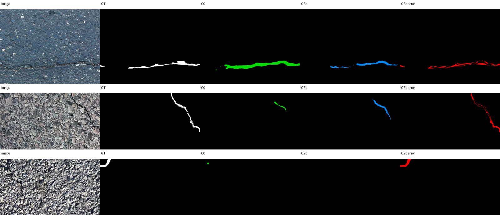
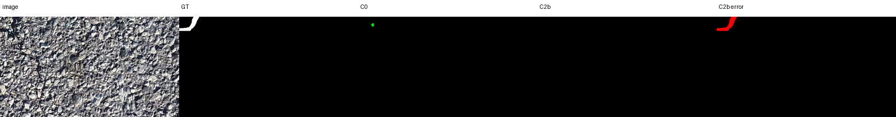
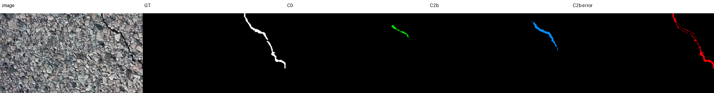

# 实验结果图整理

本目录集中放置已经生成、可以直接用于检查和写论文的结果图。原始证据仍保留在各实验目录中。

## PointRend 逐图诊断

该组图用于说明 PointRend 对边界的改善和主体区域退化。配套数据是 `D:\论文复现\experiments\local_structure_wave2_20260930\results\four_model_per_image_diagnosis.json`、`four_model_deltas.csv` 和 `recovery_comparison.json`。

## 自建数据 SegFormer 验证掩膜示例

这些 PNG 是自建数据 SegFormer S0 验证集输出掩膜示例，用于检查长裂缝连续性、细裂缝漏检和纹理误检。完整 177 张验证图仍在 `D:\论文复现\experiments\local_segformer_wave1_20261006\results\S0_seed42_val_masks`。

示例文件：`789.png`、`869.png`、`1124.png`、`1608.png`、`27.png`、`921.png`、`1480.png`、`1479.png`、`661.png`、`1122.png`、`80.png`、`1175.png`。

## 结果表与原始证据

- Crack500 公开模型与 SegFormer 主线：`D:\论文复现\experiments\retrain_wave4_20261007\results\crack500_segformer_ablation_summary.json`
- C4 输入裁剪和多种子：`D:\论文复现\experiments\local_structure_wave3_20261001\results\final_comparison_20261001.json`
- C1b/C2b 逐图误差：`D:\论文复现\experiments\local_structure_wave2_20260930\results\wave2_validation_metrics.json`
- SegFormer 波次五模块消融：`D:\论文复现\experiments\retrain_wave5_20261012\results\wave5_summary.json`
